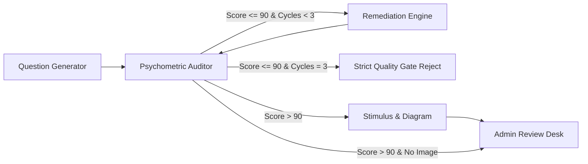

# Infynno UCAT Question Bank Generator v2.0
> **An Infynno Solutions LLP Product • [Infinite Innovations](https://infynno.com/)**

[](https://github.com/VishwamPatel-Infynno/UK-UCAT-Question-Bank-Generator/actions/workflows/ci.yml)

An enterprise autonomous AI application for generating, quality-reviewing, and creating high-quality exam questions for the official **UK UCAT** (University Clinical Aptitude Test).

Engineered by **[Infynno Solutions LLP](https://infynno.com/)**, powered by a **4-Step AI Team**, **FastAPI**, **React 19**, and **PostgreSQL 16**, featuring a modern single-canvas studio, live team tracker, batch staging, and strict 90+ score quality standard.

---

## 📚 Comprehensive Documentation Suite

For deep-dive technical specifications, architecture diagrams, API schemas, and authoring guidelines, consult the dedicated guides in the [`docs/`](docs/) directory:

| Document | Description |
| :--- | :--- |
| **[Architecture & Multi-Agent Workflow](docs/ARCHITECTURE.md)** | Complete LangGraph StateGraph diagrams, 4-agent specifications, Strict Quality Gate, SSE pipeline, batch routing, and PostgreSQL 16 ERD. |
| **[REST & SSE API Reference](docs/API.md)** | Complete FastAPI endpoint documentation, batch generation schemas, SSE event stream contracts, filter parameters, and cURL examples. |
| **[Token Usage & Cost Tracking](docs/TOKEN_TRACKING.md)** | High-throughput rate card ($0.10 in / $0.32 out per 1M tokens), exact mathematical cost formulas, multi-agent accumulation, and UI observability. |
| **[Installation, Setup & Deployment](docs/SETUP_AND_CONFIG.md)** | Step-by-step setup, Docker PostgreSQL 16 guide, environment variables reference, production deployment, linters, and troubleshooting. |
| **[UCAT Psychometric Rubric & Standards](docs/UCAT_RUBRIC.md)** | Official 5 subtests pacing, 100-point 4-pillar evaluation rubric, $> 90$ quality benchmark, and cognitive distractor trap engineering. |

---

## 🚀 Key System Capabilities

### 1. 4-Agent Autonomous Workflow with Strict Quality Gate

- **Question Generator Agent (`generator.py`)**: Synthesizes authentic UK UCAT clinical passages and 4 distinct options (A, B, C, D) using subtest-specific cognitive pacing and syllabus constraints.
- **Psychometric Auditor Agent (`reviewer.py`)**: Impartially evaluates candidate items against a standardized **100-point psychometric rubric** across 4 equal 25-point pillars (*Authenticity*, *Clarity*, *Distractor Traps*, *Explanation Rigor*).
- **Remediation Engine Agent (`regenerator.py`)**: Automatically triggered when score $\le 90$. Digests the Auditor's exact weaknesses and recommendations to repair borderline distractors and expand step-by-step proofs up to 3 iterations.
- **Strict Quality Gate**: If a question fails to score $> 90$ after reaching maximum attempts (`MAX_REGENERATION_ATTEMPTS = 3`), the workflow halts immediately. Bypasses image generation and discards the candidate to protect repository integrity.
- **Stimulus & Diagram Agent (`image_generator.py`)**: Renders clean programmatic SVG vector diagrams for geometric patterns, Venn syllogisms, and charts, with fallback support for AI visual generators.

### 2. High-Throughput Autonomous Inference & Precision Cost Accounting
- **Inference Engine**: Autonomous Psychometric Engine v2.0 (High-Throughput Enterprise Gateway)
- **Official Rate Card**:
  - **Input (Prompt) Tokens**: **$0.10** per 1,000,000 tokens
  - **Output (Completion) Tokens**: **$0.32** per 1,000,000 tokens
- **Micro-Dollar Tracking**: Every request computes exact USD costs:
  $$\text{Cost (USD)} = \left(\frac{\text{Prompt Tokens}}{1,000,000} \times 0.10\right) + \left(\frac{\text{Completion Tokens}}{1,000,000} \times 0.32\right)$$
- **Granular Observability**:
  - Live pipeline stepper with active stopwatch and collapsible SSE telemetry tray.
  - QuestionCard badges displaying total tokens and cost.
  - Psychometric Review Audit Modal itemized table showing prompt tokens, completion tokens, and cost per agent cycle.
  - Question Bank metrics strip tracking accumulated repository-wide tokens and total expenditure.

### 3. Production PostgreSQL 16 Tier (SQLAlchemy Async + asyncpg)
- **Native JSONB Columns**: Stores options, review rubrics, evolution histories, and granular per-agent token tracking.
- **UUID4 Traceability**: Automatic UUID4 generation for every question (`id`), execution run (`run_id`), batch set (`batch_id`), and combination matrix (`combination_id`).
- **Docker Compose Setup**: Instant container initialization on port `5432` with pre-ping connection pooling.
- **Zero-Downtime Auto-Migration**: Automatically runs non-destructive schema migrations and SQLite fallback migrations on startup.

### 4. Modern Enterprise Minimalist UI (Dual Theme: Dark & Light)
- **Linear/Vercel-Inspired Aesthetic**: Hairline borders (`rgba(255, 255, 255, 0.06)` dark / `#e8ecf2` light), quiet obsidian and alabaster surfaces, and zero multi-card clutter.
- **Hero Landing Screen (`HeroLanding.jsx`)**: Minimalist welcome canvas presenting official UCAT subtests, instant practice presets, and target pacing badges (~14s to ~64s per question).
- **5-Step Guided Question Wizard (`GuidedWizard.jsx`)**: Step-by-step authoring workflow with interactive **Exam Coach Tips** that dynamically react to chosen sections, topics, difficulty tiers, and cognitive traps.
- **Dedicated Generation & Review Workspace**: Clean, distraction-free full-width canvas (`maxWidth: 1040px`) hosting live multi-agent synthesis, telemetry, and batch staging without cramped column docks.
- **Editorial Question Presentation**: Clinical reading passages formatted in serif typography with line-height `1.68` for fatigue-free reading; circular option badges (`A`, `B`, `C`, `D`), distractor trap rationalization drawers, and inline editing.
- **Instant Theme Switching**: Seamless toggle between Dark and Light themes with WCAG AA compliance via the `T` key shortcut.
- **Full Keyboard Navigation**: `⌘ + Enter` (Generate), `T` (Theme), `/` (Search Bank), `A` (Approve), `D` (Discard), `Escape` (Close Modals).

---

## ⚡ Quickstart Guide

### 1. Start PostgreSQL (Docker)
```bash
docker compose up -d
```
*Spins up PostgreSQL 16 on `localhost:5432` with database `ucat_db`.*

### 2. Backend Setup
```bash
# Create and activate virtual environment
python3 -m venv .venv
source .venv/bin/activate

# Install backend dependencies
pip install -r backend/requirements.txt

# Start FastAPI server
PYTHONPATH=backend uvicorn app.main:app --port 8000 --reload
```
*Backend runs on **[http://localhost:8000](http://localhost:8000)** (OpenAPI docs at `/docs`).*

### 3. Frontend Setup
```bash
# Install dependencies using pnpm
pnpm install

# Start development server
pnpm dev
```
*Frontend runs on **[http://localhost:5173](http://localhost:5173)**.*

---

## 🧪 Automated Testing & Linters

Run the full backend test suite covering schemas, routing logic, strict quality gates, SVG & FLUX synthesis, database operations, and token calculations:

```bash
# Run backend deterministic test suite (31 passed)
source .venv/bin/activate
pytest backend/tests -v -k "not live_e2e"

# Run backend linter (ruff: 0 errors)
ruff check backend
```

Verify frontend code hygiene and production bundle:

```bash
# Run frontend linter (oxlint: 0 warnings, 0 errors across 35 files)
pnpm lint

# Build production bundle (vite build: ~218ms)
pnpm build
```

---

## 📁 Repository Structure

```
Question Bank Generator/
├── README.md                    # Project overview & documentation index
├── docker-compose.yml           # PostgreSQL 16 container definition
├── .env.example                 # Environment variables template
├── docs/                        # Comprehensive Documentation Suite
│   ├── ARCHITECTURE.md          # Multi-agent architecture & LangGraph StateGraph
│   ├── API.md                   # Complete REST & SSE API specification
│   ├── TOKEN_TRACKING.md        # Inference pricing & mathematical cost engine
│   ├── SETUP_AND_CONFIG.md      # Installation, deployment & troubleshooting
│   └── UCAT_RUBRIC.md           # 100-point psychometric rubric & authoring standards
├── backend/
│   ├── requirements.txt         # Python dependencies
│   ├── tests/
│   │   ├── test_backend.py      # Automated pytest suite (26 unit & integration tests)
│   │   ├── test_database_structure.py # Relational schema, passage & batch sync tests (5 tests)
│   │   └── test_e2e_live.py     # Live end-to-end integration test suite (9 tests)
│   └── app/
│       ├── main.py              # FastAPI app with modern lifespan context & security headers
│       ├── core/                # Core configurations & Pydantic V2 settings
│       │   ├── config.py        # Settings, model configuration & token pricing constants
│       │   └── __init__.py
│       ├── db/                  # Database connectivity & session lifecycle
│       │   ├── base.py          # SQLAlchemy declarative base
│       │   ├── session.py       # Async engine, connection pool & auto-migrations
│       │   └── __init__.py
│       ├── models/              # SQLAlchemy ORM models
│       │   ├── question.py      # QuestionModel with JSONB columns & B-tree indexes
│       │   ├── passage.py       # PassageModel for shared reading stimuli
│       │   ├── batch.py         # BatchModel for multi-question generation runs
│       │   └── __init__.py
│       ├── repositories/        # Data Access Layer (DAL)
│       │   ├── question_repo.py # Clean CRUD, hybrid FTS & aggregate token usage queries
│       │   └── __init__.py
│       ├── schemas/             # Domain Pydantic V2 schemas
│       │   ├── ucat.py          # UCAT sections & subtopic taxonomy
│       │   ├── token.py         # TokenUsage & TokenCostAccumulator schemas
│       │   ├── question.py      # QuestionOption, QuestionDraft, Question
│       │   ├── workflow.py      # GenerationRequest, ReviewScore, WorkflowEvent
│       │   └── __init__.py
│       ├── agents/              # Multi-agent decision logic & prompts
│       │   ├── base.py          # LiteLLM client & calculate_token_cost()
│       │   ├── prompts.py       # Centralized system prompts & rubrics
│       │   ├── mock_fixtures.py # Mock fallback questions & heuristic rubrics
│       │   ├── generator.py     # Question Generator Agent
│       │   ├── reviewer.py      # Question Reviewer Agent (100-pt rubric)
│       │   ├── regenerator.py   # Remediation Engine Agent (<= 90 trigger)
│       │   ├── image_generator.py # Programmatic SVG & FLUX-2-klein-4b visual generator
│       │   └── __init__.py
│       ├── workflow/            # LangGraph multi-agent state graph
│       │   ├── state.py         # AgentWorkflowState typed dictionary
│       │   ├── graph.py         # StateGraph with strict quality gate routing
│       │   └── __init__.py
│       └── api/                 # Modular API Routers
│           ├── router.py        # Central API v1 router aggregator
│           └── v1/
│               ├── generation.py # SSE streaming question generator endpoint
│               ├── questions.py  # Question Bank CRUD & JSON/CSV exports
│               ├── passages.py   # Shared passage stimuli listing & retrieval
│               ├── batches.py    # Batch execution runs & staged item retrieval
│               ├── config.py     # Engine configuration & model settings
│               ├── health.py     # Database connectivity & system health checks
│               └── __init__.py
└── frontend/
    ├── package.json             # React 19 dependencies & scripts (pnpm workspace)
    ├── vite.config.js           # Vite build configuration with chunk splitting
    └── src/
        ├── App.jsx              # Main application shell with dedicated Review Workspace
        ├── index.css            # Modern Enterprise Minimalist design system (Dual Theme)
        ├── constants/           # Centralized application constants
        │   ├── ucat.js          # Subtest icons, pacing targets & fallback taxonomy
        │   └── config.js        # Model options & pricing constants
        ├── hooks/               # Custom stateful React hooks
        │   ├── useTheme.js              # Theme manager (Dark/Light with localStorage)
        │   ├── useKeyboardShortcuts.js  # Global hotkeys (⌘↵, T, A, D, /, Esc)
        │   ├── useQuestionGenerator.js  # SSE streaming multi-agent orchestrator hook
        │   └── useQuestionBank.js       # CRUD, filtering, clipboard & repository stats hook
        ├── components/          # Domain-organized UI components
        │   ├── index.js         # Barrel exports for clean component imports
        │   ├── layout/          # Layout components (Navbar, Footer)
        │   ├── wizard/          # Guided Wizard (HeroLanding, GuidedWizard, IndependentDiagramControls, QuestionStyleMixSection)
        │   ├── pipeline/        # AI Pipeline (AgentVisualizer, MultiAgentPipelineVisualizer, RejectionCard)
        │   ├── question/        # Review Desk (QuestionCard, ReviewAuditView, StageJsonInspector, StagedBatchReview, VisualStimulusViewer)
        │   ├── bank/            # Question repository (QuestionBank)
        │   ├── modals/          # Dialog modals (ExportPrintModal)
        │   └── common/          # Common primitives (CustomSelect, InfynnoLogo, NumberStepper, Toast)
        └── services/
            └── api.js           # SSE event reader & REST API client
```

---

## 📄 License & Attribution
Proprietary — Infynno UCAT Question Bank Generator is engineered and maintained by **[Infynno Solutions LLP](https://infynno.com/)**. All rights reserved.
