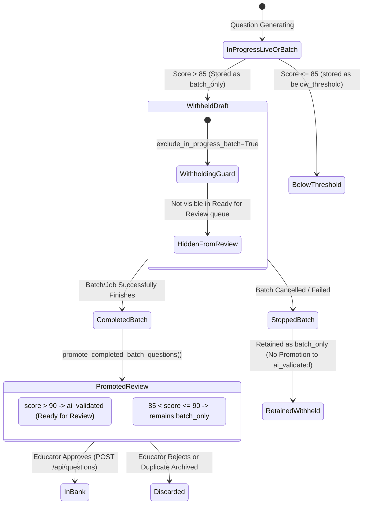

# Infynno MCAT Question Bank Generator - REST & SSE API Reference

Engineered by **[Infynno Solutions LLP](https://infynno.com/)** (*"Infinite Innovations"*).

This document provides a comprehensive technical reference for all REST endpoints and Server-Sent Events (SSE) streaming protocols exposed by the FastAPI backend on port `8000`.

---

## 1. Base URL & Protocol Information

- **Base URL**: `http://localhost:8000` (or configured deployment host)
- **Content Type**: `application/json` (REST endpoints), `text/event-stream` (Live generation SSE stream)
- **CORS Policy & Security Headers**: Restricted to trusted origins (`http://localhost:5173`, etc.) with OWASP security headers (`X-Content-Type-Options`, `X-Frame-Options`, `X-XSS-Protection`).
- **Autonomous Inference Gateway**: Backed by high-throughput enterprise reasoning models (~110-140 tok/s) with deterministic sub-micro-cent token billing ($0.098 input / $0.294 output per 1M tokens).
- **MCAT 4-Choice Purity**: All question endpoints enforce strictly 4 options ($A, B, C, D$) with length symmetry and zero multi-choice artifacts.

---

## 2. API Endpoints Summary (33 Operations / 26 Endpoint Paths)

| Method | Endpoint | Description |
| :--- | :--- | :--- |
| `POST` | `/api/generate` | Triggers multi-agent workflow and streams real-time SSE events (Candidate Staged) |
| `POST` | `/api/questions` | **Admin Review Gate**: Persists an approved candidate question into the Question Bank |
| `POST` | `/api/questions/batch` | **Admin Review Gate**: Bulk-persists an array of approved candidates atomically |
| `GET` | `/api/questions` | Lists saved questions with filtering, search, and repository token metrics |
| `GET` | `/api/questions/counts` | Returns question counts grouped by lifecycle status (`in_bank`, `ai_validated`, etc.) |
| `GET` | `/api/questions/{question_id}` | Retrieves a single question by UUID4 primary key |
| `POST` | `/api/questions/{question_id}/override-duplicate` | **Admin Review Gate**: Explicitly overrides duplicate collision alert and approves into bank |
| `POST` | `/api/questions/check-duplicate` | Evaluates a candidate question draft against the bank for similarity & collisions |
| `DELETE` | `/api/questions/{question_id}` | Deletes a single question by UUID4 primary key |
| `POST` | `/api/questions/delete-batch` | **Admin Action**: Bulk-deletes multiple questions atomically |
| `POST` | `/api/questions/update-status` | **Admin Action**: Bulk-updates question lifecycle status (`in_bank`, `ai_validated`, `discarded`) |
| `PATCH` | `/api/questions/{question_id}/status` | Updates lifecycle status for an individual question |
| `GET` | `/api/questions/{question_id}/image` | Serves visual stimulus (FLUX AI image or Vector SVG diagram) with content negotiation |
| `GET` | `/api/passages` | Lists shared reading passages with query filtering and question counts |
| `GET` | `/api/passages/{passage_id}` | Retrieves a single reading passage along with all its linked questions |
| `POST` | `/api/passages` | Admin endpoint to create or update a shared reading passage record |
| `DELETE` | `/api/passages/{passage_id}` | Admin endpoint to delete a reading passage record and cascade-remove all associated questions |
| `GET` | `/api/batches` | Lists generation batches with active running counts and global concurrency metrics |
| `GET` | `/api/batches/{batch_id}` | Retrieves a generation batch with all jobs and grouped questions |
| `POST` | `/api/batches/start` | Launches an asynchronous background batch generation (dynamically allocated, e.g., 50 Qs = 10 jobs) |
| `POST` | `/api/batches/{batch_id}/stop` | **Batch Control**: Gracefully halts active background jobs for a batch without deleting questions |
| `POST` | `/api/batches/{batch_id}/retry` | **Batch Control**: Re-launches failed or cancelled jobs for a batch into the global worker pool |
| `POST` | `/api/batches/cancel-all` | **Batch Control**: Gracefully halts all active background batches across the system |
| `DELETE` | `/api/batches/{batch_id}` | Deletes a generation batch and cascades delete to jobs and questions |
| `POST` | `/api/batches` | Admin endpoint to create or update a generation batch record |
| `GET` | `/api/batches/{batch_id}/duplicate-clusters` | Clusters batch questions by similarity to identify leader items and redundant duplicates |
| `POST` | `/api/batches/{batch_id}/resolve-duplicates` | Resolves duplicate clusters by keeping designated leaders and archiving/deleting duplicates |
| `POST` | `/api/batches/{batch_id}/refill` | Replenishes batch question deficit up to target count using pedagogical thematic variations |
| `GET` | `/api/export` | Exports repository in standardized JSON or CSV format |
| `GET` | `/api/health` | Service health, database connectivity, active models, and pricing |
| `GET` | `/api/config` | Retrieves active model configuration, runtime parameters (24 fields), and pricing constants |
| `GET` | `/api/sections` | Returns official AAMC MCAT sections, syllabus hierarchy, skills, and pacing |
| `GET` | `/api/taxonomy` | Returns the complete official AAMC Dependent Taxonomy JSON tree |

---

## 3. Endpoints Specification

### 3.1 Start Multi-Agent Generation (SSE Stream)
`POST /api/generate`

Initiates the multi-agent generation and psychometric evaluation workflow. Returns a live Server-Sent Events stream delivering step-by-step agent telemetry, intermediate drafts, review rubrics, token usage, and candidate question payloads. Supports single-item and live practice set generation.

#### Request Headers
```http
Content-Type: application/json
Accept: text/event-stream
```

#### Request Body
```json
{
  "section": "chem_phys",
  "subtopic": "Thermodynamics & Reaction Kinetics",
  "difficulty": "medium",
  "aamc_skill": "Skill 2: Scientific Reasoning and Problem-solving",
  "allow_ai_images": false,
  "require_image": false,
  "require_passage_image": false,
  "custom_prompt": "Focus on Michaelis-Menten kinetics and competitive enzyme inhibition.",
  "additional_instructions": "Include experimental Lineweaver-Burk data interpretation with explicit Km and Vmax calculation distractor traps.",
  "questions_to_generate": 1,
  "passage_mode": "single_passage",
  "interaction_type": "single_choice",
  "primary_trap": "Calculation_Formula_Trap",
  "combination_id": "CMB00001",
  "run_id": "d81f668e-c768-45b7-9fb6-ba1ee2bdbba3",
  "batch_id": null,
  "auto_save": false,
  "passing_threshold": 90
}
```

| Field | Type | Required | Default | Description |
| :--- | :--- | :--- | :--- | :--- |
| `section` | `string` | **Yes** | - | `chem_phys`, `cars`, `bio_biochem`, `psych_soc` |
| `subtopic` | `string` | No | `null` | Categorized syllabus topic |
| `difficulty` | `string` | No | `"medium"` | `low`, `medium`, `high` (with backward-compatible support for `easy`, `hard`, `foundational`, `top percentile`) |
| `aamc_skill` | `string` | No | `null` | Official AAMC SIRS Skill (1-4) or CARS Skill |
| `allow_ai_images` | `boolean` | No | `false` | Whether AI is permitted to generate visual stimuli when deemed necessary |
| `require_image` | `boolean` | No | `false` | Force visual stimulus generation for the question stem |
| `require_passage_image`| `boolean` | No | `false` | Force visual diagram generation for the shared passage stimulus |
| `custom_prompt` | `string` | No | `null` | Contextual steer or clinical scenario / reading passage guidance |
| `additional_instructions` | `string` | No | `null` | Educator instructions specifying constraints, clinical scenarios, or pedagogical rules strictly enforced across passage generation, question generation, and remediation critique cycles |
| `questions_to_generate` | `integer` | No | `5` | Quantity to generate (Wizard UI provides `5` [Practice Set] and `50` [Full Exam]; backend permits 1 to 50) |
| `passage_mode` | `string` | No | `"single_passage"` | `"single_passage"` (all Qs linked to 1 passage) or `"independent"` (standalone discretes) |
| `interaction_type` | `string` | No | `"single_choice"` | Standard 4-choice single choice item |
| `primary_trap` | `string` | No | `"Automatic"` | Cognitive trap selection: `"Automatic"` (Smart AI choice) or explicit key (`Scope_Shift`, `Keyword_Trap`, `Extreme_Language`, `Correlation_vs_Causation`, `Partial_Match`, `Half_Truth`, `Unwarranted_Assumption`, `Calculation_Formula_Trap`, `Out_of_Scope`, `False_Dichotomy`, `Over_generalisation`) |
| `subject` | `string` | No | `null` | Taxonomy subject (e.g. `General Chemistry`) |
| `unit` | `string` | No | `null` | Taxonomy unit (e.g. `Atomic Structure and Periodicity`) |
| `topic` | `string` | No | `null` | Taxonomy topic (e.g. `Periodic Trends`) |
| `subskill` | `string` | No | `null` | Granular AAMC subskill focus |
| `likely_mistake_pattern`| `string` | No | `null` | Targeted student misconception pattern |
| `combination_id` | `string` | No | Auto UUID4 | Unique matrix combination code (e.g. `CMB00001`) |
| `run_id` | `string` | No | Auto UUID4 | Execution run UUID4 |
| `batch_id` | `string` | No | `null` | Optional batch identifier grouping questions |
| `auto_save` | `boolean` | No | `false` | Auto-persist to DB (`false` retains Admin Review Gate) |
| `passing_threshold` | `integer` | No | `90` | Quality benchmark passing threshold score (defaults to 90; 85 for batch jobs) |
| `model_name` | `string` | No | Gateway Default | Model identifier override |
| `api_key` | `string` | No | `null` | Ephemeral API key override |

#### SSE Event Format
Events are delivered as standard Server-Sent Events lines: `data: {JSON_PAYLOAD}\n\n`

```
data: {"event": "workflow_start", "data": {"stage": "init", "message": "Starting multi-agent workflow..."}}

data: {"event": "agent_start", "data": {"agent": "Question Writer & Reviewer", "message": "Drafting scenario and conducting 100-pt self-critique..."}}

data: {"event": "agent_complete", "data": {"agent": "Question Writer & Reviewer", "score": 94, "latest_usage": {"prompt_tokens": 720, "completion_tokens": 480, "total_tokens": 1200, "cost_usd": 0.0002117}}}

data: {"event": "workflow_complete", "data": {"status": "completed", "question": {...}, "total_tokens": 1200, "total_cost_usd": 0.0002117}}
```

---

### 3.2 List Questions
`GET /api/questions`

Lists saved questions from the Question Bank repository with optional filtering, lexical/FTS search, and repository token metrics.

#### Query Parameters
| Parameter | Type | Required | Description |
| :--- | :--- | :--- | :--- |
| `section` | `string` | No | Filter by section (`chem_phys`, `cars`, `bio_biochem`, `psych_soc`) |
| `difficulty` | `string` | No | Filter by difficulty (`low`, `medium`, `high`) |
| `search` | `string` | No | Hybrid full-text lexical search query on stem, passage, subtopic, and ID |
| `combination_id`| `string` | No | Filter by matrix combination code |
| `run_id` | `string` | No | Filter by execution run UUID4 |
| `batch_id` | `string` | No | Filter by batch run UUID4 |
| `passage_id` | `string` | No | Filter by shared stimulus passage UUID4 |
| `status` | `string` | No | Filter by lifecycle status: `in_bank`, `ai_validated`, `batch_only`, `below_threshold`, `discarded` |
| `limit` | `integer` | No | Optional maximum number of questions to return (`1` to `500`) |
| `offset` | `integer` | No | Optional number of questions to skip for server-side pagination |
| `slim` | `boolean` | No | When `true`, omits heavy diagnostic fields (`stage_outcomes`, `iterations_history`, `token_usage_details`) to reduce network payload by 70%+ |

#### Response (`200 OK`)
```json
{
  "questions": [
    {
      "id": "e2a39281-b51c-4b6b-88a2-11e2f389a9c1",
      "section": "chem_phys",
      "section_label": "Chemical and Physical Foundations of Biological Systems",
      "subtopic": "Thermodynamics & Reaction Kinetics",
      "difficulty": "medium",
      "status": "in_bank",
      "mcat_scaled_score": 130,
      "aamc_skill": "Skill 2: Scientific Reasoning and Problem-solving",
      "question_stem": "Under physiological conditions, which thermodynamic parameter governs the spontaneous folding of a globular protein?",
      "options": [
        {"id": "A", "text": "A negative enthalpy change from peptide bonds"},
        {"id": "B", "text": "A favorable conformational entropy of the backbone"},
        {"id": "C", "text": "A large positive entropy change of the solvent"},
        {"id": "D", "text": "A zero net free energy change at equilibrium"}
      ],
      "correct_answer_id": "C",
      "explanation": "Why Option C is Correct: The hydrophobic effect drives protein folding...",
      "final_score": 94,
      "total_tokens": 1200,
      "cost_usd": 0.0002117,
      "primary_trap": "Calculation_Formula_Trap",
      "created_at": "2026-10-26T12:00:00Z"
    }
  ],
  "total_tokens": 48200,
  "total_cost_usd": 0.00845
}
```

---

### 3.3 Get Question Status Counts
`GET /api/questions/counts`

Returns real-time question counts grouped by lifecycle status for dashboard tabs and metrics strips.

#### Response (`200 OK`)
```json
{
  "in_bank": 42,
  "ai_validated": 15,
  "below_threshold": 3,
  "discarded": 5,
  "total": 65
}
```

#### cURL Example
```bash
curl -X GET http://localhost:8000/api/questions/counts
```

---

### 3.4 Get Single Question
`GET /api/questions/{question_id}`

Retrieves a single question by UUID4 primary key, including complete 4-pillar review rubrics, evolution histories, and per-agent token tracking.

#### Response (`200 OK`)
```json
{
  "id": "e2a39281-b51c-4b6b-88a2-11e2f389a9c1",
  "section": "chem_phys",
  "section_label": "Chemical and Physical Foundations of Biological Systems",
  "subtopic": "Thermodynamics & Reaction Kinetics",
  "difficulty": "medium",
  "status": "in_bank",
  "is_duplicate_override": false,
  "duplicate_info": {
    "is_duplicate": false,
    "similarity_score": 0.22,
    "matched_question_id": null,
    "matched_question_stem": null,
    "match_reason": null,
    "is_overridden": false,
    "overridden_at": null
  },
  "question_stem": "Under physiological conditions, which thermodynamic parameter...",
  "options": [
    {"id": "A", "text": "A negative enthalpy change from peptide bonds"},
    {"id": "B", "text": "A favorable conformational entropy of the backbone"},
    {"id": "C", "text": "A large positive entropy change of the solvent"},
    {"id": "D", "text": "A zero net free energy change at equilibrium"}
  ],
  "correct_answer_id": "C",
  "explanation": "...",
  "final_score": 94,
  "review_rubric": {
    "authenticity_score": 24,
    "clarity_score": 23,
    "distractor_score": 24,
    "explanation_score": 23,
    "total_score": 94,
    "strengths": ["Excellent scientific register", "Plausible distractor traps"],
    "weaknesses": []
  },
  "iteration_count": 1,
  "token_usage_details": [
    {
      "agent": "Question Writer & Reviewer",
      "iteration": 1,
      "prompt_tokens": 720,
      "completion_tokens": 480,
      "total_tokens": 1200,
      "cost_usd": 0.0002117
    }
  ]
}
```

---

### 3.5 Serve Question Visual Stimulus
`GET /api/questions/{question_id}/image`

Serves the visual stimulus image (AI FLUX image or Vector SVG diagram) for a question. Automatically handles base64 decoded binaries, SVG MIME content delivery, and external CDN redirects.

#### Response
- SVG: `Content-Type: image/svg+xml`
- Base64 Decoded Image: `Content-Type: image/jpeg` or `image/png`
- External CDN: `HTTP 307 Temporary Redirect` to image URL

#### cURL Example
```bash
curl -X GET http://localhost:8000/api/questions/e2a39281-b51c-4b6b-88a2-11e2f389a9c1/image -O
```

---

### 3.6 Approve & Persist Single Question (Admin Review Gate)
`POST /api/questions`

Persists an approved candidate question from the staging deck into the permanent Question Bank repository.

#### Request Body
Accepts a complete `Question` schema object.

#### Response (`200 OK`)
```json
{
  "success": true,
  "question": {
    "id": "e2a39281-b51c-4b6b-88a2-11e2f389a9c1",
    "status": "in_bank",
    "section": "chem_phys"
  }
}
```

---

### 3.7 Bulk Approve Questions (Atomic Batch)
`POST /api/questions/batch`

Bulk-persists an array of approved candidate questions into the Question Bank repository in a single atomic SQL transaction.

#### Request Body
```json
[
  { "id": "uuid-1", "section": "chem_phys", "status": "in_bank", ... },
  { "id": "uuid-2", "section": "chem_phys", "status": "in_bank", ... }
]
```

#### Response (`200 OK`)
```json
{
  "success": true,
  "saved_count": 5,
  "ids": ["uuid-1", "uuid-2", "uuid-3", "uuid-4", "uuid-5"]
}
```

---

### 3.8 Update Question Status
`PATCH /api/questions/{question_id}/status`

Updates the lifecycle status of an individual question (`in_bank`, `ai_validated`, `below_threshold`, `discarded`).

#### Request Body
```json
{
  "status": "in_bank"
}
```

#### Response (`200 OK`)
```json
{
  "success": true,
  "question_id": "e2a39281-b51c-4b6b-88a2-11e2f389a9c1",
  "status": "in_bank"
}
```

---

### 3.9 Bulk Update Question Status
`POST /api/questions/update-status`

Bulk updates lifecycle status for multiple questions in a single atomic transaction.

#### Request Body
```json
{
  "ids": ["uuid-1", "uuid-2", "uuid-3"],
  "status": "in_bank"
}
```

#### Response (`200 OK`)
```json
{
  "success": true,
  "updated_count": 3,
  "status": "in_bank"
}
```

---

### 3.10 Manually Override Question Duplicate Alert
`POST /api/questions/{question_id}/override-duplicate`

Admin/Reviewer override endpoint: explicitly dismisses a duplicate collision alert on a question, marks `is_duplicate_override=true`, records the override timestamp in `duplicate_info`, and updates lifecycle status to `in_bank`.

#### Response (`200 OK`)
```json
{
  "success": true,
  "question": {
    "id": "e2a39281-b51c-4b6b-88a2-11e2f389a9c1",
    "status": "in_bank",
    "is_duplicate_override": true,
    "duplicate_info": {
      "is_duplicate": true,
      "similarity_score": 0.86,
      "matched_question_id": "ref-uuid-1",
      "matched_question_stem": "Existing question stem...",
      "match_reason": "High question stem textual overlap (86%)",
      "is_overridden": true,
      "overridden_at": "2026-10-28T17:15:00Z"
    }
  }
}
```

#### cURL Example
```bash
curl -X POST http://localhost:8000/api/questions/e2a39281-b51c-4b6b-88a2-11e2f389a9c1/override-duplicate
```

---

### 3.11 On-Demand Question Duplicate Check
`POST /api/questions/check-duplicate`

Evaluates a candidate question draft against the existing Question Bank repository (scoped to the same Section & Subtopic) and returns real-time similarity metrics and collision status.

#### Request Body
```json
{
  "section": "chem_phys",
  "subtopic": "Thermodynamics & Reaction Kinetics",
  "question_stem": "Under standard physiological conditions, which thermodynamic parameter...",
  "options": [
    {"id": "A", "text": "Option A"},
    {"id": "B", "text": "Option B"},
    {"id": "C", "text": "Option C"},
    {"id": "D", "text": "Option D"}
  ]
}
```

#### Response (`200 OK`)
```json
{
  "success": true,
  "duplicate_check": {
    "is_duplicate": true,
    "similarity_score": 0.88,
    "matched_question_id": "e2a39281-b51c-4b6b-88a2-11e2f389a9c1",
    "matched_question_stem": "Under physiological conditions, which thermodynamic parameter...",
    "match_reason": "High question stem textual overlap (88%)",
    "is_overridden": false,
    "overridden_at": null
  }
}
```

---

### 3.12 Delete Question
`DELETE /api/questions/{question_id}`

Deletes a question by UUID4 primary key.

#### Response (`200 OK`)
```json
{
  "success": true
}
```

---

### 3.13 Bulk Delete Questions
`POST /api/questions/delete-batch`

Deletes multiple questions in a single atomic transaction.

#### Request Body
```json
{
  "ids": ["uuid-1", "uuid-2"]
}
```

#### Response (`200 OK`)
```json
{
  "success": true,
  "deleted_count": 2
}
```

---

### 3.14 Start Background Batch Generation (50 Qs)
`POST /api/batches/start`

Launches an asynchronous background batch generation. Creates 1 batch record and 10 parallel job records (each job producing 5 questions for 50 total items). Returns `202 Accepted` immediately while generation runs in the background.

#### Request Body
Accepts a `GenerationRequest` payload (same schema as `POST /api/generate`).

#### Response (`202 Accepted`)
```json
{
  "success": true,
  "message": "Background batch 6ba7b810-9dad-11d1-80b4-00c04fd430c8 launched with 10 jobs (50 questions total).",
  "batch": {
    "id": "6ba7b810-9dad-11d1-80b4-00c04fd430c8",
    "section": "chem_phys",
    "total_questions": 50,
    "status": "in_progress",
    "created_at": "2026-10-26T12:00:00Z"
  },
  "jobs": [
    {
      "id": "job-uuid-1",
      "batch_id": "6ba7b810-9dad-11d1-80b4-00c04fd430c8",
      "job_index": 1,
      "status": "pending",
      "questions_target": 5
    }
  ]
}
```

---

### 3.15 List Batches & Concurrency Metrics
`GET /api/batches`

Lists generation batches with job progress counts, active running batch numbers, and real-time global concurrency metrics.

#### Query Parameters
- `section` (optional): Filter by MCAT section.
- `status` (optional): Filter by batch status (`in_progress`, `completed`, `partially_completed`, `cancelled`, `failed`).

#### Response (`200 OK`)
```json
{
  "batches": [
    {
      "id": "6ba7b810-9dad-11d1-80b4-00c04fd430c8",
      "section": "chem_phys",
      "subtopic": "Thermodynamics & Reaction Kinetics",
      "difficulty": "medium",
      "target_count": 50,
      "actual_count": 50,
      "total_jobs": 10,
      "completed_jobs": 10,
      "failed_jobs": 0,
      "status": "completed",
      "created_at": "2026-10-26T12:00:00Z"
    }
  ],
  "active_running_batches": 1,
  "concurrency_metrics": {
    "active_running_batches": 1,
    "global_max_concurrent_jobs": 4,
    "global_max_concurrent_llm_calls": 10,
    "active_batch_ids": ["6ba7b810-9dad-11d1-80b4-00c04fd430c8"]
  }
}
```

---

### 3.16 Get Single Batch with Grouped Jobs & Questions
`GET /api/batches/{batch_id}`

Retrieves a generation batch along with all 10 jobs (augmented with their generated questions) and flat question records.

#### Response (`200 OK`)
```json
{
  "batch": {
    "id": "6ba7b810-9dad-11d1-80b4-00c04fd430c8",
    "section": "chem_phys",
    "target_count": 50,
    "actual_count": 50,
    "status": "completed"
  },
  "jobs": [
    {
      "id": "job-uuid-1",
      "job_number": 1,
      "status": "completed",
      "target_count": 5,
      "actual_count": 5,
      "questions": [...]
    }
  ],
  "questions": [...],
  "total_questions_count": 50
}
```

---

### 3.17 Stop Single Batch
`POST /api/batches/{batch_id}/stop`

Gracefully halts active background jobs for a specific batch. Cancels running asyncio sub-tasks and updates remaining pending jobs to `"cancelled"` status without deleting questions already generated and saved to PostgreSQL.

#### Response (`200 OK`)
```json
{
  "success": true,
  "message": "Batch 6ba7b810-9dad-11d1-80b4-00c04fd430c8 execution stopped.",
  "batch": {
    "id": "6ba7b810-9dad-11d1-80b4-00c04fd430c8",
    "status": "partially_completed"
  }
}
```

---

### 3.18 Retry Incomplete Batch Jobs
`POST /api/batches/{batch_id}/retry`

Re-launches failed, cancelled, or pending jobs for an incomplete batch into the global worker pool. Re-engages the global semaphore without duplicating completed questions.

#### Request Body (Optional)
Optionally accepts an updated `GenerationRequest` payload to override parameters (e.g. difficulty or guidance) during retry.

#### Response (`200 OK`)
```json
{
  "success": true,
  "message": "Retrying incomplete jobs for batch 6ba7b810-9dad-11d1-80b4-00c04fd430c8.",
  "batch": {
    "id": "6ba7b810-9dad-11d1-80b4-00c04fd430c8",
    "status": "in_progress"
  },
  "jobs": [
    {
      "id": "job-uuid-3",
      "job_number": 3,
      "status": "pending"
    }
  ]
}
```

---

### 3.19 Cancel All Active Batches
`POST /api/batches/cancel-all`

System-wide administrative action that gracefully halts all currently executing background batches. Cancels active worker tasks, sets status to `"cancelled"` or `"partially_completed"`, and safely flushes aggregate metrics to the database.

#### Response (`200 OK`)
```json
{
  "success": true,
  "message": "Successfully stopped 2 running batches.",
  "stopped_count": 2
}
```

---

### 3.20 Delete Batch
`DELETE /api/batches/{batch_id}`

Cancels any active runner task for the batch, then permanently deletes the generation batch record and cascades deletion to all associated jobs and question items.

#### Response (`200 OK`)
```json
{
  "success": true,
  "message": "Batch 6ba7b810-9dad-11d1-80b4-00c04fd430c8 deleted successfully."
}
```

---

### 3.21 Create or Update Batch Record
`POST /api/batches`

Admin endpoint to create or update a generation batch entity directly in PostgreSQL.

#### Response (`200 OK`)
```json
{
  "success": true,
  "batch": {
    "id": "6ba7b810-9dad-11d1-80b4-00c04fd430c8",
    "section": "chem_phys",
    "status": "in_progress"
  }
}
```

---

### 3.22 Get Batch Duplicate Clusters
`GET /api/batches/{batch_id}/duplicate-clusters`

Performs pairwise similarity clustering on questions within a batch to identify redundant items and designate primary leader questions. Automatically excludes previously discarded questions.

#### Query Parameters
| Parameter | Type | Required | Default | Description |
| :--- | :--- | :--- | :--- | :--- |
| `threshold` | `float` | No | `0.75` | Minimum cosine/Jaccard similarity threshold for clustering (range: `0.5` to `1.0`) |

#### Response (`200 OK`)
```json
{
  "batch_id": "6ba7b810-9dad-11d1-80b4-00c04fd430c8",
  "total_active_questions": 50,
  "unique_questions_count": 48,
  "duplicate_clusters_count": 1,
  "total_duplicate_questions": 2,
  "archived_duplicates_count": 0,
  "auto_resolved": false,
  "clusters": [
    {
      "cluster_id": "cluster-1",
      "leader_question": {
        "id": "q-lead-uuid",
        "question_stem": "Which thermodynamic parameter governs protein folding...",
        "final_score": 94
      },
      "duplicates": [
        {
          "question": {
            "id": "q-dup-uuid",
            "question_stem": "What thermodynamic force drives spontaneous globular protein folding...",
            "final_score": 91
          },
          "similarity_score": 0.88,
          "similarity_reason": "High semantic overlap in thermodynamic parameters"
        }
      ]
    }
  ]
}
```

---

### 3.23 Resolve Batch Duplicates
`POST /api/batches/{batch_id}/resolve-duplicates`

Resolves duplicate clusters in a batch by preserving the designated leader question and archiving (`status='discarded'`) or deleting redundant duplicate questions. Refreshes batch aggregates and computes any remaining question deficit.

#### Request Body
```json
{
  "action": "archive",
  "cluster_ids": ["cluster-1"],
  "custom_leader_ids": ["q-lead-uuid"]
}
```

| Field | Type | Required | Default | Description |
| :--- | :--- | :--- | :--- | :--- |
| `action` | `string` | No | `"archive"` | Resolution action: `"archive"` (marks `discarded`) or `"delete"` (hard delete) |
| `cluster_ids` | `list[str]`| No | `null` | Specific cluster IDs to resolve (null resolves all clusters in batch) |
| `custom_leader_ids` | `list[str]`| No | `null` | Optional list of question IDs to designate as leaders over default score leaders |

#### Response (`200 OK`)
```json
{
  "success": true,
  "message": "Successfully resolved 1 cluster(s). 1 duplicate question(s) archived.",
  "action": "archive",
  "resolved_clusters_count": 1,
  "archived_count": 1,
  "remaining_active_questions": 49,
  "target_count": 50,
  "deficit": 1
}
```

---

### 3.24 Refill Batch Question Deficit
`POST /api/batches/{batch_id}/refill`

Replenishes a batch up to its target question count by launching targeted background jobs for archived or missing questions with diverse pedagogical thematic angles to avoid re-generating similar concepts.

#### Response (`200 OK`)
```json
{
  "success": true,
  "message": "Launched refill generation for 1 replacement questions across 1 job(s).",
  "deficit": 1,
  "jobs_launched": 1,
  "jobs": [
    {
      "id": "refill-job-uuid",
      "batch_id": "6ba7b810-9dad-11d1-80b4-00c04fd430c8",
      "status": "pending",
      "questions_target": 1
    }
  ],
  "batch": {
    "id": "6ba7b810-9dad-11d1-80b4-00c04fd430c8",
    "target_count": 50,
    "status": "in_progress"
  }
}
```

---

### 3.25 Passages Management Endpoints
`GET /api/passages` | `GET /api/passages/{passage_id}` | `POST /api/passages` | `DELETE /api/passages/{passage_id}`

- **List Passages (`GET /api/passages`)**: Lists reading passages with optional `section`, `subtopic`, and `search` query parameters.
- **Get Single Passage (`GET /api/passages/{passage_id}`)**: Retrieves a reading passage along with its complete array of linked questions.
- **Create/Update Passage (`POST /api/passages`)**: Admin endpoint to persist or modify a shared stimulus passage.
- **Delete Passage (`DELETE /api/passages/{passage_id}`)**: Admin endpoint to delete a reading passage record and permanently cascade-remove all associated questions across all statuses (`in_bank`, `ai_validated`, `batch_only`), updating affected job and batch metrics.

#### Query Parameters for Listing Passages (`GET /api/passages`)
| Parameter | Type | Required | Description |
| :--- | :--- | :--- | :--- |
| `section` | `string` | No | Filter by section (`chem_phys`, `cars`, `bio_biochem`, `psych_soc`) |
| `subtopic` | `string` | No | Filter by specific subtopic / foundational concept |
| `search` | `string` | No | Search query matching passage text or subtopic |

#### List Passages Response (`GET /api/passages`)
```json
{
  "passages": [
    {
      "id": "550e8400-e29b-41d4-a716-446655440000",
      "section": "cars",
      "subtopic": "Philosophy & Epistemology",
      "passage_text": "In evaluating the nature of scientific inquiry...",
      "image_url": null,
      "image_svg": null,
      "image_description": null,
      "question_count": 5,
      "created_at": "2026-10-26T12:00:00Z",
      "updated_at": null
    }
  ]
}
```

#### Single Passage Response (`GET /api/passages/{passage_id}`)
```json
{
  "passage": {
    "id": "550e8400-e29b-41d4-a716-446655440000",
    "section": "cars",
    "subtopic": "Philosophy & Epistemology",
    "passage_text": "In evaluating the nature of scientific inquiry...",
    "image_url": null,
    "image_svg": null,
    "image_description": null,
    "question_count": 5,
    "created_at": "2026-10-26T12:00:00Z",
    "updated_at": null
  },
  "questions": [
    { "id": "q-1", "question_stem": "The author's central thesis...", "status": "in_bank" },
    { "id": "q-2", "question_stem": "Based on paragraph 3...", "status": "in_bank" }
  ]
}
```

#### Create or Update Passage Request (`POST /api/passages`)
```json
{
  "id": "550e8400-e29b-41d4-a716-446655440000",
  "section": "cars",
  "subtopic": "Philosophy & Epistemology",
  "passage_text": "In evaluating the nature of scientific inquiry...",
  "image_url": null,
  "image_svg": null,
  "image_description": null
}
```

#### Create or Update Passage Response (`200 OK`)
```json
{
  "success": true,
  "passage": {
    "id": "550e8400-e29b-41d4-a716-446655440000",
    "section": "cars",
    "subtopic": "Philosophy & Epistemology",
    "passage_text": "In evaluating the nature of scientific inquiry...",
    "image_url": null,
    "image_svg": null,
    "image_description": null,
    "question_count": 5,
    "created_at": "2026-10-26T12:00:00Z",
    "updated_at": null
  }
}
```

#### cURL Example for Creating or Updating a Passage
```bash
curl -X POST "http://localhost:8000/api/passages" \
  -H "Content-Type: application/json" \
  -d '{
    "id": "550e8400-e29b-41d4-a716-446655440000",
    "section": "cars",
    "subtopic": "Philosophy & Epistemology",
    "passage_text": "In evaluating the nature of scientific inquiry..."
  }'
```

#### Delete Passage Response (`DELETE /api/passages/{passage_id}`)
```json
{
  "success": true,
  "deleted_id": "550e8400-e29b-41d4-a716-446655440000",
  "deleted_questions_count": 5
}
```

#### Delete Passage Error Response (`404 Not Found`)
```json
{
  "detail": "Passage not found"
}
```

#### cURL Example for Passage Deletion
```bash
curl -X DELETE "http://localhost:8000/api/passages/550e8400-e29b-41d4-a716-446655440000"
```

---

### 3.26 Export Repository
`GET /api/export`

Exports the entire Question Bank (or filtered subsets) in standardized JSON or CSV format.

#### Query Parameters
- `format`: `"json"` (default) or `"csv"`

#### CSV Header Columns (Strict 4-Choice Format):
`ID, Run_ID, Batch_ID, Combination_ID, Section, Subcategory, Difficulty, MCAT_Scaled_Score, AAMC_Skill, Content_Domain, Question_Type, Interaction_Type, Primary_Trap, Passage_Required, Visual_Type, Image_URL, Image_Description, Stimulus, Question Stem, Option A, Option B, Option C, Option D, Correct Answer, Explanation, Final Score, Cycles, Created At`

#### cURL Example
```bash
curl -X GET "http://localhost:8000/api/export?format=csv" -o mcat_question_bank.csv
```

---

### 3.27 Service Health Check
`GET /api/health`

Evaluates system status, database connectivity, active text reasoning model, neural image model, and official token pricing.

#### Response (`200 OK`)
```json
{
  "status": "healthy",
  "database": "connected",
  "default_model": "deepinfra/deepseek-ai/DeepSeek-V4.1-Flash-1017",
  "image_model": "deepinfra/black-forest-labs/FLUX-2-klein-4b",
  "pricing": {
    "cost_per_million_input": 0.098,
    "cost_per_million_output": 0.294,
    "image_base_cost_usd": 0.014
  }
}
```

---

### 3.28 Runtime Configuration & Settings
`GET /api/config`

Retrieves active runtime engine configuration, cascade fallbacks, worker concurrency limits, gateway secrets status (masked booleans), and pricing parameters across all 24 runtime fields.

#### Response (`200 OK`)
```json
{
  "default_text_model": "deepinfra/deepseek-ai/DeepSeek-V4.1-Flash-1017",
  "default_image_model": "deepinfra/black-forest-labs/FLUX-2-klein-4b",
  "fast_model_cascade": [
    "deepinfra/deepseek-ai/DeepSeek-V4.1-Flash-1017"
  ],
  "has_deepinfra_key": true,
  "max_regenerations": 3,
  "passing_threshold": 90,
  "batch_passing_threshold": 85,
  "default_max_tokens": 3000,
  "reviewer_max_tokens": 1800,
  "default_temperature": 0.2,
  "generator_temperature": 0.2,
  "regenerator_temperature": 0.2,
  "reviewer_temperature": 0.1,
  "blind_solver_temperature": 0.1,
  "enable_blind_solver": true,
  "blind_solver_confidence_threshold": 88,
  "global_max_concurrent_jobs": 4,
  "global_max_concurrent_llm_calls": 10,
  "workflow_max_worker_retries": 2,
  "cost_per_million_input": 0.098,
  "cost_per_million_output": 0.294,
  "image_width": 1024,
  "image_height": 1024,
  "image_iters": 0,
  "image_cost_base_rate": 0.014,
  "current_image_cost_usd": 0.014
}
```

---

### 3.29 Official AAMC Sections & Syllabus Hierarchy
`GET /api/sections`

Returns the complete cached syllabus hierarchy across all 4 official AAMC MCAT sections, including subjects, units, topics, subtopics, reasoning skills, and target pacing.

#### Response (`200 OK`)
```json
{
  "exam": "MCAT",
  "exam_full_name": "Medical College Admission Test (AAMC)",
  "selection_flow": ["section", "subject", "unit", "topic", "subtopic", "skill", "subskill"],
  "sections": [
    {
      "id": "chem_phys",
      "code": "CP",
      "label": "Chemical and Physical Foundations of Biological Systems",
      "pacing": {"time_limit_mins": 95, "total_questions": 59, "seconds_per_question": 96},
      "subtopics": ["Thermodynamics & Kinetics", "Fluids & Optics"],
      "subjects": [
        {
          "name": "General Chemistry",
          "units": [
            {
              "name": "Thermodynamics and Kinetics",
              "topics": [
                {"name": "Reaction Rates and Rate Laws", "subtopics": ["Rate constants", "Activation energy"]}
              ]
            }
          ]
        }
      ],
      "skills": []
    }
  ],
  "skills": [],
  "aamc_skills": [],
  "generation_options": {
    "difficulty": ["Low", "Medium", "High"],
    "question_type": ["single_choice", "multi_choice"],
    "content_domain": ["Foundational Concept", "Scientific Inquiry"],
    "primary_trap": ["Calculation_Formula_Trap", "Extreme_Language", "Scope_Shift"]
  }
}
```

---

### 3.30 Official AAMC Dependent Taxonomy Tree
`GET /api/taxonomy`

Returns the comprehensive hierarchical AAMC Dependent Taxonomy tree powering the multi-level Guided Wizard selection flow.

#### Response (`200 OK`)
Returns the complete raw taxonomy dictionary containing `taxonomy_tree`, `subjects`, `reasoning_skills`, and `generation_options`.

---

## 4. Question Lifecycle Statuses & Review Queue Withholding

Every generated question item transitions through explicit, strictly guarded states defined in `QuestionStatus`:



### Lifecycle Status Definitions

| Status | Persistence Level | Description |
| :--- | :--- | :--- |
| **`batch_only`** | Batch Storage | Active generation withholding status. Staged questions with score $> 85$ stay in `batch_only` while a batch is in progress to prevent partial/draft questions from leaking into the reviewer queue. Promoted to `ai_validated` only upon clean batch completion. |
| **`ai_validated`** | Review Queue | Questions that achieved a score $> 90$ through autonomous generation and blind-solver dual validation, whose parent batch has completed. Visible in the "Ready for Review" workspace tab. |
| **`in_bank`** | Published Bank | Authoritative, published questions approved by an educator or admin. Included in all production exports, test assemblies, and study packs. |
| **`below_threshold`** | Rejected Audit | Questions scoring $\le 85$ that failed remediation after 3 regeneration cycles. Preserved in audit telemetry but excluded from review queues. |
| **`discarded`** | Archive | Questions archived or deleted during duplicate cluster resolution or dismissed by educators. Excluded from active count aggregations. |
| **`approved`** | Published Bank | Alias/variant of approved questions persisted directly into bank storage. |
| **`rejected_below_threshold`** | Audit History | Legacy audit status for items rejected at the psychometric quality gate. |
| **`error` / `failed`** | Execution Log | Unrecoverable model syntax error or network exception during generation. |

### Withholding & Promotion Safeguards
- **In-Progress Guard**: `GET /api/questions` and `GET /api/questions/counts` strictly filter out questions belonging to batches where `status == 'in_progress'`.
- **Atomic Promotion**: When a batch completes, `promote_completed_batch_questions(batch_id)` executes an atomic SQL update promoting questions with `final_score > 90` to `ai_validated`.
- **Failure Safety**: If a batch is stopped or cancelled, questions remain in `batch_only` status and never transition to `ai_validated`, ensuring educators only review batches that finished completely.
