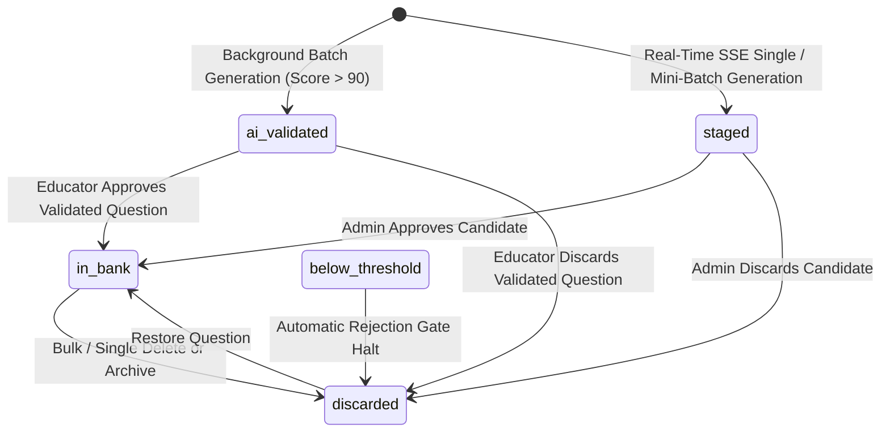
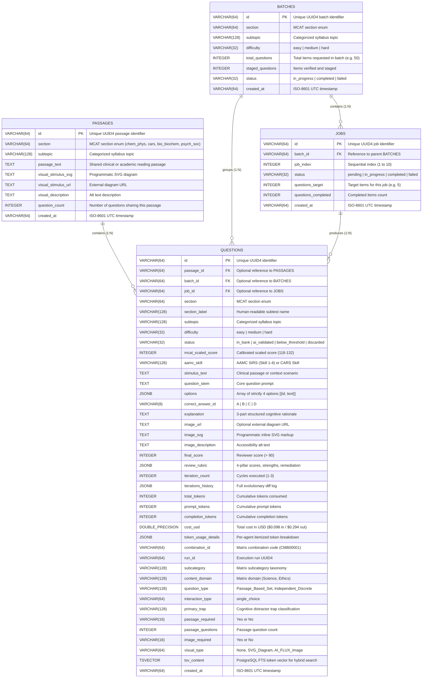
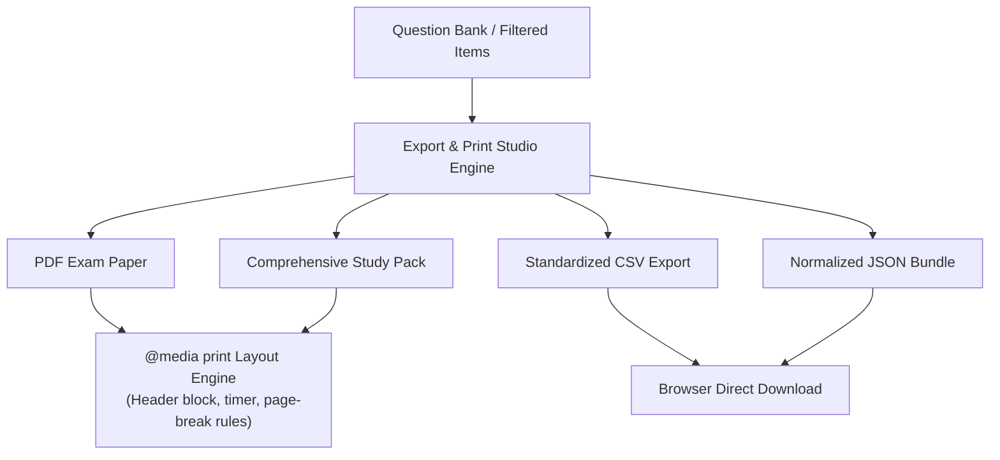

# System Architecture & Multi-Agent Workflow

Engineered by **[Infynno Solutions LLP](https://infynno.com/)** (*"Infinite Innovations"*).

This document details the software architecture, multi-agent design patterns, state management, database schema, background batch execution services, and frontend systems powering the **Infynno MCAT Question Bank Generator v2.0**.

---

## 1. High-Level Architecture Overview

The system is constructed as an asynchronous, event-driven multi-agent workflow coordinated by **LangGraph** and served via **FastAPI** with **Server-Sent Events (SSE)** to a high-performance **React 19** frontend featuring an interactive **7-Step Guided Question Wizard**, a dedicated full-width **Generation & Review Workspace**, and an enterprise **Batch Execution Engine**.

```mermaid
graph TD
    User([User / Web Client]) -->|POST /api/generate| API[FastAPI Orchestrator]
    API -->|Initialize State| Graph[LangGraph Fused Engine]
    
    subgraph "LangGraph StateGraph Workflow"
        Graph --> NodeFused[Fused Draft & Self-Critique Engine]
        
        NodeFused -->|Self-Score > 90 & Bypass Review (~40% Faster)| NodeBypass{Needs Visual?}
        NodeBypass -->|Yes| NodeImg[Infynno Visual & Vector Engine]
        NodeBypass -->|No| NodeFin[Finalize & Staging Node]
        
        NodeFused -->|Self-Score <= 90| NodeRegen[Autonomous Remediation Engine]
        NodeRegen --> NodeRev[Independent Psychometric Auditor]
        
        NodeRev -->|Audit Score <= 90 & Iteration < 3| NodeRegen
        NodeRev -->|Score <= 90 & Iteration >= 3| NodeReject[Strict Quality Gate Reject]
        
        NodeRev -->|Score > 90 & Needs Visual| NodeImg
        NodeRev -->|Score > 90 & Text Only| NodeFin
        NodeImg --> NodeFin
    end

    NodeReject -->|Halt & Discard Draft| SSEStream[SSE Event Stream]
    NodeFin -->|Stage for Admin Review or Save| PG[(PostgreSQL 16 DB)]
    NodeFin --> SSEStream
    SSEStream -->|Real-Time SSE JSON Updates| User
```

---

## 2. Multi-Agent StateGraph Workflow

The workflow enforces a strict psychometric quality contract. A question **must score higher than 90 out of 100** on the psychometric rubric to be approved for publication.

### 2.1 StateGraph Workflow Diagram


---

## 3. Agent Specifications & Prompt Engineering

The system coordinates specialized autonomous engines with a deterministic quality gate:

### 3.1 Fused Draft-and-Critique Cognitive Engine (`fused_generator_node` / `generator.py`)
- **Mission**: Primary workflow entry point. Synthesizes a high-yield clinical or scientific scenario for the selected AAMC MCAT section with 4 distinct options (A, B, C, D) and immediately conducts an internal 100-point self-critique within a single LLM round-trip.
- **Core Prompt Strategy**:
  - Uses section-specific rules (e.g., enzyme kinetics and thermodynamics for Chem/Phys, rhetorical thesis and authorial intent for CARS, molecular pathways and biochemical regulation for Bio/Biochem, and behavioral theories and sociological stratification for Psych/Soc).
  - Explicitly crafts 1 definitive correct key and 3 sophisticated distractors representing realistic cognitive biases, arithmetic sign inversions, or calculation traps.
  - **Option Symmetry & Anti-Guessability Engine**: Enforces strict word count parity (all options within $\pm 15\%$ or 2-4 words of each other), parallel grammatical syntax, and balanced epistemic qualification.
  - **Anti-AI Punctuation Standard**: Strictly forbids em dashes (`—`), en dashes (`–`), or double hyphens (`--`); enforces standard single hyphens (`-`).
  - **3-Part Structured Mentor Explanations**: Generates a rigorous 3-card explanation layout:
    1. *Why Option [Key] is Correct*: Establishes core intuition and step-by-step mathematical or deductive proof.
    2. *Why Other Options are Incorrect*: Itemized distractor cards dissecting why each wrong choice fails and why students are tempted.
    3. *Primary Cognitive Trap Spotlight*: Dedicated spotlight with exact Trap classification, Error Mechanism, and actionable Student Defense Strategy.
  - **Automatic (Smart AI Choice) Cognitive Trap Engine**: When `primary_trap` is `"Automatic"`, the generator evaluates the drafted item and dynamically selects the best-fit trap from the 11 official MCAT trap types (`Scope_Shift`, `Keyword_Trap`, `Extreme_Language`, `Correlation_vs_Causation`, `Partial_Match`, `Half_Truth`, `Unwarranted_Assumption`, `Calculation_Formula_Trap`, `Out_of_Scope`, `False_Dichotomy`, `Over_generalisation`). The chosen trap is recorded in `draft.primary_trap` and persisted across the workflow.
  - **Fallback Trap Detection**: If `primary_trap` is omitted or unpopulated, `generator.py` and `nodes.py` run regex taxonomy matching against the explanation text to extract and assign the trap automatically.
  - **Immediate Self-Critique Object**: Evaluates Authenticity, Clarity, Distractor Traps, and Explanation Rigor.
- **Routing Optimization**:
  - If self-critique score $> 90$, the workflow sets `fused_self_passed=True` and routes directly to the Visual Engine or Finalize Node, cutting latency by $35-45\%$ and saving ~590 tokens.
  - If self-critique score $\le 90$, the candidate draft is routed to the Remediation Engine and Independent Auditor loop.
- **Inference Gateway**: High-throughput enterprise reasoning model (~110-140 tok/s, Temperature: `0.7`).

### 3.2 Independent Senior Psychometric Auditor (`reviewer.py`)
- **Mission**: Acts as an impartial Senior Psychometric Auditor, independently evaluating candidate questions whenever the initial draft does not clear the self-critique threshold or after a remediation cycle.
- **Evaluation Rubric (100 Points)**:
  1. *MCAT Authenticity & Scientific Rigor* (0-25 points)
  2. *Clarity & Logical Soundness* (0-25 points)
  3. *Distractor Trap Quality & Anti-Guessability* (0-25 points) - Docks 5-8 points if option length disparity $\ge 20\%$.
  4. *Explanation & Key Rigor* (0-25 points)
- **Quality Benchmark**:
  - Passing Score: **$> 90$** points ($91 - 100$).
  - Failing Score: **$\le 90$** points ($0 - 90$).
- **Output**: Returns numerical pillar scores, observed strengths, specific weaknesses, and actionable remediation instructions.
- **Inference Gateway**: High-throughput enterprise reasoning model (Temperature: `0.3` for objective, deterministic evaluation).

### 3.3 Autonomous Remediation Engine (`regenerator.py`)
- **Mission**: Triggered exclusively when the score is $\le 90$. It digests the exact critique, distractor deficiencies, and recommendations to repair the draft.
- **Rules**:
  - Fixes borderline ambiguities, equalizes option lengths, and sharpens distractor plausibility.
  - Deepens step-by-step rationales explaining why the key is incontrovertible and why every distractor fails.
  - Re-submits the updated draft back to the Reviewer for re-audit.
- **Inference Gateway**: High-throughput enterprise reasoning model (Temperature: `0.6`).

### 3.4 Strict Quality Gate (`reject_node` in `app/workflow/nodes.py`)
- **Mission**: Deterministic circuit breaker. If a candidate draft fails to exceed 90 points after reaching the maximum permitted remediation cycles (`MAX_REGENERATION_ATTEMPTS = 3`), the workflow halts immediately.
- **Safety Guarantee**:
  - **Bypasses Image Generation**: Prevents wasted computation and unnecessary token expenses.
  - **Discards from Database**: Zero substandard questions enter the PostgreSQL repository.
  - **Diagnostic Payload**: Transmits full rejection telemetry and history via SSE for audit inspection.

### 3.5 Infynno Visual & Vector Engine (`image_generator.py`)
- **Mission**: Generates visual stimuli for questions requiring graphical diagrams (e.g., metabolic cycles, enzyme kinetics, gel electrophoresis assays, optics diagrams; strictly disabled for CARS).
- **Autonomous AI Routing**: Supports autonomous AI-driven stimulus synthesis when `allow_ai_images` is enabled and deemed pedagogically necessary.
- **Hybrid Visual Engine**:
  - *Programmatic SVG Renderer*: Generates clean, crisp, scalable vector graphics for reaction mechanisms, cell transport, coordinate grids, and statistical bar charts.
  - *FLUX-2-klein-4b Neural Visual Engine*: State-of-the-art rectified-flow transformer (`black-forest-labs/FLUX-2-klein-4b`) hosted on DeepInfra for photorealistic scientific illustrations with dynamic provider cost extraction and a flat $0.014 unit baseline rate.

---

## 4. State Management & Lifecycle

Workflow state is tracked via a typed dictionary `AgentWorkflowState` defined in [`backend/app/workflow/state.py`](file:///Users/infynnosolutions/Desktop/Code/Question%20Bank%20Generator/backend/app/workflow/state.py):

```python
class AgentWorkflowState(TypedDict, total=False):
    request: Dict[str, Any]  # Original GenerationRequest parameters
    current_draft: Optional[Dict[str, Any]]  # Active candidate QuestionDraft
    current_review: Optional[Dict[str, Any]]  # Latest ReviewScore rubric
    iteration_count: int  # Current iteration counter (1, 2, 3)
    iterations_history: List[Dict[str, Any]]  # Full audit history of drafts and reviews
    image_url: Optional[str]  # URL if external image generated
    image_svg: Optional[str]  # Embedded SVG markup
    image_description: Optional[str]  # Accessibility alt text
    final_question: Optional[Dict[str, Any]]  # Finalized Question model
    rejection_data: Optional[Dict[str, Any]]  # Telemetry if rejected by Quality Gate
    status: str  # Workflow lifecycle phase
    active_agent: str  # Currently executing agent node
    log_messages: List[str]  # Running log entries

    # Per-Request Token Usage & Cost Accumulator
    total_tokens: int  # Cumulative tokens consumed
    total_prompt_tokens: int  # Cumulative input tokens
    total_completion_tokens: int  # Cumulative output tokens
    total_cost_usd: float  # Cumulative cost in USD ($0.098 in / $0.294 out)
    agent_usage_breakdown: List[Dict[str, Any]]  # Itemized usage per agent cycle
    latest_usage: Optional[Dict[str, Any]]  # Usage of the most recently executed node
```

### 4.1 State Accumulation Pattern
At each node execution, token consumption from the LLM response is unpacked and added to cumulative state counters:
1. `fused_generator_node`: Accumulates single-pass authoring and 100-point self-critique tokens, appending `Question Writer & Reviewer` entry to `agent_usage_breakdown`.
2. `regenerator_node`: Accumulates remediation tokens if initial score $\le 90$ and appends `Question Improver` entry.
3. `reviewer_node`: Accumulates independent audit tokens during remediation cycles and records usage in `iterations_history`.
4. `image_node`: Accumulates visual stimulus synthesis tokens / compute units for `Diagram & Chart Maker`.
5. `finalize_node`: Binds final accumulated totals and itemized breakdown directly into the `Question` schema for database persistence.

---

## 5. Background Batch Execution Service (`batch_runner.py`)

For large-scale question synthesis (e.g. **Full Mock Section [50 Questions]**), the backend utilizes an asynchronous worker pool managed by [`backend/app/services/batch_runner.py`](file:///Users/infynnosolutions/Desktop/Code/Question%20Bank%20Generator/backend/app/services/batch_runner.py):

```mermaid
graph TD
    Client[Web Client] -->|POST /api/batches/start| API[Batches API Endpoint]
    API --> Runner[launch_background_batch]
    
    Runner --> BatchDB[Create Batch Record in DB]
    Runner --> JobDB[Create 10 Job Records in DB]
    Runner --> BackgroundTask[Spawn Async Background Worker Pool]
    
    API -->> Client|202 Accepted + Batch/Job UUIDs| Client

    subgraph "Parallel Worker Execution (10 Jobs x 5 Qs = 50 Total)"
        BackgroundTask --> Job1[Job 1: 5 Qs]
        BackgroundTask --> Job2[Job 2: 5 Qs]
        BackgroundTask --> Job3[Job 3: 5 Qs]
        BackgroundTask --> Job4[Job 4: 5 Qs]
        BackgroundTask --> JobDots[...]
        BackgroundTask --> Job10[Job 10: 5 Qs]
        
        Job1 --> Workflow1[Multi-Agent LangGraph]
        Job2 --> Workflow2[Multi-Agent LangGraph]
        Job3 --> Workflow3[Multi-Agent LangGraph]
        Job4 --> Workflow4[Multi-Agent LangGraph]
        Job10 --> Workflow10[Multi-Agent LangGraph]
    end

    Workflow1 --> PersistQ[(Save Questions to DB with status=ai_validated)]
    Workflow2 --> PersistQ
    Workflow3 --> PersistQ
    Workflow4 --> PersistQ
    Workflow10 --> PersistQ
    
    PersistQ --> UpdateBatch[Update Batch & Job status to completed]
```

### 5.1 Question Lifecycle State Machine
Every question in the system progresses through an explicit lifecycle state:



- **`ai_validated`**: Background batch questions that cleared the 90+ quality gate and await educator review in the AI Validated bank.
- **`in_bank`**: Formally approved questions published in the primary searchable Question Bank repository.
- **`below_threshold`**: Drafts that failed to achieve >90 after 3 remediation cycles (discarded before DB persistence, or flagged).
- **`discarded`**: Archived or rejected items removed from active question banks.

---

## 6. PostgreSQL 16 Database Architecture

The persistence tier runs on **PostgreSQL 16** managed through **SQLAlchemy 2.0 Async** and the **`asyncpg`** driver.

### 6.1 Entity-Relationship Diagram (ERD)



---

## 7. Export & Print Studio Architecture

The **Export & Print Studio** ([`ExportPrintModal.jsx`](file:///Users/infynnosolutions/Desktop/Code/Question%20Bank%20Generator/frontend/src/components/modals/ExportPrintModal.jsx)) provides client-side document synthesis and multi-format export capabilities for educators and candidates.



### 7.1 Export Modes
1. **Official Exam Paper (PDF / Print)**:
   - Formatted for classroom and mock exam printing with candidate name/date header, official pacing instructions (~96s to ~101s per item), and clean typographic separation.
   - Enforces `.page-break { break-before: page; }` CSS print rules to ensure reading passages and question options never split awkwardly across page folds.
2. **Comprehensive Study Pack (PDF / Print)**:
   - Includes reading stimulus, question stem, answer key, and the complete step-by-step cognitive proof and distractor trap analysis.
3. **CSV Export Engine**:
   - Converts relational questions into standardized comma-separated columns (`id`, `section`, `subtopic`, `difficulty`, `stem`, `option_a` through `option_d`, `key`, `explanation`, `score`).
4. **JSON Relational Bundle**:
   - Serializes question items including full 4-pillar review rubrics, per-agent token tracking telemetry, and evolution histories.

---

## 8. Frontend Domain-Driven Architecture

The frontend follows an enterprise domain-driven component architecture split into top-level views, specialized domain components, and centralized hooks:

```
frontend/src/
├── views/                        # Top-level application view screens (code-split)
│   ├── index.js                  # Views barrel export
│   ├── GeneratorWorkspaceView.jsx# Interactive exam generation & pipeline workspace
│   ├── QuestionBankView.jsx      # Verified Question Bank view & repository table
│   ├── AiValidatedQuestionsView.jsx # Dedicated AI Validated (>90) quality bank
│   └── BatchActivityView.jsx     # Live & historical batch monitoring dashboard
├── components/
│   ├── index.js                  # Centralized barrel export for all components
│   ├── wizard/                   # Progressive 7-Step Guided Question Wizard
│   │   ├── GuidedWizard.jsx      # Central wizard controller
│   │   ├── HeroLanding.jsx       # Welcome landing hero header
│   │   ├── IndependentDiagramControls.jsx # Standalone diagram requirements selector
│   │   ├── wizardConstants.js    # Presets, difficulty tiers, and step configs
│   │   └── steps/                # Step 1 through Step 7 modular step components
│   ├── pipeline/                 # Real-time multi-agent visualizer
│   │   ├── AgentVisualizer.jsx   # Live generating telemetry & compact stepper
│   │   ├── MultiAgentPipelineVisualizer.jsx # 3-Milestone pipeline visualizer with electric conduits
│   │   └── RejectionCard.jsx     # Diagnostic display when score fails threshold
│   ├── staged/                   # Staged batch review deck
│   │   ├── StagedBatchReview.jsx # Multi-question batch confirmation desk
│   │   ├── StagedBatchGrid.jsx   # Grid of staged batch question slots
│   │   ├── StagedDetailedView.jsx# Expanded single question review panel
│   │   ├── StagedQuestionSlotCard.jsx # Individual question slot reviewer card
│   │   ├── StagedSlotSkeleton.jsx# Slot loading pulse skeleton
│   │   ├── BatchProgressHeader.jsx # Staged batch progress telemetry header
│   │   └── StageJsonInspector.jsx# Deep stage outcome JSON inspector modal
│   ├── question/                 # Question presentation & editing
│   │   ├── QuestionCard.jsx      # Interactive student practice & review card
│   │   ├── QuestionScorecardTab.jsx # 100-point rubric breakdown accordion
│   │   ├── QuestionInlineEditor.jsx # In-place authoring & remediation editor
│   │   ├── MentorExplanationView.jsx # 3-card mentor explanation view
│   │   ├── ReviewAuditView.jsx   # 100-point rubric breakdown & token cost modal
│   │   ├── SharedPassageCard.jsx # Shared reading passage stimulus display card
│   │   └── VisualStimulusViewer.jsx # SVG & neural visual diagram renderer
│   ├── bank/                     # Question Bank repository
│   │   ├── QuestionBankFilters.jsx # Section, difficulty, and search filter controls
│   │   └── QuestionBankTable.jsx # Tabular question rows, batch selection, and actions
│   ├── batch/                    # Batch monitoring components
│   │   ├── BatchCard.jsx         # Summary status card for generation batches
│   │   ├── BatchFiltersBar.jsx   # Section, status, and search filters
│   │   ├── BatchJobCard.jsx      # Per-question job card with lifecycle status
│   │   ├── BatchQuestionItem.jsx # Staged question item with review modal
│   │   └── BatchStatsHeader.jsx  # High-level aggregate batch statistics
│   ├── validated/                # AI Validated bank components
│   │   ├── AiValidatedCard.jsx   # Card with direct bank approval actions
│   │   ├── AiValidatedFiltersBar.jsx # Filters for AI-validated questions
│   │   └── AiValidatedStatsBar.jsx # Quick-action statistics header
│   ├── modals/                   # Dialog modals
│   │   ├── ExportPrintModal.jsx  # Exam Paper (PDF), Study Pack, CSV and JSON export modal
│   │   └── ExportPaperPreview.jsx# Live print layout previewer
│   ├── layout/                   # Global layout
│   │   ├── Navbar.jsx            # Header with branding, navigation tabs, and theme toggle
│   │   └── Footer.jsx            # Infynno Solutions LLP attribution & resource footer
│   └── common/                   # Shared UI primitives
│       ├── CustomSelect.jsx      # Accessible custom dropdown select primitive
│       ├── FormattedText.jsx     # Inline markdown & cognitive trap chip highlighter
│       ├── InfynnoLogo.jsx       # Official corporate vector logo primitive
│       ├── NumberStepper.jsx     # Accessible numerical stepper primitive
│       └── Toast.jsx             # Floating toast notification system
├── constants/
│   ├── config.js                 # Pricing models, image parameters, token rates
│   ├── mcat.js                   # MCAT sections, pacing specs, icons, and fallback topics
│   ├── mcatTaxonomy.json         # AAMC-aligned foundational concepts and skills
│   └── mcatTraps.js              # AAMC cognitive trap definitions and defense strategies
├── hooks/
│   ├── useAppState.js            # Centralized view routing & global event broker
│   ├── useGeneratorForm.js       # Form state & validation logic
│   ├── useKeyboardShortcuts.js   # Global hotkeys (⌘↵, A, D, T, /, Esc)
│   ├── useQuestionBank.js        # Debounced search, sorting, and bank fetching
│   ├── useQuestionGenerator.js   # SSE streaming, batch progress, and state management
│   └── useTheme.js               # Dual-theme engine (dark / light with localStorage)
├── services/
│   └── api.js                    # FastAPI client & SSE stream reader
├── utils/                        # Pure utility helpers
│   ├── exportUtils.js            # A4 HTML print document builder, CSV & JSON serializers
│   ├── formatters.js             # Time, word count, token & currency formatters
│   ├── trapHelpers.js            # Cognitive trap resolution & text detectors
│   └── explanationHelpers.js     # Structured explanation parser
├── index.css                     # Enterprise CSS design tokens, conduit animations, dual-theme styling
└── main.jsx                      # React 19 application root
```

For complete UI design tokens, color scales, typography guidelines, and component contracts, consult [`DESIGN.md`](file:///Users/infynnosolutions/Desktop/Code/Question%20Bank%20Generator/DESIGN.md).
