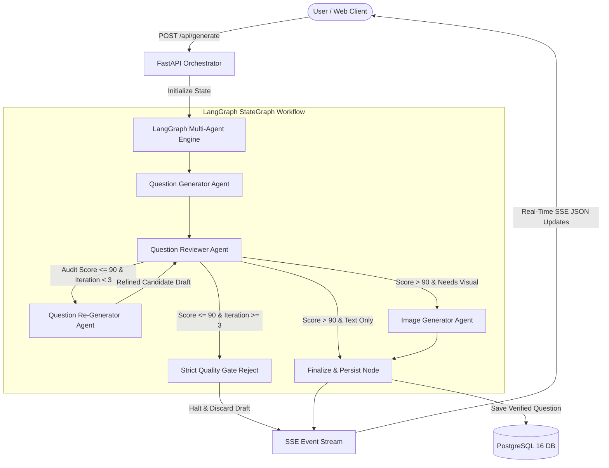
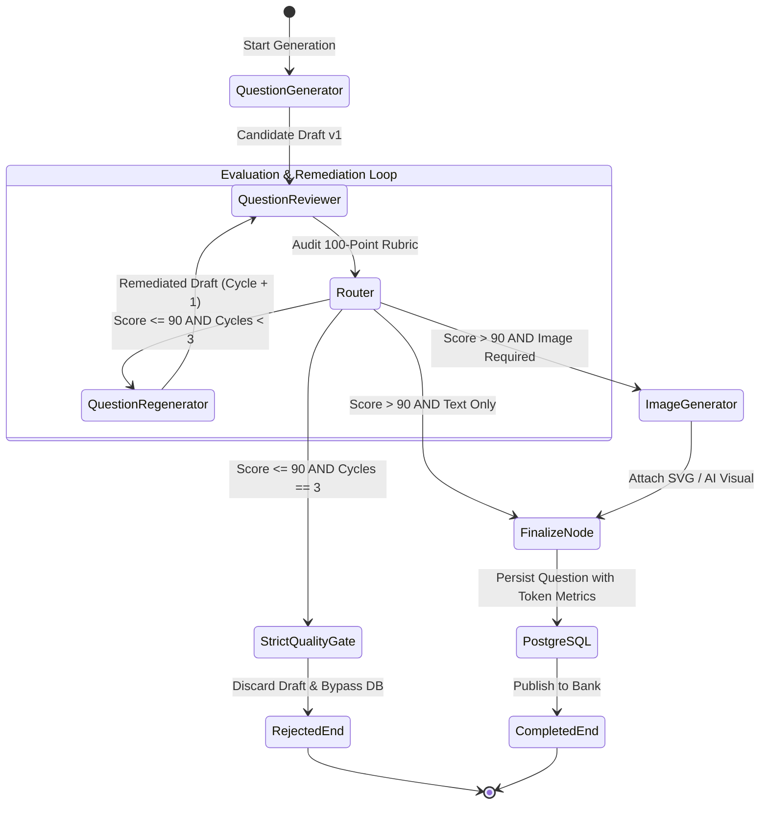
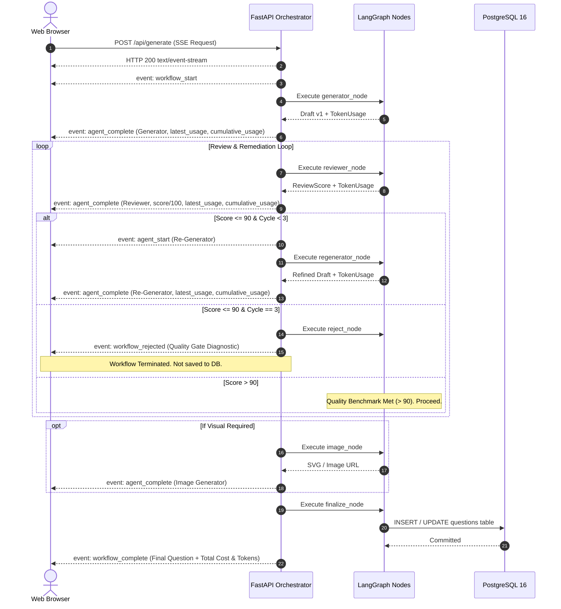
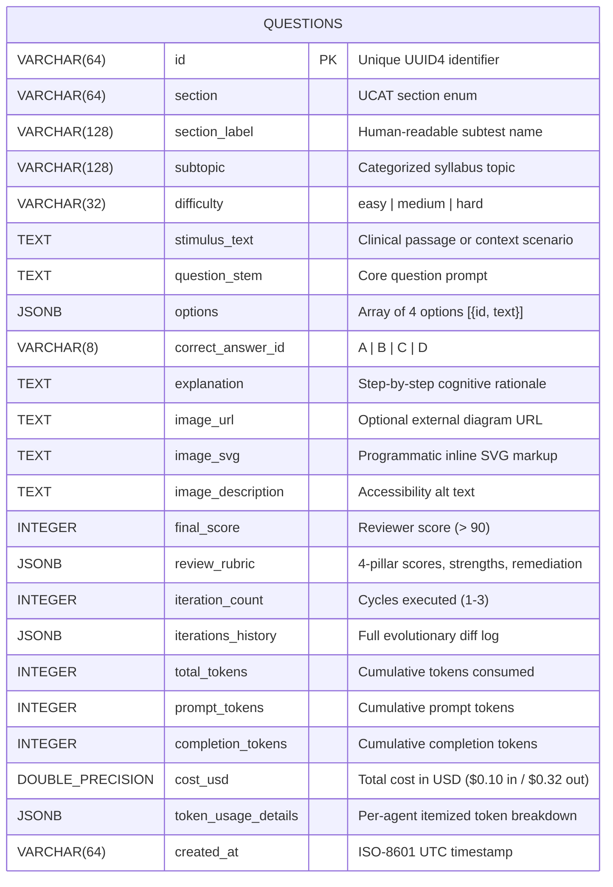

# System Architecture & Multi-Agent Workflow

This document details the software architecture, multi-agent design patterns, state management, and database schema powering the **UK UCAT Question Bank Generator**.

---

## 1. High-Level Architecture Overview

The system is constructed as an asynchronous, event-driven multi-agent workflow coordinated by **LangGraph** and served via **FastAPI** with **Server-Sent Events (SSE)** to a **React 19** frontend.



---

## 2. Multi-Agent StateGraph Workflow

The workflow enforces a strict psychometric quality contract. A question **must score higher than 90 out of 100** on the psychometric rubric to be approved for publication.

### 2.1 StateGraph Workflow Diagram



---

## 3. Agent Specifications & Prompt Engineering

The system decomposes question authoring into 4 specialized autonomous agents plus 1 deterministic quality gate:

### 3.1 Question Generator Agent (`generator.py`)
- **Mission**: Synthesizes a high-yield clinical or cognitive scenario for the selected UK UCAT subtest with 4 distinct options (A, B, C, D).
- **Core Prompt Strategy**:
  - Uses subtest-specific rules (e.g., categorical syllogisms for Decision Making, Venn reasoning for Abstract Reasoning, GMC Good Medical Practice guidance for Situational Judgement).
  - Explicitly crafts 1 definitive correct key and 3 sophisticated distractors representing realistic cognitive biases or calculation traps.
  - Requires strict JSON response matching the `QuestionDraft` schema.
- **Model**: `deepinfra/meta-llama/Llama-3.3-70B-Instruct-Turbo` (Temperature: `0.7`).

### 3.2 Question Reviewer Agent (`reviewer.py`)
- **Mission**: Acts as an impartial Senior Psychometric Auditor, independently evaluating the candidate question against a standardized **100-point rubric**:
  1. *UCAT Authenticity & Tone* (0-25 points)
  2. *Clarity & Logical Soundness* (0-25 points)
  3. *Distractor Trap Quality* (0-25 points)
  4. *Explanation & Key Rigor* (0-25 points)
- **Quality Benchmark**:
  - Passing Score: **$> 90$** points ($91 - 100$).
  - Failing Score: **$\le 90$** points ($0 - 90$).
- **Output**: Returns numerical pillar scores, observed strengths, specific weaknesses, and actionable remediation instructions.
- **Model**: `deepinfra/meta-llama/Llama-3.3-70B-Instruct-Turbo` (Temperature: `0.3` for objective, deterministic evaluation).

### 3.3 Question Re-Generator Agent (`regenerator.py`)
- **Mission**: Triggered exclusively when the Reviewer's score is $\le 90$. It digests the Reviewer's exact critique, distractor deficiencies, and recommendations to repair the draft.
- **Rules**:
  - Fixes borderline ambiguities and sharpens distractor plausibility.
  - Deepens step-by-step rationales explaining why the key is incontrovertible and why every distractor fails.
  - Re-submits the updated draft back to the Reviewer for re-audit.
- **Model**: `deepinfra/meta-llama/Llama-3.3-70B-Instruct-Turbo` (Temperature: `0.6`).

### 3.4 Strict Quality Gate (`reject_node` in `graph.py`)
- **Mission**: Deterministic circuit breaker. If a candidate draft fails to exceed 90 points after reaching the maximum permitted remediation cycles (`MAX_REGENERATION_ATTEMPTS = 3`), the workflow halts immediately.
- **Safety Guarantee**:
  - **Bypasses Image Generation**: Prevents wasted computation and unnecessary token expenses.
  - **Discards from Database**: Zero substandard questions enter the PostgreSQL repository.
  - **Diagnostic Payload**: Transmits full rejection telemetry and history via SSE for audit inspection.

### 3.5 Image Generator Agent (`image_generator.py`)
- **Mission**: Generates visual stimuli for questions requiring graphical diagrams (mandatory for Abstract Reasoning; optional for Decision Making and Quantitative Reasoning).
- **Hybrid Visual Engine**:
  - *Programmatic SVG Renderer*: Generates clean, crisp, scalable vector graphics for Venn diagrams, geometric transformation grids, and statistical bar charts.
  - *AI Generative Image Provider*: Configurable for LiteLLM image models (FLUX.1 Schnell on DeepInfra, Imagen on Gemini, or DALL-E on OpenAI).

---

## 4. State Management & Lifecycle

Workflow state is tracked via a typed dictionary `AgentWorkflowState` defined in [`backend/app/workflow/state.py`](file:///Users/infynnosolutions/Desktop/Code/Question%20Bank%20Generator/backend/app/workflow/state.py):

```python
class AgentWorkflowState(TypedDict, total=False):
    request: Dict[str, Any]                   # Original GenerationRequest parameters
    current_draft: Optional[Dict[str, Any]]   # Active candidate QuestionDraft
    current_review: Optional[Dict[str, Any]]  # Latest ReviewScore rubric
    iteration_count: int                      # Current iteration counter (1, 2, 3)
    iterations_history: List[Dict[str, Any]]  # Full audit history of drafts and reviews
    image_url: Optional[str]                  # URL if external image generated
    image_svg: Optional[str]                  # Embedded SVG markup
    image_description: Optional[str]          # Accessibility alt text
    final_question: Optional[Dict[str, Any]]  # Finalized Question model
    rejection_data: Optional[Dict[str, Any]]  # Telemetry if rejected by Quality Gate
    status: str                               # Workflow lifecycle phase
    active_agent: str                         # Currently executing agent node
    log_messages: List[str]                   # Running log entries
    
    # Per-Request Token Usage & Cost Accumulator
    total_tokens: int                         # Cumulative tokens consumed
    total_prompt_tokens: int                  # Cumulative input tokens
    total_completion_tokens: int              # Cumulative output tokens
    total_cost_usd: float                     # Cumulative cost in USD ($0.10 in / $0.32 out)
    agent_usage_breakdown: List[Dict[str, Any]] # Itemized usage per agent cycle
    latest_usage: Optional[Dict[str, Any]]    # Usage of the most recently executed node
```

### 4.1 State Accumulation Pattern
At each node execution, token consumption from the LLM response is unpacked and added to cumulative state counters:
1. `generator_node`: Accumulates initial drafting tokens and appends `Question Generator` entry to `agent_usage_breakdown`.
2. `reviewer_node`: Accumulates audit evaluation tokens, appends `Question Reviewer` entry, and records usage in `iterations_history`.
3. `regenerator_node`: Accumulates remediation tokens and appends `Question Re-Generator` entry.
4. `finalize_node`: Binds final accumulated totals and itemized breakdown directly into the `Question` schema for database persistence.

---

## 5. Real-Time Streaming Pipeline (SSE)

Communication between the FastAPI orchestrator and the web client uses **Server-Sent Events (SSE)** via `StreamingResponse`.



---

## 6. PostgreSQL 16 Database Architecture

The persistence tier runs on **PostgreSQL 16** managed through **SQLAlchemy 2.0 Async** and the **`asyncpg`** driver.

### 6.1 Entity-Relationship Diagram (ERD)



### 6.2 Key Database Features
- **Native JSONB Storage**: Flexible storage for option lists, reviewer rubrics, evolution histories, and granular per-agent token tracking.
- **B-Tree Indexes**: Placed on `section`, `subtopic`, `difficulty`, and `created_at` for sub-millisecond filtering and sorting in the Question Bank.
- **Connection Pooling**: Managed via `async_sessionmaker` with `pool_size=10`, `max_overflow=20`, and `pool_pre_ping=True` to prevent stale connection drops.
- **Automatic Schema Migration**: Built-in `init_db()` automatically runs `ALTER TABLE questions ADD COLUMN IF NOT EXISTS ...` ensuring zero downtime when new tracking fields are added.

---

## 7. Codebase Directory Structure & Modular Layers

The codebase follows professional software engineering practices, separating responsibilities into clean, decoupled layers across both backend and frontend.

### 7.1 Backend Modular Layers

```
backend/app/
├── core/                # Configuration & Settings
│   └── config.py        # Pydantic SettingsConfigDict, DeepInfra defaults, token costs
├── db/                  # Database connectivity & session lifecycle
│   ├── base.py          # Declarative Base
│   └── session.py       # Async engine, connection pool, init_db, health checks
├── models/              # SQLAlchemy 2.0 ORM Entities
│   └── question.py      # QuestionModel with JSONB columns & B-Tree indexes
├── repositories/        # Data Access Layer (DAL)
│   └── question_repo.py # Clean async CRUD operations & token aggregations
├── schemas/             # Pydantic Domain Transfer Schemas
│   ├── ucat.py          # UCAT sections & subtopic taxonomy
│   ├── token.py         # TokenUsage & TokenCostAccumulator schemas
│   ├── question.py      # QuestionOption, QuestionDraft, Question
│   └── workflow.py      # GenerationRequest, ReviewScore, WorkflowEvent
├── agents/              # Multi-Agent Logic & System Prompts
│   ├── base.py          # LiteLLM execution & token calculations
│   ├── prompts.py       # Centralized system prompts & rubrics
│   ├── mock_fixtures.py # Mock fallback questions & heuristic rubrics
│   ├── generator.py     # Question Generator Agent
│   ├── reviewer.py      # Question Reviewer Agent (100-pt rubric)
│   ├── regenerator.py   # Question Re-Generator Agent
│   └── image_generator.py # Programmatic SVG & AI visual generator
├── workflow/            # Orchestration Engine
│   ├── state.py         # AgentWorkflowState typed dict
│   └── graph.py         # LangGraph StateGraph with conditional quality routing
├── api/                 # Modular API Routers
│   ├── router.py        # Central API v1 router aggregator
│   └── v1/
│       ├── generation.py # SSE streaming question generator endpoint
│       ├── questions.py  # Question Bank CRUD, Admin Approval & JSON/CSV exports
│       ├── config.py     # DeepInfra configuration & model settings
│       └── health.py     # DB connectivity & system health checks
├── config.py            # Backward-compatibility facade (deprecated -> app.core.config)
├── database.py          # Backward-compatibility facade (deprecated -> app.db / app.repositories)
└── main.py              # FastAPI application entrypoint with security headers & CORS
```

### 7.2 Frontend Domain-Driven Architecture

```
frontend/src/
├── constants/           # Centralized application constants
│   ├── ucat.js          # Subtest icons, pacing targets & fallback taxonomy
│   └── config.js        # Model options & pricing constants
├── hooks/               # Custom stateful React hooks
│   ├── useQuestionGenerator.js # SSE streaming multi-agent orchestrator hook
│   └── useQuestionBank.js      # CRUD, filtering, clipboard & repository stats hook
├── components/          # Domain-organized UI components
│   ├── index.js         # Barrel exports for clean component imports
│   ├── layout/          # Layout components (Navbar)
│   ├── generator/       # Question generation studio (Panel, Visualizer, RejectionCard)
│   ├── question/        # Candidate question review & audit (QuestionCard, ReviewAuditView, StageJsonInspector)
│   ├── matrix/          # Combinations matrix & batch generation studio (MatrixRunner)
│   ├── bank/            # Question repository (QuestionBank)
│   ├── modals/          # Dialog modals (SettingsModal)
│   └── common/          # Common components (Toast)
└── services/
    └── api.js           # SSE event reader, candidate approval & REST API client
```

