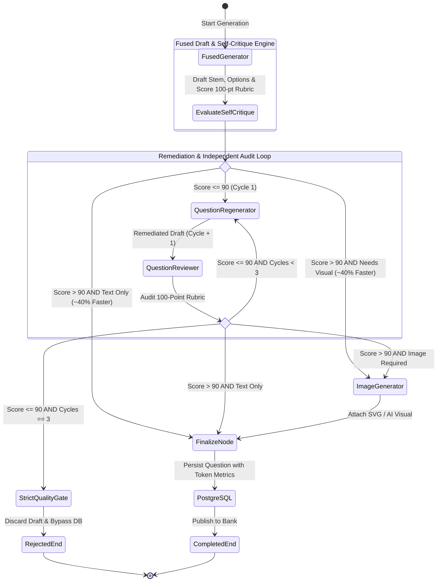
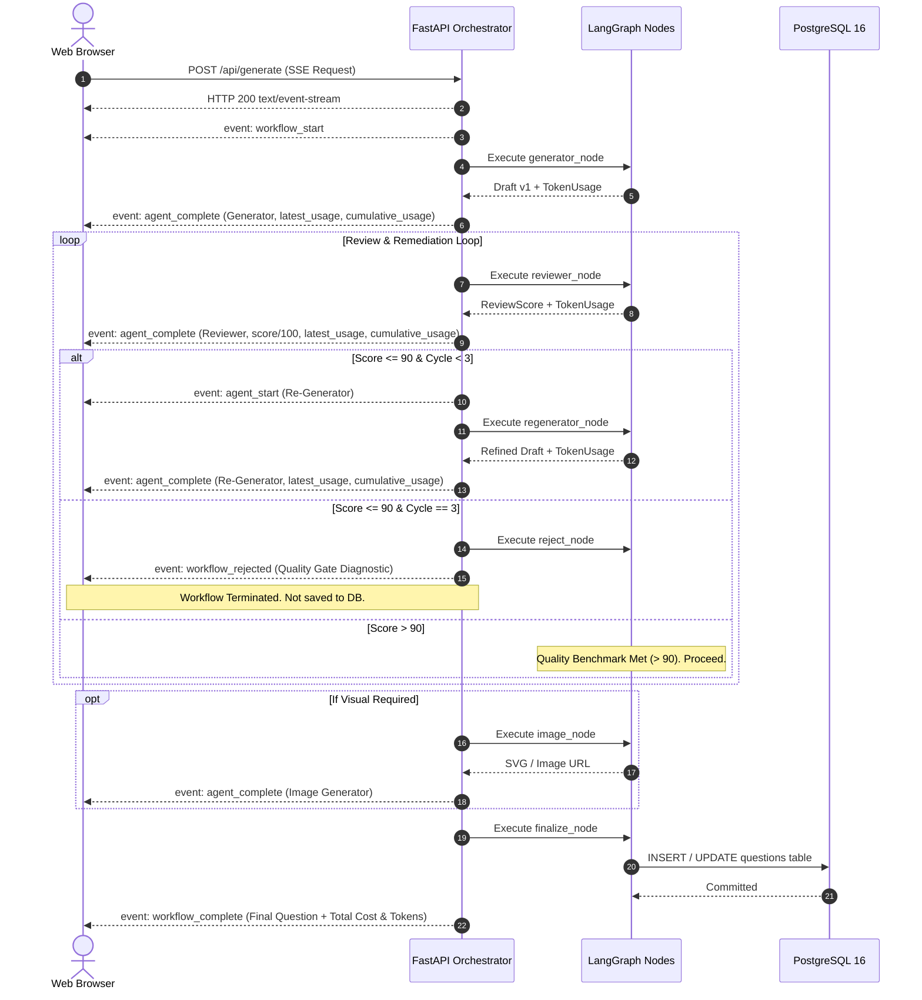
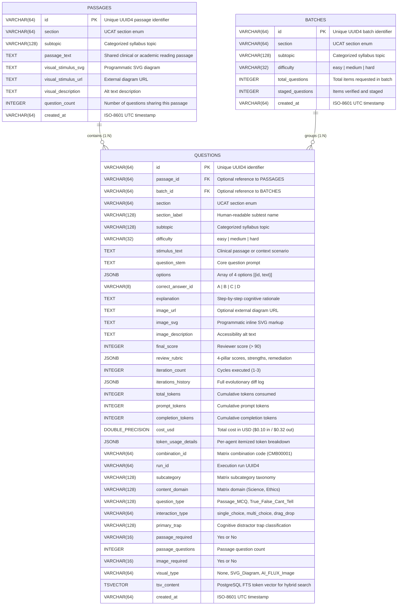
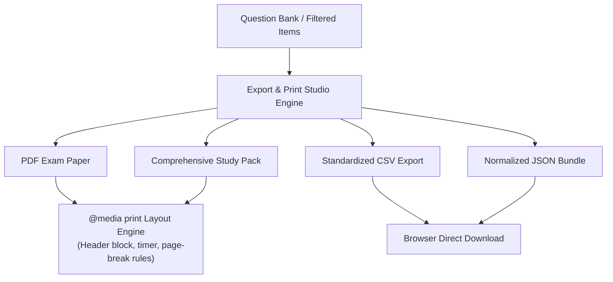

# System Architecture & Multi-Agent Workflow

Engineered by **[Infynno Solutions LLP](https://infynno.com/)** (*"Infinite Innovations"*).

This document details the software architecture, multi-agent design patterns, state management, database schema, and frontend systems powering the **UK UCAT Question Studio v2.0**.

---

## 1. High-Level Architecture Overview

The system is constructed as an asynchronous, event-driven multi-agent workflow coordinated by **LangGraph** and served via **FastAPI** with **Server-Sent Events (SSE)** to a high-performance **React 19** frontend featuring an interactive **5-Step Guided Question Wizard** and a dedicated full-width **Generation & Review Workspace**.

```mermaid
graph TD
    User([User / Web Client]) -->|POST /api/generate| API[FastAPI Orchestrator]
    API -->|Initialize State| Graph[LangGraph Fused Engine]
    
    subgraph "LangGraph StateGraph Workflow"
        Graph --> NodeFused[Fused Draft & Self-Critique Engine]
        
        NodeFused -->|Self-Score > 90 & Bypass Review (~40% Faster)| NodeBypass{Needs Visual?}
        NodeBypass -->|Yes| NodeImg[Infynno Visual & Vector Engine]
        NodeBypass -->|No| NodeFin[Finalize & Staging Node]
        
        NodeFused -->|Self-Score <= 90| NodeRegen[Autonomous Remediation Engine]
        NodeRegen --> NodeRev[Independent Psychometric Auditor]
        
        NodeRev -->|Audit Score <= 90 & Iteration < 3| NodeRegen
        NodeRev -->|Score <= 90 & Iteration >= 3| NodeReject[Strict Quality Gate Reject]
        
        NodeRev -->|Score > 90 & Needs Visual| NodeImg
        NodeRev -->|Score > 90 & Text Only| NodeFin
        NodeImg --> NodeFin
    end

    NodeReject -->|Halt & Discard Draft| SSEStream[SSE Event Stream]
    NodeFin -->|Stage for Admin Review or Save| PG[(PostgreSQL 16 DB)]
    NodeFin --> SSEStream
    SSEStream -->|Real-Time SSE JSON Updates| User
```

---

## 2. Multi-Agent StateGraph Workflow

The workflow enforces a strict psychometric quality contract. A question **must score higher than 90 out of 100** on the psychometric rubric to be approved for publication.

### 2.1 StateGraph Workflow Diagram



---

## 3. Agent Specifications & Prompt Engineering

The system coordinates specialized autonomous engines with a deterministic quality gate:

### 3.1 Fused Draft-and-Critique Cognitive Engine (`fused_generator_node` / `generator.py`)
- **Mission**: Primary workflow entry point. Synthesizes a high-yield clinical or cognitive scenario for the selected UK UCAT subtest with 4 distinct options (A, B, C, D) and immediately conducts an internal 100-point self-critique within a single LLM round-trip.
- **Core Prompt Strategy**:
  - Uses subtest-specific rules (e.g., categorical syllogisms for Decision Making, Venn reasoning for Abstract Reasoning, GMC Good Medical Practice guidance for Situational Judgement).
  - Explicitly crafts 1 definitive correct key and 3 sophisticated distractors representing realistic cognitive biases or calculation traps.
  - **Option Symmetry & Anti-Guessability Engine**: Enforces strict word count parity (all options within $\pm 15\%$ or 2-4 words of each other), parallel grammatical syntax, and balanced epistemic qualification.
  - **Anti-AI Punctuation Standard**: Strictly forbids em dashes (`—`), en dashes (`–`), or double hyphens (`--`); enforces standard single hyphens (`-`).
  - **Conversational Mentor Explanations**: Generates dual-section rationales (Winning Strategy Walkthrough + Distractor Trap Breakdown) in a supportive, expert tutor voice.
  - **Immediate Self-Critique Object**: Evaluates Authenticity, Clarity, Distractor Traps, and Explanation Rigor.
- **Routing Optimization**:
  - If self-critique score $> 90$, the workflow sets `fused_self_passed=True` and routes directly to the Visual Engine or Finalize Node, cutting latency by $35-45\%$ and saving ~590 tokens.
  - If self-critique score $\le 90$, the candidate draft is routed to the Remediation Engine and Independent Auditor loop.
- **Inference Gateway**: High-throughput enterprise reasoning model (~110-140 tok/s, Temperature: `0.7`).

### 3.2 Independent Senior Psychometric Auditor (`reviewer.py`)
- **Mission**: Acts as an impartial Senior Psychometric Auditor, independently evaluating candidate questions whenever the initial draft does not clear the self-critique threshold or after a remediation cycle.
- **Evaluation Rubric (100 Points)**:
  1. *UCAT Authenticity & Tone* (0-25 points)
  2. *Clarity & Logical Soundness* (0-25 points)
  3. *Distractor Trap Quality & Anti-Guessability* (0-25 points) - Docks 5-8 points if option length disparity $\ge 20\%$.
  4. *Explanation & Key Rigor* (0-25 points)
- **Quality Benchmark**:
  - Passing Score: **$> 90$** points ($91 - 100$).
  - Failing Score: **$\le 90$** points ($0 - 90$).
- **Output**: Returns numerical pillar scores, observed strengths, specific weaknesses, and actionable remediation instructions.
- **Inference Gateway**: High-throughput enterprise reasoning model (Temperature: `0.3` for objective, deterministic evaluation).

### 3.3 Autonomous Remediation Engine (`regenerator.py`)
- **Mission**: Triggered exclusively when the score is $\le 90$. It digests the exact critique, distractor deficiencies, and recommendations to repair the draft.
- **Rules**:
  - Fixes borderline ambiguities, equalizes option lengths, and sharpens distractor plausibility.
  - Deepens step-by-step rationales explaining why the key is incontrovertible and why every distractor fails.
  - Re-submits the updated draft back to the Reviewer for re-audit.
- **Inference Gateway**: High-throughput enterprise reasoning model (Temperature: `0.6`).

### 3.4 Strict Quality Gate (`reject_node` in `app/workflow/nodes.py`)
- **Mission**: Deterministic circuit breaker. If a candidate draft fails to exceed 90 points after reaching the maximum permitted remediation cycles (`MAX_REGENERATION_ATTEMPTS = 3`), the workflow halts immediately.
- **Safety Guarantee**:
  - **Bypasses Image Generation**: Prevents wasted computation and unnecessary token expenses.
  - **Discards from Database**: Zero substandard questions enter the PostgreSQL repository.
  - **Diagnostic Payload**: Transmits full rejection telemetry and history via SSE for audit inspection.

### 3.5 Infynno Visual & Vector Engine (`image_generator.py`)
- **Mission**: Generates visual stimuli for questions requiring graphical diagrams (mandatory for Abstract Reasoning; optional for Decision Making and Quantitative Reasoning).
- **Hybrid Visual Engine**:
  - *Programmatic SVG Renderer*: Generates clean, crisp, scalable vector graphics for Venn diagrams, geometric transformation grids, and statistical bar charts.
  - *FLUX-2-klein-4b Neural Visual Engine*: State-of-the-art rectified-flow transformer (`black-forest-labs/FLUX-2-klein-4b`) hosted on DeepInfra for photorealistic clinical illustrations with dynamic provider cost extraction and a flat $0.014 unit baseline rate.

---

## 4. State Management & Lifecycle

Workflow state is tracked via a typed dictionary `AgentWorkflowState` defined in [`backend/app/workflow/state.py`](file:///Users/infynnosolutions/Desktop/Code/Question%20Bank%20Generator/backend/app/workflow/state.py):

```python
class AgentWorkflowState(TypedDict, total=False):
    request: Dict[str, Any]  # Original GenerationRequest parameters
    current_draft: Optional[Dict[str, Any]]  # Active candidate QuestionDraft
    current_review: Optional[Dict[str, Any]]  # Latest ReviewScore rubric
    iteration_count: int  # Current iteration counter (1, 2, 3)
    iterations_history: List[Dict[str, Any]]  # Full audit history of drafts and reviews
    image_url: Optional[str]  # URL if external image generated
    image_svg: Optional[str]  # Embedded SVG markup
    image_description: Optional[str]  # Accessibility alt text
    final_question: Optional[Dict[str, Any]]  # Finalized Question model
    rejection_data: Optional[Dict[str, Any]]  # Telemetry if rejected by Quality Gate
    status: str  # Workflow lifecycle phase
    active_agent: str  # Currently executing agent node
    log_messages: List[str]  # Running log entries

    # Per-Request Token Usage & Cost Accumulator
    total_tokens: int  # Cumulative tokens consumed
    total_prompt_tokens: int  # Cumulative input tokens
    total_completion_tokens: int  # Cumulative output tokens
    total_cost_usd: float  # Cumulative cost in USD ($0.10 in / $0.32 out)
    agent_usage_breakdown: List[Dict[str, Any]]  # Itemized usage per agent cycle
    latest_usage: Optional[Dict[str, Any]]  # Usage of the most recently executed node
```

### 4.1 State Accumulation Pattern
At each node execution, token consumption from the LLM response is unpacked and added to cumulative state counters:
1. `generator_node`: Accumulates initial drafting tokens and appends `Question Generator` entry to `agent_usage_breakdown`.
2. `reviewer_node`: Accumulates audit evaluation tokens, appends `Question Reviewer` entry, and records usage in `iterations_history`.
3. `regenerator_node`: Accumulates remediation tokens and appends `Question Re-Generator` entry.
4. `finalize_node`: Binds final accumulated totals and itemized breakdown directly into the `Question` schema for database persistence.

---

## 5. Real-Time Streaming Pipeline (SSE)

Communication between the FastAPI orchestrator and the web client uses **Server-Sent Events (SSE)** via `StreamingResponse`.



---

## 6. PostgreSQL 16 Database Architecture

The persistence tier runs on **PostgreSQL 16** managed through **SQLAlchemy 2.0 Async** and the **`asyncpg`** driver.

### 6.1 Entity-Relationship Diagram (ERD)



### 6.2 Key Database Features
- **3-Table Normalized Architecture**: Separates shared reading passages (`PASSAGES`), batch generation records (`BATCHES`), and item-level question records (`QUESTIONS`) with automatic foreign key cascades.
- **Hybrid Full-Text Search (FTS)**: Built-in `tsv_content` tsvector column with GIN index on `questions` enabling sub-millisecond lexical search with ILIKE substring fallback.
- **Native JSONB Storage**: Flexible storage for option lists, reviewer rubrics, evolution histories, and granular per-agent token tracking.
- **B-Tree Indexes**: Placed on `section`, `subtopic`, `difficulty`, `combination_id`, `run_id`, `batch_id`, `passage_id`, and `created_at` for rapid filtering and sorting.
- **Connection Pooling**: Managed via `async_sessionmaker` with `pool_size=10`, `max_overflow=20`, and `pool_pre_ping=True` to prevent stale connection drops.
- **Automatic Schema Migration**: Built-in `init_db()` automatically runs non-destructive `ALTER TABLE questions ADD COLUMN IF NOT EXISTS ...` ensuring zero downtime across updates.

---

## 7. Export & Print Studio Architecture

The **Export & Print Studio** ([`ExportPrintModal.jsx`](file:///Users/infynnosolutions/Desktop/Code/Question%20Bank%20Generator/frontend/src/components/modals/ExportPrintModal.jsx)) provides client-side document synthesis and multi-format export capabilities for educators and candidates.



### 7.1 Export Modes
1. **Official Exam Paper (PDF / Print)**:
   - Formatted for classroom and mock exam printing with candidate name/date header, official pacing instructions (~14s to ~64s per item), and clean typographic separation.
   - Enforces `.page-break { break-before: page; }` CSS print rules to ensure reading passages and question options never split awkwardly across page folds.
2. **Comprehensive Study Pack (PDF / Print)**:
   - Includes reading stimulus, question stem, answer key, and the complete step-by-step cognitive proof and distractor trap analysis.
3. **CSV Export Engine**:
   - Converts relational questions into standardized comma-separated columns (`id`, `section`, `subtopic`, `difficulty`, `stem`, `option_a` through `option_d`, `key`, `explanation`, `score`).
4. **JSON Relational Bundle**:
   - Serializes question items including full 4-pillar review rubrics, per-agent token tracking telemetry, and evolution histories.

---

## 8. Codebase Directory Structure & Modular Layers

The codebase follows enterprise software engineering practices, separating responsibilities into clean, decoupled layers across backend, frontend, and design systems.

### 8.1 Backend Modular Layers

```
backend/app/
├── core/                # Configuration & Settings
│   └── config.py        # Pydantic SettingsConfigDict, gateway defaults, token costs
├── db/                  # Database connectivity & session lifecycle
│   ├── base.py          # Declarative Base
│   └── session.py       # Async engine, connection pool, init_db, health checks
├── models/              # SQLAlchemy 2.0 ORM Entities
│   ├── question.py      # QuestionModel with JSONB columns & B-Tree indexes
│   ├── passage.py       # PassageModel for shared reading passage stimuli
│   └── batch.py         # BatchModel for multi-question generation runs
├── repositories/        # Data Access Layer (DAL)
│   ├── question_repo.py # Clean async CRUD operations, FTS search & token aggregations
│   ├── batch_repo.py    # Staged batch run queries & persistence
│   └── passage_repo.py  # Shared stimulus reading passage queries
├── schemas/             # Pydantic Domain Transfer Schemas
│   ├── ucat.py          # UCAT sections & subtopic taxonomy
│   ├── token.py         # TokenUsage & TokenCostAccumulator schemas
│   ├── question.py      # QuestionOption, QuestionDraft, Question
│   └── workflow.py      # GenerationRequest, ReviewScore, WorkflowEvent
├── agents/              # Multi-Agent Logic & System Prompts
│   ├── base.py          # LiteLLM execution & token calculations
│   ├── prompts.py       # Centralized system prompts & rubrics
│   ├── mock_fixtures.py # Mock fallback questions & heuristic rubrics
│   ├── generator.py     # Question Generator Agent
│   ├── reviewer.py      # Question Reviewer Agent (100-pt rubric)
│   ├── regenerator.py   # Question Re-Generator Agent
│   └── image_generator.py # Programmatic SVG & AI visual generator (FLUX-2-klein-4b)
├── workflow/            # LangGraph Orchestration Engine
│   ├── engine.py        # Core asynchronous workflow runner & event emitters
│   ├── nodes.py         # Discrete agent worker nodes (Generator, Reviewer, etc.)
│   ├── routes.py        # Deterministic conditional edge routing (Quality Gate)
│   ├── graph.py         # StateGraph builder and compiled graph
│   └── state.py         # AgentWorkflowState typed dict
├── api/                 # Modular API Routers
│   ├── router.py        # Central API v1 router aggregator
│   └── v1/
│       ├── generation.py # SSE streaming question generator endpoint
│       ├── questions.py  # Question Bank CRUD, Admin Approval & JSON/CSV exports
│       ├── passages.py   # Passage stimulus listing & grouped question retrieval
│       ├── batches.py    # Batch execution tracking & grouped retrieval
│       ├── config.py     # Read-only runtime engine configuration & pricing
│       └── health.py     # Database connectivity & system health checks
└── main.py              # FastAPI application entrypoint with security headers & CORS
```

### 8.2 Frontend Domain-Driven Architecture

```
frontend/src/
├── constants/           # Centralized application constants
│   ├── ucat.js          # Subtest icons, pacing targets & fallback taxonomy
│   └── config.js        # Model options & pricing constants
├── hooks/               # Custom stateful React hooks
│   ├── index.js         # Barrel export for custom hooks
│   ├── useGeneratorForm.js     # Form state, validation & preset handlers
│   ├── useQuestionGenerator.js # SSE streaming multi-agent orchestrator hook
│   ├── useQuestionBank.js      # CRUD, filtering, clipboard & repository stats hook
│   ├── useKeyboardShortcuts.js # Keyboard shortcuts (⌘↵, A, D, T, /, Esc)
│   └── useTheme.js             # Dual-theme engine (dark / light with localStorage)
├── components/          # Domain-organized UI components
│   ├── index.js         # Barrel exports for clean component imports
│   ├── layout/          # Layout components (Navbar, Footer)
│   ├── wizard/          # Guided Wizard (HeroLanding, GuidedWizard, IndependentDiagramControls, QuestionStyleMixSection)
│   ├── pipeline/        # AI Pipeline (AgentVisualizer, MultiAgentPipelineVisualizer, RejectionCard)
│   ├── question/        # Review Desk (MentorExplanationView, QuestionCard, ReviewAuditView, SharedPassageCard, StageJsonInspector, StagedBatchReview, StagedQuestionSlotCard, VisualStimulusViewer)
│   ├── bank/            # Repository table, filter chips, pagination, export (QuestionBank)
│   ├── modals/          # Dialog modals (ExportPrintModal)
│   └── common/          # Common primitives (CustomSelect, InfynnoLogo, NumberStepper, Toast)
├── services/
│   └── api.js           # SSE event reader, candidate approval & REST API client
├── index.css            # Enterprise CSS tokens, conduit animations, dual-theme styling
└── main.jsx             # React 19 application root
```

For complete UI design tokens, color scales, typography guidelines, and component contracts, consult [`DESIGN.md`](file:///Users/infynnosolutions/Desktop/Code/Question%20Bank%20Generator/DESIGN.md).


