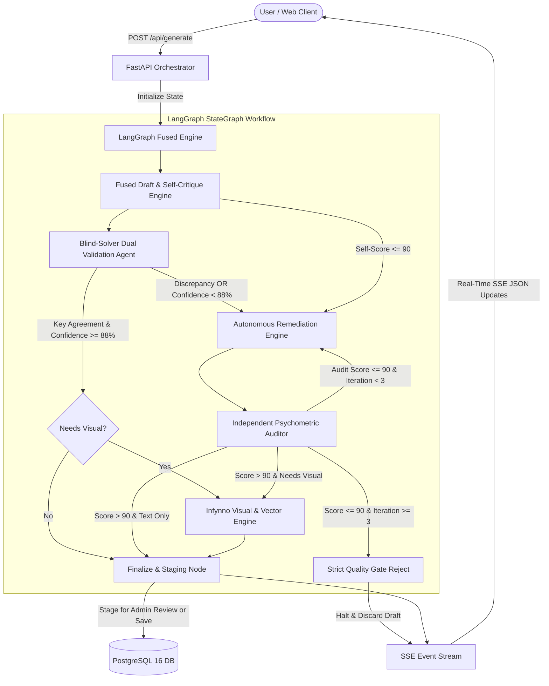
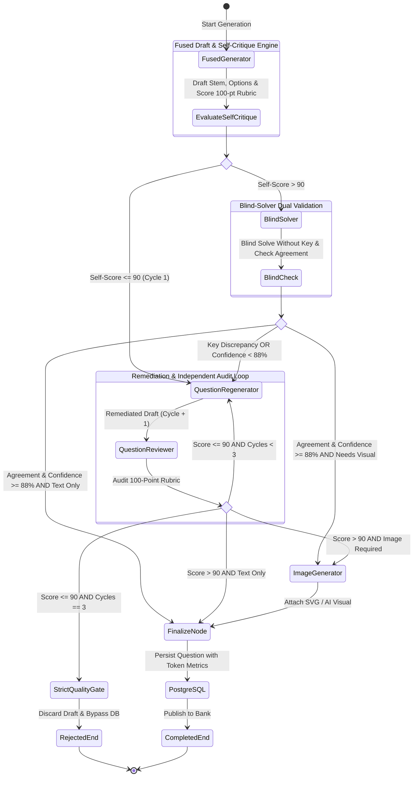
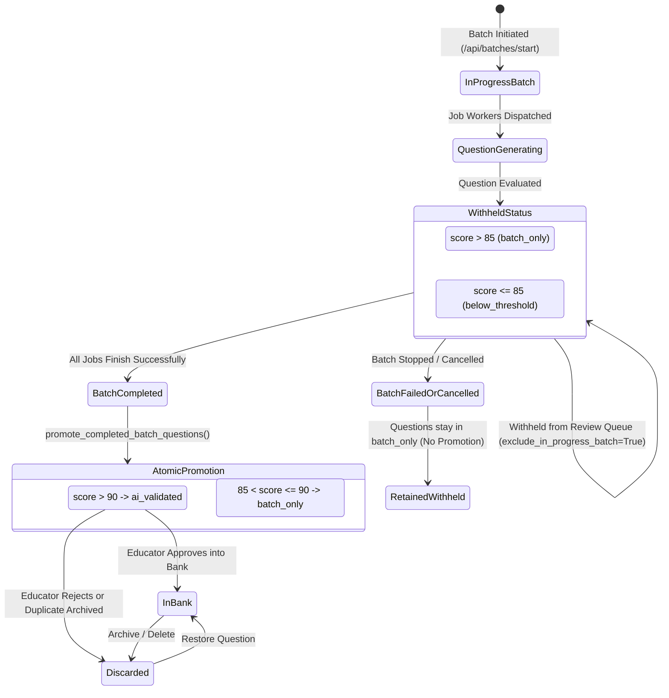
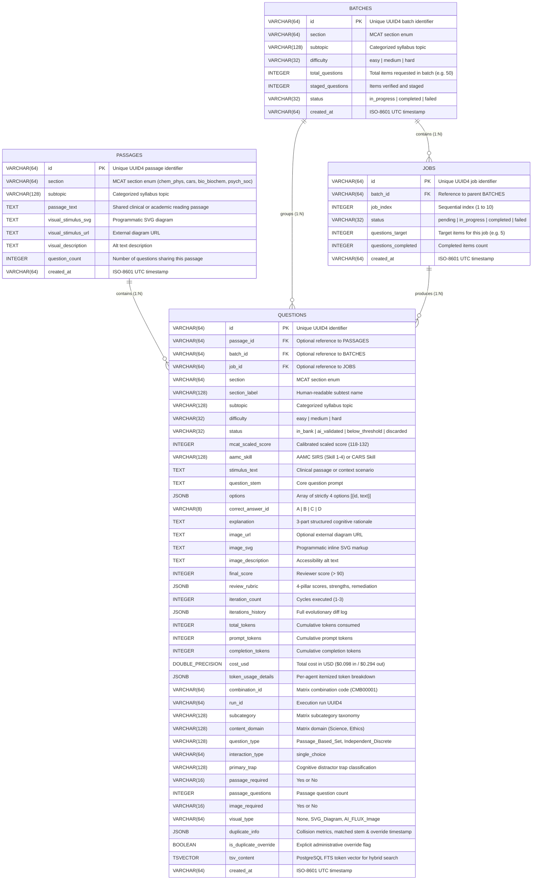
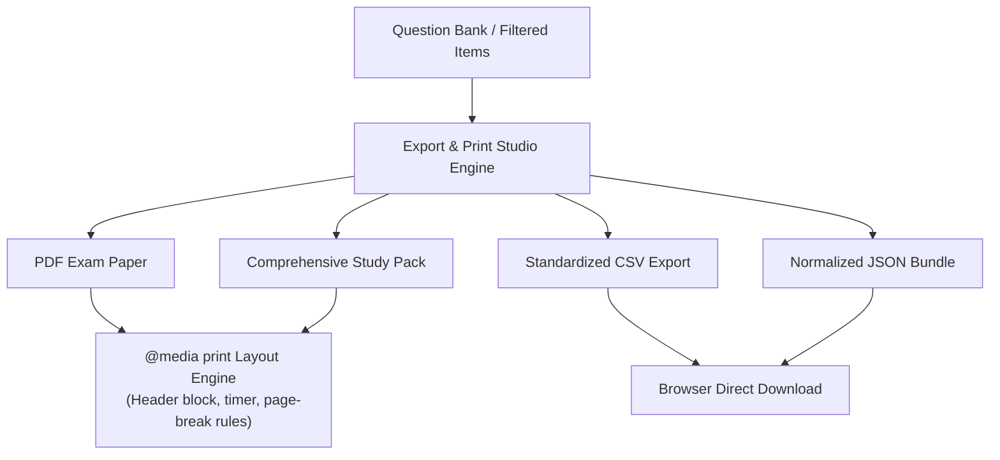

# System Architecture & Multi-Agent Workflow

Engineered by **[Infynno Solutions LLP](https://infynno.com/)** (*"Infinite Innovations"*).

This document details the software architecture, multi-agent design patterns, state management, database schema, background batch execution services, and frontend systems powering the **Infynno MCAT Question Bank Generator v2.0**.

---

## 1. High-Level Architecture Overview

The system is constructed as an asynchronous, event-driven multi-agent workflow coordinated by **LangGraph** and served via **FastAPI** with **Server-Sent Events (SSE)** to a high-performance **React 19** frontend featuring a streamlined **3-Step Guided Question Wizard**, a dedicated full-width **Generation & Review Workspace**, and an enterprise **Batch Execution Engine**.



---

## 2. Multi-Agent StateGraph Workflow

The workflow enforces a strict psychometric quality contract. A question **must score higher than 90 out of 100** on the psychometric rubric and pass **Blind-Solver independent validation** to be approved for publication.

### 2.1 StateGraph Workflow Diagram



### 2.3 Two-Tier Quality Threshold Architecture

The system implements a calibrated two-tier quality threshold model to ensure uncompromising individual question bank admission while enabling resilient high-throughput batch evaluation:

| Tier | Governing Threshold | Scope & Application | System Consequence |
| :--- | :---: | :--- | :--- |
| **Tier 1: Question Bank & AI Validated Gate** | **$> 90$ Points**<br>`PASSING_SCORE_THRESHOLD = 90` | Applied to every candidate question drafted in live sessions or batch workers. | Questions scoring $> 90$ qualify for admission into the permanent **Question Bank** or the dedicated **AI Validated** repository (`status = 'ai_validated'`). Candidate items scoring $\le 90$ must be remediated or discarded. |
| **Tier 2: Batch Activity Run Evaluation Gate** | **$> 85$ Points**<br>`BATCH_PASSING_SCORE_THRESHOLD = 85` | Applied across aggregate generation jobs in multi-job background batches (e.g. 10 jobs x 5 questions = 50 total). | Jobs achieving an aggregate question quality $\ge 85$ are marked as passing batch runs (`status = 'completed'`). Jobs with sub-85 averages are highlighted for instructor review or targeted retry. |

---

## 3. Agent Specifications & Prompt Engineering

The system coordinates specialized autonomous engines with a deterministic quality gate:

### 3.1 Fused Draft-and-Critique Cognitive Engine (`fused_generator_node` / `generator.py`)
- **Mission**: Primary workflow entry point. Synthesizes a high-yield clinical or scientific scenario for the selected AAMC MCAT section with 4 distinct options (A, B, C, D) and immediately conducts an internal 100-point self-critique within a single LLM round-trip.
- **Core Prompt Strategy**:
  - Uses section-specific rules (e.g., enzyme kinetics and thermodynamics for Chem/Phys, rhetorical thesis and authorial intent for CARS, molecular pathways and biochemical regulation for Bio/Biochem, and behavioral theories and sociological stratification for Psych/Soc).
  - Explicitly crafts 1 definitive correct key and 3 sophisticated distractors representing realistic cognitive biases, arithmetic sign inversions, or calculation traps.
  - **Option Symmetry & Anti-Guessability Engine**: Enforces strict word count parity (all options within $\pm 15\%$ or 2-4 words of each other), parallel grammatical syntax, and balanced epistemic qualification.
  - **Anti-AI Punctuation Standard**: Strictly forbids em dashes (`—`), en dashes (`–`), or double hyphens (`--`); enforces standard single hyphens (`-`).
  - **3-Part Structured Mentor Explanations**: Generates a rigorous 3-card explanation layout:
    1. *Why Option [Key] is Correct*: Establishes core intuition and step-by-step mathematical or deductive proof.
    2. *Why Other Options are Incorrect*: Itemized distractor cards dissecting why each wrong choice fails and why students are tempted.
    3. *Primary Cognitive Trap Spotlight*: Dedicated spotlight with exact Trap classification, Error Mechanism, and actionable Student Defense Strategy.
  - **Automatic (Smart AI Choice) Cognitive Trap Engine**: When `primary_trap` is `"Automatic"`, the generator evaluates the drafted item and dynamically selects the best-fit trap from the 11 official MCAT trap types (`Scope_Shift`, `Keyword_Trap`, `Extreme_Language`, `Correlation_vs_Causation`, `Partial_Match`, `Half_Truth`, `Unwarranted_Assumption`, `Calculation_Formula_Trap`, `Out_of_Scope`, `False_Dichotomy`, `Over_generalisation`). The chosen trap is recorded in `draft.primary_trap` and persisted across the workflow.
  - **Fallback Trap Detection**: If `primary_trap` is omitted or unpopulated, `generator.py` and `nodes.py` run regex taxonomy matching against the explanation text to extract and assign the trap automatically.
  - **Immediate Self-Critique Object**: Evaluates Authenticity, Clarity, Distractor Traps, and Explanation Rigor.
- **Routing Optimization**:
  - If self-critique score $> 90$, the workflow sets `fused_self_passed=True` and routes directly to the Visual Engine or Finalize Node, cutting latency by $35-45\%$ and saving ~590 tokens.
  - If self-critique score $\le 90$, the candidate draft is routed to the Remediation Engine and Independent Auditor loop.
- **Custom Authoring Instructions Priority**:
  - Accepts educator-specified pedagogical directives (`additional_instructions`) from `GenerationRequest` via Guided Wizard Step 3.
  - Bound directly to the LangGraph `WorkflowState` and injected with high-priority mandate into prompt builders (`app/agents/prompt_builder.py`, `app/agents/generator.py`, and `app/agents/regenerator.py`).
  - Governs scientific constraints, clinical scenarios, calculation traps, and reasoning boundaries across passage generation, question generation, and all remediation critique cycles.
- **Modular Prompt Construction (`prompt_builder.py`)**: User-turn prompt assembly, section instructions, cognitive trap specifications, and cross-item diversity calibration strings are decoupled into [`backend/app/agents/prompt_builder.py`](file:///Users/infynnosolutions/Desktop/Code/Question%20Bank%20Generator/backend/app/agents/prompt_builder.py) (`_build_generator_user_prompt`), ensuring pure deterministic string assembly without external LLM side effects.
- **Inference Gateway & Fast Model Cascade**: High-throughput enterprise reasoning model (~110-140 tok/s, Temperature: `0.2` for strict instruction adherence). Powered by `DEFAULT_TEXT_MODEL` with fallback to `FAST_MODEL_CASCADE` identifiers parsed via `parse_fast_model_cascade`.

### 3.2 Blind-Solver Dual-Validation Agent (`blind_solver.py` / `blind_solver_node`)
- **Mission**: Acts as an algorithmic test candidate, solving the drafted question completely blind without access to the author's answer key, explanation, or self-critique rubric.
- **Solving Mechanism**:
  - Receives only the scientific passage or discrete scenario and the four unlabelled options ($A, B, C, D$).
  - Independently derives the scientific solution, identifies the correct key, and assigns a numerical confidence score ($0 - 100\%$).
- **Dual-Validation Contract**:
  - **Key Agreement**: The blind-solver's selected answer key must match the draft's intended `correct_answer_id`.
  - **Confidence Benchmark**: The blind-solver's confidence must satisfy $\ge 88\%$ (`BLIND_SOLVER_CONFIDENCE_THRESHOLD = 88`).
- **Autonomous Rerouting**:
  - If the blind solver **agrees** with high confidence ($\ge 88\%$), `blind_solver_passed = True`, and the question bypasses lengthy remediation directly to the visual engine or finalize node.
  - If the blind solver **disagrees** or has low confidence ($< 88\%$), the discrepancy proves that the distractors or stem contain genuine ambiguity or misleading premises. The workflow sets `blind_solver_passed = False` and routes the draft directly to the Remediation Engine with the blind solver's dissenting proof.
- **Inference Gateway**: High-throughput enterprise reasoning model (Temperature: `0.1` for deterministic, zero-hallucination solving, max tokens: `1200`).

### 3.3 Independent Senior Psychometric Auditor (`reviewer.py`)
- **Mission**: Acts as an impartial Senior Psychometric Auditor, independently evaluating candidate questions whenever the initial draft does not clear the self-critique threshold, fails blind-solver validation, or has completed a remediation cycle.
- **Evaluation Rubric (100 Points)**:
  1. *MCAT Authenticity & Scientific Rigor* (0-25 points)
  2. *Clarity & Logical Soundness* (0-25 points)
  3. *Distractor Trap Quality & Anti-Guessability* (0-25 points) - Docks 5-8 points if option length disparity $\ge 20\%$.
  4. *Explanation & Key Rigor* (0-25 points)
- **Quality Benchmark**:
  - Passing Score: **$> 90$** points ($91 - 100$).
  - Failing Score: **$\le 90$** points ($0 - 90$).
- **Output**: Returns numerical pillar scores, observed strengths, specific weaknesses, and actionable remediation instructions.
- **Inference Gateway**: High-throughput enterprise reasoning model (Temperature: `0.1` for objective, deterministic evaluation).

### 3.4 Autonomous Remediation Engine (`regenerator.py`)
- **Mission**: Triggered exclusively when the score is $\le 90$ or blind solver fails. It digests the exact critique, distractor deficiencies, dissenting blind-solver rationales, and recommendations to repair the draft.
- **Rules**:
  - Fixes borderline ambiguities, equalizes option lengths, and sharpens distractor plausibility.
  - Deepens step-by-step rationales explaining why the key is incontrovertible and why every distractor fails.
  - Re-submits the updated draft back to the Reviewer for re-audit.
- **Inference Gateway**: High-throughput enterprise reasoning model (Temperature: `0.2` for disciplined remediation).

### 3.5 Strict Quality Gate (`reject_node` in `app/workflow/nodes.py`)
- **Mission**: Deterministic circuit breaker. If a candidate draft fails to exceed 90 points after reaching the maximum permitted remediation cycles (`MAX_REGENERATION_ATTEMPTS = 3`), the workflow halts immediately.
- **Safety Guarantee**:
  - **Bypasses Image Generation**: Prevents wasted computation and unnecessary token expenses.
  - **Discards from Database**: Zero substandard questions enter the PostgreSQL repository.
  - **Diagnostic Payload**: Transmits full rejection telemetry and history via SSE for audit inspection.

### 3.6 Infynno Visual & Vector Engine (`image_generator.py`)
- **Mission**: Generates visual stimuli for questions requiring graphical diagrams (e.g., metabolic cycles, enzyme kinetics, gel electrophoresis assays, optics diagrams; strictly disabled for CARS).
- **Autonomous AI Routing**: Supports autonomous AI-driven stimulus synthesis when `allow_ai_images` is enabled and deemed pedagogically necessary.
- **Hybrid Visual Engine**:
  - *Programmatic SVG Renderer*: Generates clean, crisp, scalable vector graphics for reaction mechanisms, cell transport, coordinate grids, and statistical bar charts.
  - *FLUX-2-klein-4b Neural Visual Engine*: State-of-the-art rectified-flow transformer (`black-forest-labs/FLUX-2-klein-4b`) hosted on DeepInfra for photorealistic scientific illustrations with dynamic provider cost extraction and a flat $0.014 unit baseline rate.

### 3.7 Question Deduplication & Collision Prevention Subsystem (`deduplication.py`)
- **Mission**: Autonomous real-time safeguard against cognitive repetition, duplicate stems, and identical question angles across the question repository. Guarantees that neither live-generated items nor high-throughput batch sets introduce redundant questions into the bank.
- **Multi-Metric Mathematical Similarity Scoring Model**:
  Operates on normalized question stems (case-folding, alphanumeric filtering, and common English/scientific stopword removal) and 4-choice distractor sets:
  $$\text{Composite Similarity} = 0.35 \times S_{\text{containment}} + 0.25 \times S_{\text{jaccard\_1gram}} + 0.20 \times S_{\text{jaccard\_2gram}} + 0.20 \times S_{\text{sequence\_ratio}}$$
  1. *Token Containment Metric* ($S_{\text{containment}}$, 35% weight): Evaluates asymmetric lexical inclusion $\frac{|T_{\text{candidate}} \cap T_{\text{reference}}|}{\min(|T_{\text{candidate}}|, |T_{\text{reference}}|)}$ to detect paraphrased questions sharing the same scientific core despite differing introductory clauses.
  2. *1-Gram Jaccard Metric* ($S_{\text{jaccard\_1gram}}$, 25% weight): Evaluates vocabulary overlap $\frac{|T_1 \cap T_2|}{|T_1 \cup T_2|}$.
  3. *2-Gram Jaccard Metric* ($S_{\text{jaccard\_2gram}}$, 20% weight): Measures preservation of adjacent scientific bigrams (e.g., "activation energy", "uncompetitive inhibition", "capillary hydrostatic pressure").
  4. *SequenceMatcher Ratio* ($S_{\text{sequence\_ratio}}$, 20% weight): Captures character-level longest contiguous matching sub-sequences via Gestalt pattern matching.
  5. *Distractor Options Overlap Booster*: Evaluates pairwise lexical similarity across candidate and reference option sets ($A, B, C, D$). If $\ge 75\%$ of options are identical or near-identical, the engine applies an options collision penalty that elevates overall similarity or establishes an empirical collision floor.
- **Collision Decision Boundary**:
  - **Threshold $\ge 0.80$ (80%)**: Flagged as a duplicate collision (`is_duplicate = True`). Triggers the autonomous anti-collision loop or flags the item for educator review.
  - **Score $< 0.80$**: Cleared as a distinct pedagogical item (`is_duplicate = False`).
- **Autonomous Anti-Collision Loop (`_run_deduplication_anti_collision_loop`)**:
  When drafting questions during batch or live generation, the candidate is compared against:
  1. Existing questions in PostgreSQL matching the exact **Section** and **Subtopic**.
  2. Previously generated sibling items within the active batch session.
  If a collision ($\ge 0.80$) is detected during generation, the engine executes an autonomous anti-collision prompt injection:
  ```
  CRITICAL: The drafted question is too similar to an existing item in this subtopic.
  Conflicting Item: "[matched_question_stem]"
  You MUST pivot to a completely different clinical scenario, distinct biochemical mechanism,
  or alternative calculation angle while preserving the target AAMC skill.
  ```
- **Administrative Inspection & Override Audit Trail**:
  If a flagged question is presented to educators during review, the UI displays an amber badge `⚠️ Duplicate Risk (XX%)`. Educators can open the side-by-side **Duplicate Comparison Modal** to compare stems, options, and explanations. Choosing **"Override & Approve"** dispatches `POST /api/questions/{id}/override-duplicate`, stamping the record with:
  ```json
  {
    "is_duplicate_override": true,
    "duplicate_info": {
      "is_duplicate": true,
      "similarity_score": 0.88,
      "matched_question_id": "ref-uuid",
      "matched_question_stem": "Existing stem...",
      "match_reason": "High question stem textual overlap (88%)",
      "is_overridden": true,
      "overridden_at": "2026-10-28T17:15:00Z"
    }
  }
  ```

---

## 4. State Management & Lifecycle

Workflow state is tracked via a typed dictionary `AgentWorkflowState` defined in [`backend/app/workflow/state.py`](file:///Users/infynnosolutions/Desktop/Code/Question%20Bank%20Generator/backend/app/workflow/state.py):

```python
class AgentWorkflowState(TypedDict, total=False):
    request: Dict[str, Any]  # Original GenerationRequest parameters
    current_draft: Optional[Dict[str, Any]]  # Active candidate QuestionDraft
    current_review: Optional[Dict[str, Any]]  # Latest ReviewScore rubric
    iteration_count: int  # Current iteration counter (1, 2, 3)
    iterations_history: List[Dict[str, Any]]  # Full audit history of drafts and reviews
    image_url: Optional[str]  # URL if external image generated
    image_svg: Optional[str]  # Embedded SVG markup
    image_description: Optional[str]  # Accessibility alt text
    final_question: Optional[Dict[str, Any]]  # Finalized Question model
    rejection_data: Optional[Dict[str, Any]]  # Telemetry if rejected by Quality Gate
    status: str  # Workflow lifecycle phase
    active_agent: str  # Currently executing agent node
    log_messages: List[str]  # Running log entries

    # Per-Request Token Usage & Cost Accumulator
    total_tokens: int  # Cumulative tokens consumed
    total_prompt_tokens: int  # Cumulative input tokens
    total_completion_tokens: int  # Cumulative output tokens
    total_cost_usd: float  # Cumulative cost in USD ($0.098 in / $0.294 out)
    agent_usage_breakdown: List[Dict[str, Any]]  # Itemized usage per agent cycle
    latest_usage: Optional[Dict[str, Any]]  # Usage of the most recently executed node
```

### 4.1 State Accumulation Pattern
At each node execution, token consumption from the LLM response is unpacked and added to cumulative state counters:
1. `fused_generator_node`: Accumulates single-pass authoring and 100-point self-critique tokens, appending `Question Writer & Reviewer` entry to `agent_usage_breakdown`.
2. `regenerator_node`: Accumulates remediation tokens if initial score $\le 90$ and appends `Question Improver` entry.
3. `reviewer_node`: Accumulates independent audit tokens during remediation cycles and records usage in `iterations_history`.
4. `image_node`: Accumulates visual stimulus synthesis tokens / compute units for `Diagram & Chart Maker`.
5. `finalize_node`: Binds final accumulated totals and itemized breakdown directly into the `Question` schema for database persistence.

### 4.2 Modular Execution Architecture (`engine.py` & `engine_helpers.py`)
The streaming execution pipeline is implemented in [`backend/app/workflow/engine.py`](file:///Users/infynnosolutions/Desktop/Code/Question%20Bank%20Generator/backend/app/workflow/engine.py) via `run_workflow_stream` and `run_workflow`. High-level orchestration helpers are decoupled into [`backend/app/workflow/engine_helpers.py`](file:///Users/infynnosolutions/Desktop/Code/Question%20Bank%20Generator/backend/app/workflow/engine_helpers.py):
- `_prepare_shared_passage_and_visual`: Asynchronously generates shared stimulus reading passages and visual diagrams.
- `_run_review_and_repair_loop`: Coordinates iterative remediation cycles against the 100-point rubric.
- `_persist_live_question`: Handles transactional database persistence of approved candidate items.

---

## 5. Background Batch Execution Service (`batch_runner.py`)

The backend utilizes an asynchronous worker pool managed by [`backend/app/services/batch_runner.py`](file:///Users/infynnosolutions/Desktop/Code/Question%20Bank%20Generator/backend/app/services/batch_runner.py) supporting 2 calibrated Generation Scopes governed by the unified 5-question Job architecture:

1. **Practice Set (5 Questions, 1 Single Job)**:
   - Dispatches a single background worker job comprising 5 questions linked to a shared reading passage (or 5 discretes).
   - Generates and self-audits within ~35-50s, streaming real-time status and automatically staging passing items (`score > 90`) into the **AI Validated** bank (`status = 'ai_validated'`).
2. **Full Exam (50 Questions, 10 Parallel Jobs)**:
   - Enterprise background batch spawning 10 parallel jobs (5 questions each) across the global worker pool.
   - Automatically provisions shared passages per job, coordinates concurrent inference calls under rate-limit semaphores, and dynamically aggregates batch completion metrics.

```mermaid
graph TD
    Client[Web Client] -->|POST /api/batches/start| API[Batches API Endpoint]
    API --> Runner[launch_background_batch]
    
    Runner --> BatchDB[Create Batch Record in DB]
    Runner --> JobDB[Create Job Records in DB: 1 for Practice Set, 10 for Full Exam]
    Runner --> BackgroundTask[Spawn Async Background Worker Pool]
    
    API -->> Client|202 Accepted + Batch/Job UUIDs| Client

    subgraph "Parallel Worker Execution (1 Job [5 Qs] or 10 Jobs [50 Qs])"
        BackgroundTask --> Job1[Job 1: 5 Qs]
        BackgroundTask --> Job2[Job 2: 5 Qs]
        BackgroundTask --> Job3[Job 3: 5 Qs]
        BackgroundTask --> Job4[Job 4: 5 Qs]
        BackgroundTask --> JobDots[...]
        BackgroundTask --> Job10[Job 10: 5 Qs]
        
        Job1 --> Workflow1[Multi-Agent LangGraph]
        Job2 --> Workflow2[Multi-Agent LangGraph]
        Job3 --> Workflow3[Multi-Agent LangGraph]
        Job4 --> Workflow4[Multi-Agent LangGraph]
        Job10 --> Workflow10[Multi-Agent LangGraph]
    end

    Workflow1 --> PersistQ[(Save Questions to DB with status=ai_validated)]
    Workflow2 --> PersistQ
    Workflow3 --> PersistQ
    Workflow4 --> PersistQ
    Workflow10 --> PersistQ
    
    PersistQ --> AtomicUpdate[refresh_batch_aggregates Atomic DB Sync]
    AtomicUpdate --> UpdateBatch[Update Batch & Job status to completed]
```

### 5.1 Global Worker Pool Concurrency & Rate Limiting Engine

To support heavy concurrent workloads and prevent thread starvation or provider rate limits, the batch execution engine implements multi-layered concurrency controls:

1. **Global Worker Pool Semaphore (`_GLOBAL_JOB_SEMAPHORE`)**:
   - Initialized as a singleton semaphore: `asyncio.Semaphore(config.GLOBAL_MAX_CONCURRENT_JOBS)` (default: **4 concurrent jobs**).
   - Constrains simultaneous job execution across **all active running batches** in the system, preventing resource exhaustion when multiple batches are launched concurrently.
2. **Global LLM Concurrency Limiter**:
   - Managed via `config.GLOBAL_MAX_CONCURRENT_LLM_CALLS` (default: **10 concurrent inference calls**).
   - Bounds the maximum number of simultaneous HTTP requests dispatched to DeepInfra.
3. **Exponential Backoff & Rate-Limit Resilience (`call_llm` in `app/agents/base.py`)**:
   - Automatically intercepts HTTP 429 (Rate Limit) and 503 (Service Unavailable) responses.
   - Retries up to `LLM_MAX_RETRIES = 4` times using exponential backoff:
     $$\text{Wait Seconds} = \text{base\_backoff} \times 2^{\text{attempt}} + \text{jitter}$$
     with `LLM_BASE_BACKOFF_SECONDS = 1.5` and random fractional jitter to prevent thundering herd problems.
4. **Atomic Database State Aggregation (`refresh_batch_aggregates`)**:
   - Executes atomic SQL subqueries to calculate `completed_jobs`, `failed_jobs`, `actual_count`, `total_tokens`, and `cost_usd` directly inside PostgreSQL.
   - Eliminates read-modify-write race conditions between parallel background worker tasks.
5. **1-Click Batch Lifecycle Controls**:
   - **Graceful Batch Halt (`POST /api/batches/{id}/stop`)**: Cancels running asyncio worker tasks and updates remaining pending jobs to `"cancelled"` while preserving all successfully generated questions in the bank.
   - **Resilient Batch Retry (`POST /api/batches/{id}/retry`)**: Re-queues incomplete (failed or cancelled) jobs into the global worker pool, automatically picking up from where execution stopped without generating duplicate questions.
   - **Global Halt (`POST /api/batches/cancel-all`)**: System-wide fail-safe terminating all active runner tasks cleanly.
### 5.2 Question Lifecycle State Machine
Every question in the system progresses through an explicit, strictly guarded lifecycle state:



- **`batch_only`**: Active withholding status. Questions generated during live sessions or background batches are saved in `batch_only` (if score $> 85$) while the parent batch is running. This strictly prevents incomplete batches or intermediate drafts from leaking into the educator's "Ready for Review" queue.
- **`ai_validated`**: Background batch questions that cleared the 90+ quality gate (`score > 90`) whose parent batch has successfully completed (`status == 'completed'`). Atomically promoted by `promote_completed_batch_questions` and visible in the educator's review queue.
- **`in_bank`**: Formally approved questions published in the primary searchable Question Bank repository.
- **`below_threshold`**: Drafts that failed to achieve >85 points after remediation cycles (flagged or discarded).
- **`discarded`**: Archived or rejected items removed from active question banks or resolved during duplicate clustering.

### 5.3 Canonical Status Determination, Withholding Guards & Batch Idempotency

1. **Review Queue Withholding Safeguard**:
   During active batch execution, candidate questions scoring $> 85$ are saved with `status = 'batch_only'`. All repository search and count queries ([`backend/app/repositories/question_repository.py`](file:///Users/infynnosolutions/Desktop/Code/Question%20Bank%20Generator/backend/app/repositories/question_repository.py)) enforce an active subquery guard:
   ```python
   in_progress_batches = select(GenerationBatchModel.id).where(
       GenerationBatchModel.status == "in_progress"
   )
   stmt = stmt.where(
       or_(
           QuestionModel.batch_id.is_(None),
           QuestionModel.batch_id.notin_(in_progress_batches),
       )
   )
   ```
   This prevents questions from running batches from appearing in the "Ready for Review" tab or inflating repository status counts until the entire batch has cleanly completed.

2. **Atomic Batch Promotion (`promote_completed_batch_questions`)**:
   Implemented in [`backend/app/repositories/batch_repository.py`](file:///Users/infynnosolutions/Desktop/Code/Question%20Bank%20Generator/backend/app/repositories/batch_repository.py), this function runs atomically when a batch transitions to `"completed"`:
   - High-scoring questions (`final_score > 90`) in `batch_only` are promoted to `ai_validated`.
   - Questions scoring between 86 and 90 (`85 < final_score <= 90`) remain in `batch_only` for historical inspection.
   - If a batch is stopped, cancelled, or fails, `promote_completed_batch_questions` is bypassed entirely, safely retaining questions in `batch_only` without polluting review queues.

3. **Dynamic Job Allocation & Exact Target Count Guarantees**:
   In [`backend/app/services/batch_runner.py`](file:///Users/infynnosolutions/Desktop/Code/Question%20Bank%20Generator/backend/app/services/batch_runner.py), `launch_background_batch` dynamically partitions target quotas into parallel jobs capped at 5 questions per job:
   - 5 questions $\to$ 1 job of 5 items.
   - 50 questions $\to$ 10 jobs of 5 items.
   - 12 questions $\to$ 3 jobs of 5, 5, and 2 items.
   When duplicate resolution or quality gate dropouts create a deficit, `auto_resolve_batch_and_refill` and `refill_batch_deficit` launch targeted replacement jobs with diverse thematic angles, ensuring exact target count delivery.

4. **Idempotent Batch Counter Synchronization**:
   [`backend/app/repositories/question_repository.py`](file:///Users/infynnosolutions/Desktop/Code/Question%20Bank%20Generator/backend/app/repositories/question_repository.py) enforces idempotent batch counter updates in `save_question`. When editing an existing question or re-saving an approved item, the repository detects the existing record and skips counter increments, preventing counter inflation across re-edits or stage-to-bank transitions.

---

## 6. PostgreSQL 16 Database Architecture

The persistence tier runs on **PostgreSQL 16** managed through **SQLAlchemy 2.0 Async** and the **`asyncpg`** driver, featuring enterprise connection pooling and zero-downtime startup migrations (`init_db()` in [`backend/app/db/session.py`](file:///Users/infynnosolutions/Desktop/Code/Question%20Bank%20Generator/backend/app/db/session.py), delegating to schema and FTS verification in [`backend/app/db/init_db.py`](file:///Users/infynnosolutions/Desktop/Code/Question%20Bank%20Generator/backend/app/db/init_db.py)):

### 6.1 Enterprise Connection Pooling Parameters
To prevent database connection drops and handle parallel batch worker loads, the async engine is configured with:
- `pool_size = 20`: Core persistent database connections maintained in the pool.
- `max_overflow = 30`: Additional burst connections during heavy multi-batch load (total 50 connections).
- `pool_timeout = 60`: Seconds to wait before timing out if all connections are busy.
- `pool_recycle = 1800`: Automatically recycles connections after 30 minutes to prevent stale TCP sockets.
- `pool_pre_ping = True`: Automatically validates connection health prior to checking out.

### 6.2 Entity-Relationship Diagram (ERD)



### 6.3 Passage Entity Lifecycle & Non-Destructive Unlinking
When multiple questions are generated as a passage set, they share a foreign key reference (`passage_id`) pointing to the parent `PASSAGES` record:
- **Passage Association**: Educators can browse shared passages in the Passage Bank and inspect all linked questions simultaneously.
- **Non-Destructive Deletion (`DELETE /api/passages/{passage_id}`)**: When an administrator deletes a reading passage via `delete_passage`, the database repository explicitly unlinks the associated questions by setting their `passage_id = None`. The questions remain fully intact and accessible in the Question Bank as independent practice items, preventing accidental content loss.

### 6.4 Deduplication & Override Schema Architecture
The deduplication subsystem extends the PostgreSQL schema with two persistent fields:
1. `duplicate_info JSONB`: Stores the serialized collision payload:
   ```json
   {
     "is_duplicate": true,
     "similarity_score": 0.88,
     "matched_question_id": "c1f7a012-3456-789a-bcde-f0123456789a",
     "matched_question_stem": "Under physiological conditions, which factor...",
     "match_reason": "High question stem textual overlap (88%)",
     "is_overridden": true,
     "overridden_at": "2026-10-28T17:15:00Z"
   }
   ```
2. `is_duplicate_override BOOLEAN DEFAULT FALSE`: Indexed boolean enabling lightning-fast administrative filtering of overridden questions in the Question Bank table.
- **Database Self-Healing**: Automated migration in [`init_db.py`](file:///Users/infynnosolutions/Desktop/Code/Question%20Bank%20Generator/backend/app/db/init_db.py) applies idempotent DDL statements (`ALTER TABLE questions ADD COLUMN IF NOT EXISTS duplicate_info JSONB;` and `ALTER TABLE questions ADD COLUMN IF NOT EXISTS is_duplicate_override BOOLEAN DEFAULT FALSE;`) upon application bootstrap.

---

## 7. Export & Print Studio Architecture

The **Export & Print Studio** ([`ExportPrintModal.jsx`](file:///Users/infynnosolutions/Desktop/Code/Question%20Bank%20Generator/frontend/src/components/modals/ExportPrintModal.jsx)) provides client-side document synthesis and multi-format export capabilities for educators and candidates.



### 7.1 Export Modes
1. **Official Exam Paper (PDF / Print)**:
   - Formatted for classroom and mock exam printing with candidate name/date header, official pacing instructions (~96s to ~101s per item), and clean typographic separation.
   - Enforces `.page-break { break-before: page; }` CSS print rules to ensure reading passages and question options never split awkwardly across page folds.
2. **Comprehensive Study Pack (PDF / Print)**:
   - Includes reading stimulus, question stem, answer key, and the complete step-by-step cognitive proof and distractor trap analysis.
3. **CSV Export Engine**:
   - Converts relational questions into standardized comma-separated columns (`id`, `section`, `subtopic`, `difficulty`, `stem`, `option_a` through `option_d`, `key`, `explanation`, `score`).
4. **JSON Relational Bundle**:
   - Serializes question items including full 4-pillar review rubrics, per-agent token tracking telemetry, and evolution histories.

---

## 8. Frontend Domain-Driven Architecture

The frontend follows an enterprise domain-driven component architecture split into top-level views, specialized domain components, and centralized hooks:

```
frontend/src/
├── views/                        # Top-level application view screens (code-split)
│   ├── index.js                  # Views barrel export
│   ├── AiValidatedQuestionsView.jsx # Dedicated AI Validated (>90) quality bank
│   ├── BatchActivityView.jsx     # Live & historical batch monitoring dashboard
│   ├── GeneratorWorkspaceView.jsx# Interactive exam generation & pipeline workspace
│   ├── PassageBankView.jsx       # Reading passages repository & editorial desk
│   └── QuestionBankView.jsx      # Verified Question Bank view & repository table
├── components/
│   ├── index.js                  # Centralized barrel export for all components
│   ├── wizard/                   # Streamlined 3-Step Guided Question Wizard
│   │   ├── GuidedWizard.jsx      # Central 3-step wizard controller
│   │   ├── HeroLanding.jsx       # Welcome landing hero header
│   │   ├── index.js              # Wizard barrel export
│   │   └── steps/                # Streamlined 3-step modular components
│   │       ├── WizardStep1SectionFocus.jsx # Step 1: Section, pacing & focus
│   │       ├── WizardStep2LevelFormat.jsx  # Step 2: Level (Low/Med/High), format & scope (5/50)
│   │       ├── WizardStep3ReviewAdvanced.jsx # Step 3: Compact review table & advanced accordion
│   │       └── index.js          # Steps barrel export
│   ├── pipeline/                 # Real-time multi-agent visualizer
│   │   ├── AgentVisualizer.jsx   # Live generating telemetry & compact stepper
│   │   ├── MultiAgentPipelineVisualizer.jsx # 3-Milestone pipeline visualizer with electric conduits
│   │   ├── RejectionCard.jsx     # Diagnostic display when score fails threshold
│   │   └── index.js              # Pipeline barrel export
│   ├── staged/                   # Staged batch review deck
│   │   ├── BatchProgressHeader.jsx # Staged batch progress telemetry header & Split/Stacked toggle
│   │   ├── StageJsonInspector.jsx# Deep stage outcome JSON inspector modal
│   │   ├── StagedBatchGrid.jsx   # Grid of staged batch question slots
│   │   ├── StagedBatchReview.jsx # Multi-question batch confirmation desk (AAMC Split-Pane Layout)
│   │   ├── StagedDetailedView.jsx# Expanded single question review panel
│   │   ├── StagedQuestionSlotCard.jsx # Individual question slot reviewer card
│   │   ├── StagedSlotSkeleton.jsx# Slot loading pulse skeleton
│   │   └── index.js              # Staged review deck barrel export
│   ├── question/                 # Question presentation & editing
│   │   ├── MentorExplanationView.jsx # 3-card mentor explanation view (Intuition, Distractors, Trap)
│   │   ├── QuestionCard.jsx      # Interactive student practice & review card
│   │   ├── QuestionDraftingSkeleton.jsx # Pulse skeleton for question creation
│   │   ├── QuestionInlineEditor.jsx # In-place authoring & remediation editor
│   │   ├── QuestionScorecardTab.jsx # 100-point rubric breakdown accordion
│   │   ├── ReviewAuditView.jsx   # 100-point rubric breakdown & token cost modal
│   │   ├── SharedPassageCard.jsx # Shared reading passage stimulus display card
│   │   ├── VisualStimulusViewer.jsx # SVG & neural visual diagram renderer
│   │   └── index.js              # Question barrel export
│   ├── passage/                  # Reading passage bank components
│   │   ├── PassageBankFilters.jsx# Passage search, section, and difficulty filters
│   │   ├── PassageBankTable.jsx  # Passage stimuli repository cards & question sets
│   │   ├── PassageEditorialDesk.jsx # Reading passage editor & preview desk
│   │   ├── PassageLinkedQuestionCard.jsx # Linked question card within passage editorial desk
│   │   ├── PassageVisualStimulusEditor.jsx # Passage diagram & figure attachment editor
│   │   └── index.js              # Passage bank barrel export
│   ├── bank/                     # Question Bank repository
│   │   ├── QuestionBankFilters.jsx # Section, difficulty (Low/Medium/High), and search filters
│   │   ├── QuestionBankTable.jsx # Canonical Editorial Cards view, batch selection, and actions
│   │   └── index.js              # Bank barrel export
│   ├── batch/                    # Batch monitoring components
│   │   ├── ActiveMultiBatchMonitor.jsx # Global concurrency metrics & live multi-batch controller
│   │   ├── BatchCard.jsx         # Summary status card for generation batches
│   │   ├── BatchFiltersBar.jsx   # Section, status, and search filters
│   │   ├── BatchJobCard.jsx      # Per-question job card with lifecycle status
│   │   ├── BatchQuestionItem.jsx # Staged question item with review modal
│   │   ├── BatchStatsHeader.jsx  # High-level aggregate batch statistics
│   │   └── index.js              # Batch barrel export
│   ├── validated/                # AI Validated bank components
│   │   ├── AiValidatedFiltersBar.jsx # Filters for AI-validated questions
│   │   ├── AiValidatedQuestionCard.jsx # Card with direct bank approval actions
│   │   ├── AiValidatedStatsBar.jsx # Quick-action statistics header
│   │   └── index.js              # Validated barrel export
│   ├── modals/                   # Dialog modals
│   │   ├── DuplicateComparisonModal.jsx # Side-by-side duplicate candidate vs bank comparison & override modal
│   │   ├── ExportPaperPreview.jsx# Live print layout previewer
│   │   ├── ExportPrintModal.jsx  # Exam Paper (PDF), Study Pack, CSV and JSON export modal
│   │   └── index.js              # Modals barrel export
│   ├── layout/                   # Global layout
│   │   ├── Footer.jsx            # Infynno Solutions LLP attribution & resource footer
│   │   ├── Navbar.jsx            # Header with branding, navigation tabs, and theme toggle
│   │   └── index.js              # Layout barrel export
│   └── common/                   # Shared UI primitives
│       ├── CustomSelect.jsx      # Accessible custom dropdown select primitive
│       ├── ErrorBoundary.jsx     # Production React error boundary with fallback UI
│       ├── FormattedText.jsx     # Inline markdown & cognitive trap chip highlighter
│       ├── InfynnoLogo.jsx       # Official corporate vector logo primitive
│       ├── LiveStopwatch.jsx     # High-precision live stopwatch timer
│       ├── PaginationBar.jsx     # Accessible pagination bar with page range counter & controls
│       ├── Toast.jsx             # Floating toast notification system
│       └── index.js              # Common primitives barrel export
├── constants/
│   ├── config.js                 # Pricing models, image parameters, token rates
│   ├── index.js                  # Constants barrel export
│   ├── mcat.js                   # MCAT sections, pacing specs, icons, and fallback topics
│   ├── mcatTraps.js              # AAMC cognitive trap definitions and defense strategies
│   └── mcat_dependent_taxonomy.json # AAMC-aligned foundational concepts and skills
├── hooks/
│   ├── index.js                  # Barrel export for custom hooks
│   ├── useAppState.js            # Centralized view routing & global event broker
│   ├── useFocusTrap.js           # Accessible WCAG AA keyboard focus-trapping hook for modals
│   ├── useGeneratorForm.js       # Form state & validation logic
│   ├── useKeyboardShortcuts.js   # Global hotkeys (⌘↵, A, D, T, /, Esc)
│   ├── useQuestionBank.js        # Debounced search, sorting, and bank fetching
│   ├── useQuestionGenerator.js   # SSE streaming, batch progress, and state management
│   └── useTheme.js               # Dual-theme engine (dark / light with localStorage)
├── services/
│   ├── api.js                    # FastAPI client & SSE stream reader (26 methods)
│   └── index.js                  # Services barrel export
├── utils/                        # Pure utility helpers
│   ├── explanationHelpers.js     # Structured explanation parser
│   ├── exportUtils.js            # A4 HTML print document builder, CSV & JSON serializers
│   ├── formatters.js             # Time, word count, token & currency formatters
│   ├── index.js                  # Utilities barrel export
│   ├── optionHelpers.js          # Option length parity & calculateOptionSymmetry engine
│   └── trapHelpers.js            # Cognitive trap resolution & text detectors
├── index.css                     # Enterprise CSS design tokens, conduit animations, dual-theme styling
└── main.jsx                      # React 19 application root
```

For complete UI design tokens, color scales, typography guidelines, and component contracts, consult [`DESIGN.md`](file:///Users/infynnosolutions/Desktop/Code/Question%20Bank%20Generator/DESIGN.md).
