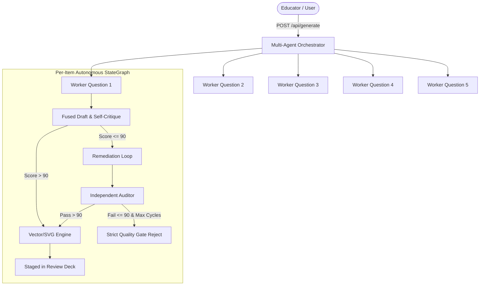

# Infynno MCAT Question Bank Generator v2.0: System Architecture & Client Workflow Guide

> **Author**: Lead Software Architect & Systems Builder  
> **Target Audience**: Client Leadership, Product Stakeholders, and Medical Admissions Educators  
> **System Status**: Fully Implemented, Tested, and Production-Ready  

---

## 1. Executive Summary & Architecture Overview

Preparing candidates for the **AAMC MCAT (Medical College Admission Test)** requires simulating the exact cognitive rigor, multi-disciplinary depth, and strict timing of North American medical admissions testing. Unlike standard memorization tests, the MCAT evaluates deep critical reasoning across physical sciences, biochemistry, humanities, and behavioral dynamics under extreme time pressure (**~96 to ~101 seconds per question**).

### The Problem With Standard AI Question Generation
Most off-the-shelf generative AI setups produce flawed test questions for four reasons:

1. **The "Longest Option" Giveaway**: Language models tend to over-explain the correct answer, creating a giveaway choice that test-savvy students exploit without doing the science.
2. **Superficial Distractors**: Generic models write wrong options that are obviously nonsensical. Official MCAT items use distractors that reflect authentic student misconceptions, inverted ratios, or out-of-scope extrapolations.
3. **Pacing & Passage Realism**: Official MCAT passages demand dense experimental narratives with figures, reaction kinetics, and control groups. Naive prompts generate disjointed trivia stems.
4. **AI Style Tell-Tales**: Generic AI outputs frequently use unnatural em dashes ("—") and repetitive qualifiers that immediately break immersion.

### How Infynno Engineered the Solution
The **Infynno MCAT Question Bank Generator v2.0** solves these challenges with five core pillars:

- **Calibrated Multi-Tier Generation Scopes**:
  - **Mini-Batch (5 Qs)**: Rapid background worker drafting on a shared passage or discrete set (~35-50s) streamed into the AI Validated Bank and Batch Activity Desk with live telemetry.
  - **Full Mock Section (50 Qs)**: Enterprise background multi-job batch (10 concurrent jobs x 5 questions) with automatic AI validation.
- **Binary Passage Architecture**: In a generation run, the studio generates either:
  - **Passage-Based Set**: 1 comprehensive scientific or rhetoric passage linked to all questions in the set; OR
  - **Independent Discretes**: Standalone scientific stems with zero stimulus text.
- **CARS Pure Passage Standard**: For **Critical Analysis and Reasoning Skills (CARS)**, the system strictly enforces 100% passage-based sets, locking discrete mode out in accordance with AAMC regulations.
- **Fused Draft-and-Critique Cognitive Engine**: Authors the scenario, symmetric options, and mentor explanation while simultaneously self-scoring the item across a standardized 100-point rubric in a single unified round-trip, cutting latency by 35-45%.
- **Blind-Solver Dual-Validation Safeguard**: Acts as an algorithmic test candidate, solving the drafted question completely blind without access to the author's answer key or explanation. Any discrepancy in the answer key or low confidence ($< 88\%$) instantly forces the item into remediation, eliminating false keys and ambiguous stems before human review.
- **AAMC Dual Split-Pane Reading Mode**: Provides an authentic side-by-side split reading canvas for passage sets. The left pane anchors the dense research passage with sticky scrolling, while the right pane presents candidate stems, options, and rationales with independent vertical navigation.
- **Autonomous Remediation & Strict Quality Gate (>90 Points)**: Items scoring $\le 90$ undergo up to three cycles of independent auditing and remediation. Unrepaired items are discarded and never committed to the database.

---

## 2. The 4 Official AAMC MCAT Sections & Pacing Standards

The platform is engineered around the official syllabus, cognitive traps, and pacing rules of the four AAMC MCAT sections:

| Section Code | Official Section Name | Total Qs | Time Limit | Target Pacing | Core Focus & Purity Rules |
| :---: | :--- | :---: | :---: | :---: | :--- |
| **chem_phys** | **Chemical and Physical Foundations of Biological Systems** | 59 | 95 mins | **~96s / question** | General chemistry, organic chemistry, physics, thermodynamics, enzymatic kinetics. Supports Passage Sets or Discretes. |
| **cars** | **Critical Analysis and Reasoning Skills** | 53 | 90 mins | **~101s / question** | Humanities and social science rhetoric, authorial tone, thesis extraction. **Strictly 100% Passage-Based (Discretes forbidden).** |
| **bio_biochem** | **Biological and Biochemical Foundations of Living Systems** | 59 | 95 mins | **~96s / question** | Molecular genetics, metabolic pathways, microbiology, organ physiology. Supports Passage Sets or Discretes. |
| **psych_soc** | **Psychological, Social, and Biological Foundations of Behavior** | 59 | 95 mins | **~96s / question** | Cognitive psychology, healthcare sociodemographics, sensory perception. Supports Passage Sets or Discretes. |

---

## 3. End-to-End User Experience & Streamlined 3-Step Guided Wizard

The workstation provides an interactive **Streamlined 3-Step Guided Wizard** docked beside the full-width workspace, organizing authoring decisions into three high-velocity stages:

```
[ Step 1: Section & Topic Focus ] ──> [ Step 2: Level, Format & Scope ] ──> [ Step 3: Review & Launch (Advanced Calibration) ]
```

1. **Step 1: Section & Topic Focus**: 
   - **Exam Section Selection**: Choose from the 4 official AAMC sections (Chemical and Physical Foundations, CARS, Biological and Biochemical Foundations, Psychological, Social, and Biological Foundations). Selecting CARS automatically primes the wizard for 100% passage-based operation and disables image generation.
   - **Discipline & Major Unit**: Select syllabus discipline and unit taxonomy.
   - **High-Yield Concept Subtopics**: Multi-select granular subtopics or select all concepts for a balanced mix.
2. **Step 2: Level, Format & Scope**:
   - **Generation Scope**: Select Mini-Batch (5 Qs, 1 Job) or Full Mock Section (50 Qs, 10 Jobs) for background worker pool batch execution.
   - **Challenge Level**: Foundational, Standard MCAT, or Top Percentile tier calibration.
   - **Binary Passage Mode**: Passage-Based Set vs Independent Discretes.
   - **Question Breakdown**: Calibrate single-choice and multi-choice proportions.
3. **Step 3: Review & Launch (with Advanced Calibration)**:
   - **Scientific Figures & Visual Stimuli**: Enable/disable autonomous AI visual diagrams (reaction coordinates, Western blots, anatomical pathways).
   - **Expandable Advanced Directives**: Multi-select official AAMC cognitive distractor traps (Formula Trap, Extreme Quantifiers, False Causation), SIRS reasoning skills (Skill 1–4), and likely student mistake patterns.
   - **Unified Review & Launch**: Inspect the live configuration summary and launch real-time SSE streaming or background worker pool batch generation.


---

## 4. Multi-Agent Pipeline & Strict Quality Gate



### 4.1 Fused Draft-and-Critique Cognitive Engine (`fused_generator_node`)
- Crafts high-yield clinical or scientific scenarios, 4 symmetric options ($A, B, C, D$), and 3-card mentor explanations.
- Simultaneously generates a 100-point self-critique object in a single inference call, cutting latency by $35-45\%$ and saving ~590 tokens on passing drafts.
- Strictly forbids em dashes (`—`) and enforces option word count symmetry ($\pm 15\%$).

### 4.2 Blind-Solver Dual-Validation Safeguard (`blind_solver.py`)
- Acts as an algorithmic test candidate, solving the drafted question completely blind without knowing the author's key or explanation.
- Evaluates whether the question stem and passage provide unambiguous mathematical or deductive proof to identify the intended key.
- Requires both **answer key agreement** and **$\ge 88\%$ confidence**. If the blind solver selects a different option or confidence is low, the item is automatically redirected to remediation to remove ambiguity.

### 4.3 Independent Senior Psychometric Auditor (`reviewer.py`)
- Engaged if a draft scores $\le 90$, fails blind-solver verification, or has undergone remediation.
- Evaluates four 25-point pillars:
  1. *MCAT Authenticity & Scientific Rigor* (0-25)
  2. *Clarity & Logical Soundness* (0-25)
  3. *Distractor Trap Quality & Anti-Guessability* (0-25)
  4. *Explanation & Key Rigor* (0-25)

### 4.4 Autonomous Remediation Engine (`regenerator.py`)
- Repairs identified distractor weaknesses, equalizes option lengths, and sharpens pedagogical proofs.
- Loops up to 3 cycles before triggering the deterministic rejection circuit breaker.

### 4.5 Strict Quality Gate Benchmark ($> 90$ Points)
- Any item unable to achieve $> 90$ points after 3 cycles is completely rejected and excluded from the Question Bank.

---

## 5. Mentor Explanations & 11 Cognitive Traps

Every approved question presents a comprehensive **3-Card Mentor Explanation**:

1. **Card 1: Why Option [Key] is Correct** (Emerald / Success) — Clear deductive or mathematical proof citing specific passage data.
2. **Card 2: Why Other Options are Incorrect** (Amber / Warning) — Itemized distractor cards dissecting the exact fallacy in each incorrect choice ($A, B, C, D$).
3. **Card 3: Primary Cognitive Trap Spotlight** (Purple / Tactical Defense) — Details the exact psychological trap, the underlying student error mechanism, and an actionable test-day defense strategy.

### Supported Trap Taxonomy:
- `Scope_Shift`, `Keyword_Trap`, `Extreme_Language`, `Correlation_vs_Causation`, `Partial_Match`, `Half_Truth`, `Unwarranted_Assumption`, `Calculation_Formula_Trap`, `Out_of_Scope`, `False_Dichotomy`, `Over_generalisation`.

---

## 6. Financial Transparency, Concurrency & Batch Resiliency

Every generated item tracks real-time inference telemetry:

$$\text{Total Cost} = \left(\frac{\text{Input Tokens}}{1{,}000{,}000} \times \$0.098\right) + \left(\frac{\text{Output Tokens}}{1{,}000{,}000} \times \$0.294\right)$$

- **Predictable Micro-Costs**: An audited 5-question batch typically costs **between $0.006 and $0.012 USD** in total inference.
- **Repository Observability**: The Question Bank header displays accumulated input tokens, output tokens, total execution time, and cumulative investment across the entire repository.
- **Enterprise Multi-Batch Concurrency & Resiliency**:
  - The background batch runner operates under global worker semaphores (`4 concurrent jobs`, `10 concurrent LLM calls`) ensuring safe execution without API rate limit bottlenecks.
  - **1-Click Batch Stop**: Educators can pause a 50-question mock run at any time without losing items already generated and validated.
  - **1-Click Batch Retry**: If a job encounters temporary network latency, educators can re-launch incomplete jobs with a single click, picking up immediately from the exact point of interruption.
- **Dedicated Application Views**: Seamlessly navigate between:
  1. **Generator Workspace**: Interactive exam generation & pipeline workspace with AAMC Split-Pane mode.
  2. **AI Validated Bank**: High-quality items (>90 points) awaiting one-click educator publishing.
  3. **Question Bank**: Primary verified repository with search, filtering, and export.
  4. **Batch Activity**: Real-time monitor tracking background 50-question mock runs with live worker metrics.
