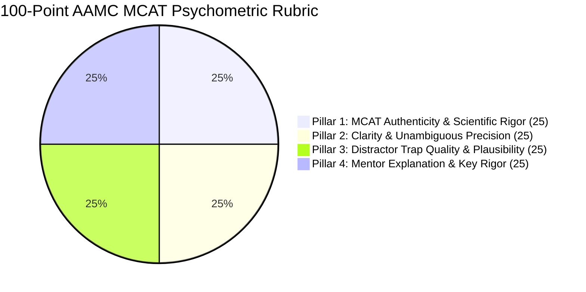

# AAMC MCAT 100-Point Psychometric Rubric & Question Authoring Standards

Engineered by **[Infynno Solutions LLP](https://infynno.com/)** (*"Infinite Innovations"*).

This document specifies the psychometric standards, 100-point quality rubric, cognitive distractor trap engineering principles, and pacing guidelines governing the **Infynno MCAT Question Bank Generator v2.0**.

---

## 1. The Official AAMC MCAT Examination Overview

The **Medical College Admission Test (MCAT)**, administered by the Association of American Medical Colleges (AAMC), is the computer-based standardized examination required for admission to medical schools across the United States and Canada.

The MCAT evaluates problem-solving, critical thinking, and knowledge of natural, behavioral, and social science concepts and principles prerequisite to the study of medicine.

### 1.1 The 4 Official Sections & Pacing Standards

| Section Code | Official Section Name | Total Qs | Time Limit | Target Pacing | Core Scientific & Cognitive Domain |
| :---: | :--- | :---: | :---: | :---: | :--- |
| **chem_phys** | **Chemical and Physical Foundations of Biological Systems** | 59 | 95 mins | **~96s / question** | General chemistry, organic chemistry, physics, biochemistry, cellular thermodynamics, and laboratory kinetics. |
| **cars** | **Critical Analysis and Reasoning Skills** | 53 | 90 mins | **~101s / question** | Humanities and social sciences rhetoric, authorial tone, thesis extraction, inference, and philosophical argument critique (100% passage-based, strictly 0 discretes). |
| **bio_biochem** | **Biological and Biochemical Foundations of Living Systems** | 59 | 95 mins | **~96s / question** | Molecular genetics, metabolic pathways, microbiology, organ system physiology, enzymatic regulation, and gel/Western blot analysis. |
| **psych_soc** | **Psychological, Social, and Biological Foundations of Behavior** | 59 | 95 mins | **~96s / question** | Cognitive psychology, neurobiology, sociology of healthcare, demographic disparity, sensory perception, and experimental design. |

---

## 2. AAMC Scientific Inquiry & Reasoning Skills (SIRS)

All generated questions explicitly test one of the official four AAMC Scientific Inquiry and Reasoning Skills:

1. **Skill 1: Knowledge of Scientific Concepts and Principles** — Recognizing, recalling, and defining scientific phenomena, models, and relationships.
2. **Skill 2: Scientific Reasoning and Problem Solving** — Formulating hypotheses, applying conceptual models to novel clinical scenarios, and evaluating scientific solutions.
3. **Skill 3: Reasoning About the Design and Execution of Research** — Evaluating experimental variables, positive/negative controls, ethical standards, and instrumentation validity.
4. **Skill 4: Data-Based and Statistical Reasoning** — Reading tables, dose-response curves, gel electrophoresis assays, bar charts, and evaluating statistical significance ($p < 0.05$).

---

## 3. The 100-Point Psychometric Rubric

Every candidate question drafted by the autonomous pipeline is audited against a standardized **100-point rubric** divided into 4 equal 25-point pillars:

---

### Pillar 1: MCAT Authenticity & Scientific Rigor (0 - 25 Points)
Evaluates whether the stimulus passage or clinical stem matches the exact intellectual register, terminology, units of measurement (SI units), biochemical nomenclature, and experimental structure of official AAMC exam passages.

| Score Range | Descriptor | Criteria |
| :---: | :--- | :--- |
| **23 - 25** | *Flawless Authenticity* | Indistinguishable from official AAMC Section Bank items. Precise biochemical terminology, accurate thermodynamic and kinetic framing, authentic experimental or philosophical vignette. |
| **19 - 22** | *Strong Authenticity* | Minor stylistic variance, but scientifically watertight and stylistically consistent with authentic MCAT standards. |
| **14 - 18** | *Borderline* | Simplistic language, colloquial terminology, or scenario slightly uncharacteristic of medical admissions testing. |
| **0 - 13** | *Unacceptable* | Factual error in science, cartoonish or trivia-level prompt, completely unrepresentative of MCAT rigor. |

---

### Pillar 2: Clarity & Unambiguous Precision (0 - 25 Points)
Ensures the question stem contains all necessary conditions and variables, is free of grammatical ambiguity, and leaves zero doubt as to what is being asked.

| Score Range | Descriptor | Criteria |
| :---: | :--- | :--- |
| **23 - 25** | *Axiomatic Precision* | Absolute clarity. The question stem guides the candidate unequivocally to the exact variable or reasoning required. |
| **19 - 22** | *Sound & Clear* | Premise is logically valid with minimal extraneous fluff; stem is straightforward. |
| **14 - 18** | *Ambiguous* | Borderline double-negative phrasing or subtle omission in the passage causing legitimate contention. |
| **0 - 13** | *Confusing* | Self-contradictory stem or flawed premise that makes selecting an objectively correct answer impossible. |

---

### Pillar 3: Distractor Trap Quality & Plausibility (0 - 25 Points)
Official MCAT distractors are **never trivial or obviously wrong**; they are deliberate psychological traps reflecting real student misconceptions, inverse relationships, arithmetic sign inversions, or out-of-scope over-extrapolations.

| Score Range | Descriptor | Criteria |
| :---: | :--- | :--- |
| **23 - 25** | *Exceptional Traps* | All 3 distractors are highly plausible, scientifically coherent, and target distinct cognitive traps. Options exhibit symmetric length and grammatical parallelism. |
| **19 - 22** | *Strong Distractors* | Options represent genuine misconceptions with strong plausibility; minor length variance. |
| **14 - 18** | *Mediocre Distractors* | One distractor is easily eliminated by basic common sense; trap mechanisms are weak. |
| **0 - 13** | *Defective Options* | Distractors are silly, obviously absurd, or mathematically incoherent. |

---

### Pillar 4: Mentor Explanation & Key Rigor (0 - 25 Points)
The correct answer must be incontrovertible. The explanation must provide deep pedagogical value, structured into:
1. Proof of why the key is correct.
2. Step-by-step refutation of each incorrect distractor.
3. Cognitive trap spotlight detailing error mechanisms and defense strategies.

| Score Range | Descriptor | Criteria |
| :---: | :--- | :--- |
| **23 - 25** | *Gold-Standard Pedagogy* | Elegant step-by-step scientific proof, rigorous distractor breakdown for choices A, B, C, D, and explicit tactical defense guidance. |
| **19 - 22** | *Thorough Explanation* | Valid proof and refutations, but lacks nuanced cognitive trap defense notes. |
| **14 - 18** | *Superficial Explanation* | Explains only why the key is right without explaining why distractors are wrong. |
| **0 - 13** | *Defective / Circular* | Simply restates the question key ("B is correct because B is the right answer") with no proof. |

---

## 4. The 11-Trap Cognitive Taxonomy for Distractors

The engine applies an authoritative taxonomy of 11 psychological traps:

1. **Scope Shift**: Extrapolates beyond experimental boundaries or shifts from in vitro to in vivo without evidence.
2. **Keyword Trap**: Uses verbatim vocabulary from the passage in a scientifically inverted or irrelevant context.
3. **Extreme Language**: Uses absolute terms ("always", "completely", "never") unsupported by biological variability.
4. **Correlation vs Causation**: Assumes a causal mechanism when the passage only demonstrates statistical association.
5. **Partial Match**: Contains true scientific facts that fail to address the specific question stem.
6. **Half-Truth**: First half of the option is scientifically accurate, but the conclusion is subtly inverted.
7. **Unwarranted Assumption**: Relies on external assumptions not supported by the experimental passage.
8. **Calculation Trap**: Intermediate calculation error, inverted reciprocal, or wrong unit prefix ($10^{-3}$ vs $10^{-6}$).
9. **Out of Scope**: Introduces facts completely outside the tested scope or curriculum domain.
10. **False Dichotomy**: Presumes an all-or-nothing binary between two biological mechanisms when both operate synergistically.
11. **Over-generalisation**: Generalizes results observed in an isolated enzyme to an entire metabolic pathway or organism.

---

## 5. Strict Quality Gate Benchmark ($\ge 90$ Points)

Any drafted question scoring $< 90$ points is automatically rejected by the Strict Quality Gate and routed through autonomous remediation. Items failing after maximum allowed cycles are discarded and never committed to the permanent database repository.
