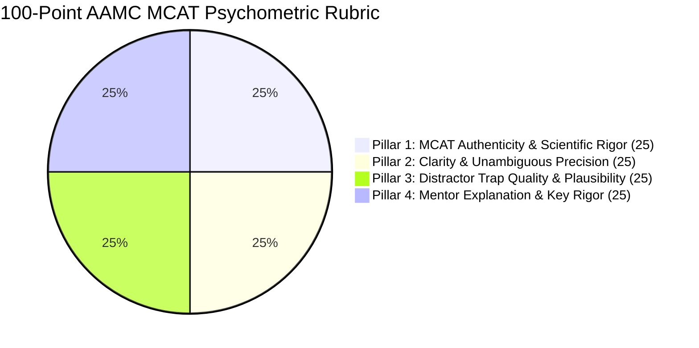

# AAMC MCAT 100-Point Psychometric Rubric & Question Authoring Standards

Engineered by **[Infynno Solutions LLP](https://infynno.com/)** (*"Infinite Innovations"*).

This document specifies the psychometric standards, 100-point quality rubric, cognitive distractor trap engineering principles, AAMC reasoning skills, calibrated scaled score mapping, and pacing guidelines governing the **Infynno MCAT Question Bank Generator v2.0**.

---

## 1. The Official AAMC MCAT Examination Overview

The **Medical College Admission Test (MCAT)**, administered by the Association of American Medical Colleges (AAMC), is the computer-based standardized examination required for admission to medical schools across the United States and Canada.

The MCAT evaluates problem-solving, critical thinking, and knowledge of natural, behavioral, and social science concepts and principles prerequisite to the study of medicine.

### 1.1 The 4 Official Sections & Pacing Standards

| Section Code | Official Section Name | Total Qs | Time Limit | Target Pacing | Core Scientific & Cognitive Domain |
| :---: | :--- | :---: | :---: | :---: | :--- |
| **chem_phys** | **Chemical and Physical Foundations of Biological Systems** | 59 | 95 mins | **~96s / question** | General chemistry, organic chemistry, physics, biochemistry, cellular thermodynamics, and laboratory kinetics. |
| **cars** | **Critical Analysis and Reasoning Skills** | 53 | 90 mins | **~101s / question** | Humanities and social sciences rhetoric, authorial tone, thesis extraction, inference, and philosophical argument critique (100% passage-based, strictly 0 discretes). |
| **bio_biochem** | **Biological and Biochemical Foundations of Living Systems** | 59 | 95 mins | **~96s / question** | Molecular genetics, metabolic pathways, microbiology, organ system physiology, enzymatic regulation, and gel/Western blot analysis. |
| **psych_soc** | **Psychological, Social, and Biological Foundations of Behavior** | 59 | 95 mins | **~96s / question** | Cognitive psychology, neurobiology, sociology of healthcare, demographic disparity, sensory perception, and experimental design. |

---

## 2. AAMC Scientific Inquiry & Reasoning Skills (SIRS)

All generated questions explicitly test one of the official four AAMC Scientific Inquiry and Reasoning Skills (or CARS reasoning skills):

### Natural, Behavioral & Social Sciences (SIRS)
1. **Skill 1: Knowledge of Scientific Concepts and Principles** — Recognizing, recalling, and defining scientific phenomena, models, and relationships.
2. **Skill 2: Scientific Reasoning and Problem Solving** — Formulating hypotheses, applying conceptual models to novel clinical scenarios, and evaluating scientific solutions.
3. **Skill 3: Reasoning About the Design and Execution of Research** — Evaluating experimental variables, positive/negative controls, ethical standards, and instrumentation validity.
4. **Skill 4: Data-Based and Statistical Reasoning** — Reading tables, dose-response curves, gel electrophoresis assays, bar charts, and evaluating statistical significance ($p < 0.05$).

### Critical Analysis and Reasoning Skills (CARS)
1. **Foundations of Comprehension** — Understanding the literal meaning and main ideas of complex philosophical and social science passages.
2. **Reasoning Within the Text** — Identifying assumptions, evaluating evidence, and understanding rhetorical tone and logical connections within the passage.
3. **Reasoning Beyond the Text** — Applying passage arguments to novel external scenarios and assessing the impact of new information on the author's thesis.

---

## 3. The 100-Point Psychometric Rubric

Every candidate question drafted by the autonomous pipeline is audited against a standardized **100-point rubric** divided into 4 equal 25-point pillars:

---

### Pillar 1: MCAT Authenticity & Scientific Rigor (0 - 25 Points)
Evaluates whether the stimulus passage or clinical stem matches the exact intellectual register, terminology, units of measurement (SI units), biochemical nomenclature, and experimental structure of official AAMC exam passages.

| Score Range | Descriptor | Criteria |
| :---: | :--- | :--- |
| **23 - 25** | *Flawless Authenticity* | Indistinguishable from official AAMC Section Bank items. Precise biochemical terminology, accurate thermodynamic and kinetic framing, authentic experimental or philosophical vignette. |
| **19 - 22** | *Strong Authenticity* | Minor stylistic variance, but scientifically watertight and stylistically consistent with authentic MCAT standards. |
| **14 - 18** | *Borderline* | Simplistic language, colloquial terminology, or scenario slightly uncharacteristic of medical admissions testing. |
| **0 - 13** | *Unacceptable* | Factual error in science, cartoonish or trivia-level prompt, completely unrepresentative of MCAT rigor. |

---

### Pillar 2: Clarity & Unambiguous Precision (0 - 25 Points)
Ensures the question stem contains all necessary conditions and variables, is free of grammatical ambiguity, and leaves zero doubt as to what is being asked.

| Score Range | Descriptor | Criteria |
| :---: | :--- | :--- |
| **23 - 25** | *Axiomatic Precision* | Absolute clarity. The question stem guides the candidate unequivocally to the exact variable or reasoning required. |
| **19 - 22** | *Sound & Clear* | Premise is logically valid with minimal extraneous fluff; stem is straightforward. |
| **14 - 18** | *Ambiguous* | Borderline double-negative phrasing or subtle omission in the passage causing legitimate contention. |
| **0 - 13** | *Confusing* | Self-contradictory stem or flawed premise that makes selecting an objectively correct answer impossible. |

---

### Pillar 3: Distractor Trap Quality & Plausibility (0 - 25 Points)
Official MCAT distractors are **never trivial or obviously wrong**; they are deliberate psychological traps reflecting real student misconceptions, inverse relationships, arithmetic sign inversions, or out-of-scope over-extrapolations.

| Score Range | Descriptor | Criteria |
| :---: | :--- | :--- |
| **23 - 25** | *Exceptional Traps* | All 3 distractors are highly plausible, scientifically coherent, and target distinct cognitive traps. Options exhibit symmetric length and grammatical parallelism ($\pm 15\%$). |
| **19 - 22** | *Strong Distractors* | Options represent genuine misconceptions with strong plausibility; minor length variance. |
| **14 - 18** | *Mediocre Distractors* | One distractor is easily eliminated by basic common sense; trap mechanisms are weak. |
| **0 - 13** | *Defective Options* | Distractors are silly, obviously absurd, or mathematically incoherent. |

---

### Pillar 4: Mentor Explanation & Key Rigor (0 - 25 Points)
The correct answer must be incontrovertible. Beyond editorial evaluation, the system enforces algorithmic verification via the **Blind-Solver Dual Validation Agent**, which solves the question without access to the key. To earn full credit, the key must be incontrovertibly deduced from passage evidence, and the explanation must provide deep pedagogical value structured into:
1. Proof of why the key is correct (Core intuition + step-by-step mathematical or deductive proof).
2. Step-by-step refutation of each incorrect distractor ($A, B, C, D$).
3. Cognitive trap spotlight detailing psychological error mechanisms and actionable student defense strategies.

| Score Range | Descriptor | Criteria |
| :---: | :--- | :--- |
| **23 - 25** | *Gold-Standard Pedagogy* | Incontrovertible key verified by Blind-Solver ($\ge 88\%$ confidence), elegant step-by-step scientific proof, rigorous distractor breakdown for all choices, and tactical defense guidance. |
| **19 - 22** | *Thorough Explanation* | Valid proof and refutations, but lacks nuanced cognitive trap defense notes. |
| **14 - 18** | *Superficial Explanation* | Explains only why the key is right without explaining why distractors are wrong. |
| **0 - 13** | *Defective / Circular* | Simply restates the question key ("B is correct because B is the right answer") with no proof, or key is disputed by Blind-Solver. |

---

## 4. The 11-Trap Cognitive Taxonomy for Distractors

The engine applies an authoritative taxonomy of 11 psychological traps:

1. **Scope Shift**: Extrapolates beyond experimental boundaries or shifts from in vitro to in vivo without evidence.
2. **Keyword Trap**: Uses verbatim vocabulary from the passage in a scientifically inverted or irrelevant context.
3. **Extreme Language**: Uses absolute terms ("always", "completely", "never") unsupported by biological variability.
4. **Correlation vs Causation**: Assumes a causal mechanism when the passage only demonstrates statistical association.
5. **Partial Match**: Contains true scientific facts that fail to address the specific question stem.
6. **Half-Truth**: First half of the option is scientifically accurate, but the conclusion is subtly inverted.
7. **Unwarranted Assumption**: Relies on external assumptions not supported by the experimental passage.
8. **Calculation Formula Trap**: Intermediate calculation error, inverted reciprocal, or wrong unit prefix ($10^{-3}$ vs $10^{-6}$).
9. **Out of Scope**: Introduces facts completely outside the tested scope or curriculum domain.
10. **False Dichotomy**: Presumes an all-or-nothing binary between two biological mechanisms when both operate synergistically.
11. **Over-generalisation**: Generalizes results observed in an isolated enzyme to an entire metabolic pathway or organism.

---

## 5. Calibrated Difficulty Calibration Tiers (Low, Medium, High)

The generator calibrates questions into 3 difficulty tiers across the authoring wizard, question cards, and repository filters:

| Difficulty Tier | Cognitive Complexity | Typical AAMC Reasoning Skill | Characteristics & Trap Sophistication |
| :---: | :--- | :--- | :--- |
| **Low** | Direct recall & single-step deduction | Skill 1 (Knowledge of Concepts) / CARS Skill 1 | Direct application of core definitions, single-variable calculations, direct passage fact extraction; clear distractors targeting basic misconceptions. |
| **Medium** | Multi-step reasoning & graphical data | Skill 2 (Scientific Problem Solving) / CARS Skill 2 | Multi-step deduction, two-variable data analysis (e.g., standard Michaelis-Menten curve or Lineweaver-Burk interpretation), standard distractor traps (e.g. calculation formula traps, sign inversions). |
| **High** | Multi-component synthesis & research design | Skill 3 (Research Design) & Skill 4 (Data/Stats) / CARS Skill 3 | Novel experimental setups, subtle rhetorical tone shifts, conflicting hypotheses, multi-step stoichiometry or kinetics, highly sophisticated distractors (e.g., subtle half-truths, unwarranted assumptions). |

---

## 6. Calibrated AAMC Scaled Score Mapping

Internal 100-point psychometric audit scores are mathematically calibrated to the official AAMC scaled score ranges:
- **Individual Section Scale**: `118` to `132` (Median: `125`)
- **Composite Examination Scale**: `472` to `528` (Median: `500`)

| 100-Point Audit Score | AAMC Section Scaled Score | Percentile Rank | Classification |
| :---: | :---: | :---: | :--- |
| **98 - 100** | **132** | **99th+ Percentile** | Elite / Perfect Calibration |
| **96 - 97** | **131** | **98th - 99th Percentile** | Exceptional Standard Bank |
| **94 - 95** | **130** | **96th - 97th Percentile** | Outstanding / Competitive MD |
| **92 - 93** | **129** | **92nd - 95th Percentile** | Superior Psychometric Validity |
| **91** | **128** | **87th - 91st Percentile** | Minimum Accepted Standard |
| **$\le$ 90** | **$\le$ 127** | **$<$ 86th Percentile** | **Fails Quality Gate (Remediation Required)** |

---

## 7. Two-Tier Quality Threshold Model & Quality Gates

The system enforces a calibrated two-tier quality evaluation framework that balances uncompromising question-bank admission with high-throughput batch evaluation:

### 6.1 Tier 1: Question Bank & AI Validated Admission Gate (`PASSING_SCORE_THRESHOLD = 90`)
- **Benchmark**: Score **$> 90$ Points** on the 100-point rubric.
- **Rule**: Individual question candidates must achieve $> 90$ to qualify for admission into the permanent **Question Bank** or promotion to the **AI Validated Questions** workspace (`status = 'ai_validated'`).
- **Remediation**: Any question scoring $\le 90$ points is automatically rejected by the gate and routed through autonomous remediation (`regenerator.py`).
- **Circuit Breaker**: Items failing to achieve $> 90$ after the maximum allowed cycles (`MAX_REGENERATION_ATTEMPTS = 3`) are discarded permanently and never admitted into the database repository.

### 6.2 Tier 2: Batch Activity Run Evaluation Gate (`BATCH_PASSING_SCORE_THRESHOLD = 85`)
- **Benchmark**: Score **$> 85$ Points** across aggregate batch jobs.
- **Rule**: High-throughput multi-job batches (e.g. 50-question mock sections across 10 parallel jobs) evaluate overall job health using the 85-point benchmark.
- **Batch Acceptance**: Jobs whose questions achieve an average quality score $\ge 85$ are marked as passing batch jobs (`status = 'completed'`), while sub-85 drafts are flagged for targeted review or remediation (`status = 'below_threshold'`).

---

## 8. Smart AI Choice & Targeted Misconception Calibration (`likely_mistake_pattern`)

Beyond standard cognitive traps, the engine operationalizes pedagogical misconception diagnosis:
1. **Automatic (Smart AI Choice)**: The generator agent analyzes the scientific research study, equations, and question stem to autonomously diagnose the most authentic student calculation or conceptual error for the tested concept (e.g., `USES_WRONG_REFERENCE_VALUE`, `INVERTS_FRACTION`, `FORGETS_SQUARE_ROOT`, `CONFUSES_ENANTIOMERS_DIASTEREOMERS`, `MISREADS_GRAPH_AXES`, `FAILS_TO_SUBTRACT_BASELINE`, `CONFUSES_KM_VMAX`, `DROPS_NEGATIVE_SIGN`).
2. **Explicit Distractor Targeting**: At least one distractor option is engineered specifically to attract students committing that exact misconception, and the complete error mechanism is detailed in the 3-card mentor explanation.
3. **Audit Trail Persistence**: The diagnosed pattern is saved to PostgreSQL in `likely_mistake_pattern` and displayed on question cards and audit modals.
