# Infynno MCAT Question Bank Generator v2.0 - Documentation Suite

Welcome to the official documentation portal for the **Infynno MCAT Question Bank Generator v2.0**, engineered by **[Infynno Solutions LLP](https://infynno.com/)** (*"Infinite Innovations"*).

This centralized hub provides an architectural overview, role-based navigation guides, and direct links to every technical specification and operational manual across the repository.

---

## 🗺️ Documentation Directory & Architecture Map

```mermaid
graph TD
    Root[Infynno MCAT Question Bank Generator Docs]
    
    subgraph "Core Operational Guides"
        Root --> ClientGuide[Client System & Workflow Guide<br>docs/CLIENT_SYSTEM_AND_WORKFLOW_GUIDE.md]
        Root --> Rubric[AAMC MCAT Psychometric Rubric<br>docs/MCAT_RUBRIC.md]
        Root --> Setup[Installation & Deployment<br>docs/SETUP_AND_CONFIG.md]
    end

    subgraph "Technical & Engineering Specs"
        Root --> Arch[System Architecture & Multi-Agent Flow<br>docs/ARCHITECTURE.md]
        Root --> API[REST & SSE API Reference<br>docs/API.md]
        Root --> Tokens[Token Usage & Cost Tracking<br>docs/TOKEN_TRACKING.md]
        Root --> Design[UI/UX Design System Guide<br>DESIGN.md]
    end

    subgraph "Subsystem Engineering Guides"
        Root --> BackendGuide[Backend Developer Guide<br>backend/README.md]
        Root --> FrontendGuide[Frontend Workstation Guide<br>frontend/README.md]
        Root --> Contrib[Contributing & Code Standards<br>CONTRIBUTING.md]
    end
```

---

## 📚 Complete Guides Index

| Document | Primary Audience | Core Focus & Description |
| :--- | :--- | :--- |
| **[Client System & Workflow Guide](file:///Users/infynnosolutions/Desktop/Code/Question%20Bank%20Generator/docs/CLIENT_SYSTEM_AND_WORKFLOW_GUIDE.md)** | Product Stakeholders, Medical Admissions Educators | End-to-end operational walkthrough: 7-step Guided Wizard, 3 generation scopes (1 Q, 5 Qs, 50 Qs), >90 quality threshold, 3-card mentor explanations, and financial transparency. |
| **[System Architecture & Workflow](file:///Users/infynnosolutions/Desktop/Code/Question%20Bank%20Generator/docs/ARCHITECTURE.md)** | System Architects, AI Engineers | Multi-agent LangGraph StateGraph, Fused Draft-and-Critique engine, Autonomous Remediation loop, Strict Quality Gate, PostgreSQL 16 ERD, and batch execution pipeline. |
| **[REST & SSE API Reference](file:///Users/infynnosolutions/Desktop/Code/Question%20Bank%20Generator/docs/API.md)** | Full-Stack & API Developers | Comprehensive reference of all 18 REST endpoints and Server-Sent Events (SSE) streaming protocols, request/response models, lifecycle transitions, and cURL examples. |
| **[Token Usage & Cost Tracking](file:///Users/infynnosolutions/Desktop/Code/Question%20Bank%20Generator/docs/TOKEN_TRACKING.md)** | Finance, DevOps, Developers | DeepInfra pricing rate card ($0.098 input / $0.294 output per 1M tokens), FLUX image pricing, exact sub-micro-cent mathematical formulas, state accumulation, and UI observability. |
| **[Installation, Setup & Deployment](file:///Users/infynnosolutions/Desktop/Code/Question%20Bank%20Generator/docs/SETUP_AND_CONFIG.md)** | DevOps, QA Engineers, Developers | Complete environment provisioning: Docker PostgreSQL 16 setup, virtual environment, dependencies, automated verification (41 unit tests), production servers, and FAQs. |
| **[AAMC Psychometric Rubric & Standards](file:///Users/infynnosolutions/Desktop/Code/Question%20Bank%20Generator/docs/MCAT_RUBRIC.md)** | Content Authors, Psychometricians | Official 4 AAMC section standards (~96s to ~101s pacing), 100-point 4-pillar quality audit rubric, AAMC SIRS reasoning skills, scaled score calibration (118-132), and 11 cognitive distractor traps. |
| **[UI/UX Design System (DESIGN.md)](file:///Users/infynnosolutions/Desktop/Code/Question%20Bank%20Generator/DESIGN.md)** | Frontend Designers, UI Engineers | Authoritative design tokens (dark obsidian / alabaster light), typography stacks (`Newsreader`, `Plus Jakarta Sans`, `JetBrains Mono`), component contracts, accessibility criteria (WCAG AA), and micro-animations. |
| **[Backend Developer Guide](file:///Users/infynnosolutions/Desktop/Code/Question%20Bank%20Generator/backend/README.md)** | Python & Backend Engineers | Modular layer separation (`api/`, `workflow/`, `agents/`, `repositories/`, `models/`, `schemas/`), async database sessions, background batch runners, and test suite execution. |
| **[Frontend Workstation Guide](file:///Users/infynnosolutions/Desktop/Code/Question%20Bank%20Generator/frontend/README.md)** | React & Frontend Engineers | React 19 architecture, Vite 8 build pipeline, top-level views (`views/`), feature components (`wizard/`, `staged/`, `question/`, `bank/`, `batch/`, `validated/`), and custom hooks. |
| **[Contributing Guidelines](file:///Users/infynnosolutions/Desktop/Code/Question%20Bank%20Generator/CONTRIBUTING.md)** | Contributors & Developers | Zero-defect testing policy (41 unit tests required), Oxlint & Ruff formatting, MCAT 4-choice purity standards, anti-AI hyphenation, and Git PR conventions. |

---

## 👥 Role-Based Reading Paths

Find the most relevant starting point based on your objective:

### 1. Medical Admissions Educator & Content Director
- Start with **[CLIENT_SYSTEM_AND_WORKFLOW_GUIDE.md](file:///Users/infynnosolutions/Desktop/Code/Question%20Bank%20Generator/docs/CLIENT_SYSTEM_AND_WORKFLOW_GUIDE.md)** for a high-level operational overview.
- Consult **[MCAT_RUBRIC.md](file:///Users/infynnosolutions/Desktop/Code/Question%20Bank%20Generator/docs/MCAT_RUBRIC.md)** to understand how candidate items are scored and calibrated against AAMC percentiles.
- Review **[DESIGN.md](file:///Users/infynnosolutions/Desktop/Code/Question%20Bank%20Generator/DESIGN.md)** Section 4.5 for details on printing classroom Exam Papers and Study Packs.

### 2. Full-Stack / Backend Engineer
- Start with **[ARCHITECTURE.md](file:///Users/infynnosolutions/Desktop/Code/Question%20Bank%20Generator/docs/ARCHITECTURE.md)** to understand the LangGraph state machine and database entities.
- Consult **[API.md](file:///Users/infynnosolutions/Desktop/Code/Question%20Bank%20Generator/docs/API.md)** for exact endpoint specifications and SSE event payloads.
- Refer to **[backend/README.md](file:///Users/infynnosolutions/Desktop/Code/Question%20Bank%20Generator/backend/README.md)** for local development, repositories, and testing.

### 3. Frontend & UI Engineer
- Read **[DESIGN.md](file:///Users/infynnosolutions/Desktop/Code/Question%20Bank%20Generator/DESIGN.md)** for CSS custom properties, dual-theme tokens, and accessibility standards.
- Consult **[frontend/README.md](file:///Users/infynnosolutions/Desktop/Code/Question%20Bank%20Generator/frontend/README.md)** for view routing (`views/`), component prop contracts, and state hooks.
- Cross-reference with **[API.md](file:///Users/infynnosolutions/Desktop/Code/Question%20Bank%20Generator/docs/API.md)** Section 3.1 for handling real-time Server-Sent Events.

### 4. DevOps & QA Engineer
- Follow **[SETUP_AND_CONFIG.md](file:///Users/infynnosolutions/Desktop/Code/Question%20Bank%20Generator/docs/SETUP_AND_CONFIG.md)** to configure PostgreSQL 16 via Docker, set `.env` secrets, and deploy Gunicorn/Uvicorn.
- Review **[TOKEN_TRACKING.md](file:///Users/infynnosolutions/Desktop/Code/Question%20Bank%20Generator/docs/TOKEN_TRACKING.md)** for inference rate cards and budget monitoring.
- Execute automated quality checks as detailed in **[CONTRIBUTING.md](file:///Users/infynnosolutions/Desktop/Code/Question%20Bank%20Generator/CONTRIBUTING.md)** (41 pytest cases + Oxlint + Ruff).

---

## ⚡ Core Technical Stack Summary

| Layer | Technologies | Key Responsibilities |
| :--- | :--- | :--- |
| **Backend Framework** | **Python 3.11+**, **FastAPI 0.115+**, **Uvicorn** | Asynchronous REST endpoints, SSE event streaming, security headers. |
| **Workflow Engine** | **LangGraph 0.2+**, **LiteLLM 1.50+** | Multi-agent state graph, fused draft & self-critique, autonomous remediation loop. |
| **Persistence Tier** | **PostgreSQL 16**, **SQLAlchemy 2.0 (Async)**, **asyncpg** | Normalized 4-entity model (Passages, Batches, Jobs, Questions), JSONB storage, hybrid FTS. |
| **Frontend Framework**| **React 19**, **Vite 8** | Modern reactive workstation, single-canvas studio, real-time live telemetry. |
| **Styling & Theme** | **Vanilla CSS Tokens**, **Lucide Icons** | Linear/Vercel obsidian & alabaster design system, electric conduit animations. |
| **AI Inference** | **DeepSeek V4.1 Flash**, **FLUX-2-klein-4b** (via DeepInfra) | High-throughput reasoning (~110-140 tok/s), $0.098/$0.294 per 1M tokens, neural visual stimuli. |

---

## 🛡️ Key Architectural Guarantees

1. **MCAT 4-Choice Purity**: Strictly 4 options (A, B, C, D) per question, perfectly length-balanced ($\pm 15\%$) to eliminate guessing cues. Zero multi-choice or legacy 5-choice artifacts.
2. **Deterministic Quality Gate (>90 Points)**: Every question is audited against an uncompromising 100-point rubric. Unrepaired questions that fail after 3 cycles are discarded immediately.
3. **Sub-Micro-Cent Cost Precision**: Every token is mathematically accounted for, rounded to 7 decimal places, and persisted alongside question records in PostgreSQL.
4. **Anti-AI Formatting Standard**: Strictly forbids em dashes (`—`), en dashes (`–`), or double hyphens (`--`); enforces human editorial authenticity with standard single hyphens (`-`).
5. **Zero-Defect Code Hygiene**: Full test suite with 41 passing deterministic unit and integration tests, 0 Ruff errors, and 0 Oxlint warnings.
