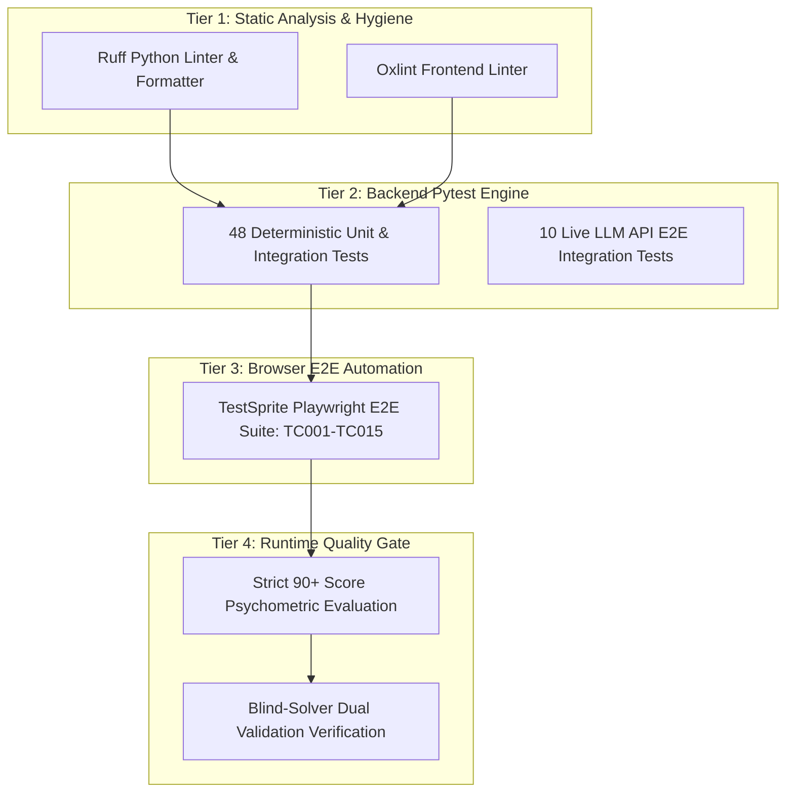

# Testing & Quality Assurance Specification

Engineered by **[Infynno Solutions LLP](https://infynno.com/)** (*"Infinite Innovations"*).

This document details the comprehensive testing architecture, automated quality gates, End-to-End Playwright test specifications, and code hygiene standards governing the **Infynno MCAT Question Bank Generator v2.0**.

---

## 1. Quality Engineering Overview

The system enforces a multi-tiered testing strategy ensuring psychometric integrity, deterministic execution, and seamless user interaction across the entire stack:



| Testing Layer | Scope | Tooling | Coverage / Status |
| :--- | :--- | :--- | :--- |
| **Static Code Hygiene** | PEP 8, syntax correctness, modern JS/JSX idioms | **Ruff** (Python 3.11), **Oxlint** (React 19) | 0 errors, 0 warnings policy (88 frontend files, 68 backend files) |
| **Deterministic Unit & Integration** | Schemas, agents, DAL, API endpoints, tokens, batch runner | **Pytest**, **pytest-asyncio**, SQLite / PG Mock | **48 passing tests** (~16.0s) |
| **Live Multi-Agent Integration** | End-to-end LLM inference, DeepInfra gateways | **Pytest** (`-m live_e2e`) | 10 dedicated live tests |
| **Automated Browser E2E** | Guided wizard, SSE streaming, UI modals, bank CRUD | **Playwright**, **TestSprite AI** | **15/15 passed (100.0%)** |
| **Runtime Psychometric Gate** | 100-point 4-pillar rubric, AAMC distractor traps | **LangGraph StateGraph** | Threshold $> 90$ points |

---

## 2. Backend Pytest Test Suite

The deterministic test suite verifies all backend logic without making live external API calls or incurring token costs.

### 2.1 Test Directory Structure

```
backend/tests/
├── conftest.py                       # Async event loops, mock client fixtures & DB overrides
├── test_agents.py                    # Multi-agent worker nodes, heuristics, and blind solver
├── test_api.py                       # REST endpoints, CRUD, batch staging, and approval
├── test_batch_jobs_flow.py           # Background batch execution lifecycle (10 jobs x 5 questions)
├── test_database_structure.py        # SQLAlchemy schema, hybrid FTS, and atomic aggregations
├── test_multi_batch_concurrency.py   # Global semaphores, rate limiting backoff, and metrics
├── test_pedagogy.py                  # Option symmetry (±15%), distractor traps, and taxonomy parity
├── test_schemas.py                   # Pydantic V2 model validation and serialization
├── test_tokens.py                    # Sub-micro-cent token cost math ($0.098 in / $0.294 out)
├── test_visuals.py                   # SVG vector generation and FLUX image cost formulas
├── test_workflow.py                  # LangGraph streaming, event serialization, and routing
└── test_e2e_live.py                  # Live LLM inference suite (marked as live_e2e)
```

### 2.2 Test Suite Execution Commands

```bash
# 1. Activate backend virtual environment
source .venv/bin/activate

# 2. Run all 48 deterministic unit and integration tests
pytest backend/tests -v -k "not live_e2e"

# 3. Run specific test modules
pytest backend/tests/test_multi_batch_concurrency.py -v
pytest backend/tests/test_agents.py -v
pytest backend/tests/test_pedagogy.py -v

# 4. Run live LLM tests (requires DEEPINFRA_API_KEY in .env)
pytest backend/tests/test_e2e_live.py -v -m live_e2e
```

### 2.3 Detailed Test Module Coverage (48 Tests)

1. **`test_agents.py` (7 tests)**:
   - `test_all_mcat_sections_mock`: Verifies authentic section-specific mock fixtures for Chem/Phys, CARS, Bio/Biochem, and Psych/Soc.
   - `test_reviewer_heuristic_and_loop_routing`: Tests autonomous remediation loop triggers when score $\le 90$.
   - `test_strict_rejection_routing_when_score_le_90`: Verifies circuit-breaker termination when candidate fails after 3 cycles.
   - `test_section_image_guard_routing`: Ensures CARS strictly forbids image generation.
   - `test_generate_question_with_self_critique_structure`: Validates fused single-pass drafting and 100-pt self-critique.
   - `test_blind_solver_node_agreement`: Verifies agreement between blind solver and generator draft.
   - `test_blind_solver_node_discrepancy_triggers_critique`: Verifies that key discrepancies immediately route candidate to reviewer critique.
2. **`test_api.py` (9 tests)**:
   - `test_database_crud`: Full CRUD lifecycle verification against question repository.
   - `test_admin_approval_and_persistence_endpoints`: Verifies admin approval workflow and PostgreSQL persistence.
   - `test_multichoice_and_passage_support`: Validates 4-choice purity and shared stimulus passage handling.
   - `test_batch_generation_and_staging_flow`: End-to-end multi-question staging and approval cycle.
   - `test_single_passage_multi_question_set`: Verifies multiple questions sharing a single passage stimulus.
   - `test_binary_passage_and_independent_batches`: Confirms binary passage mode (all passage-linked or all independent).
   - `test_independent_question_direct_no_stimulus`: Ensures independent questions omit stimulus without errors.
   - `test_passage_set_with_passage_level_visual_stimulus`: Validates shared reading passage diagrams.
   - `test_question_status_lifecycle_and_counts`: Verifies question lifecycle counts and transitions.
3. **`test_batch_jobs_flow.py` (2 tests)**:
   - `test_batch_and_jobs_lifecycle`: End-to-end multi-job batch lifecycle (10 jobs x 5 questions = 50 total).
   - `test_mini_batch_lifecycle`: Validates single-job mini-batch lifecycle (1 job x 5 questions).
4. **`test_database_structure.py` (6 tests)**:
   - `test_database_schema_initialization`: Verifies PostgreSQL tables, columns, and foreign key relations.
   - `test_passage_auto_sync_and_retrieval`: Validates passage synchronization and caching.
   - `test_batch_auto_sync_and_atomic_aggregation`: Ensures atomic calculation of batch metrics.
   - `test_hybrid_full_text_search`: Validates PostgreSQL tsvector hybrid FTS queries.
   - `test_api_passages_and_batches`: Confirms passage and batch REST endpoint contracts.
   - `test_centralized_repository_package_exports`: Ensures clean package exports across DAL layers.
5. **`test_multi_batch_concurrency.py` (4 tests)**:
   - `test_global_concurrency_semaphores`: Confirms `GLOBAL_MAX_CONCURRENT_JOBS = 4` prevents thread saturation.
   - `test_call_llm_rate_limit_backoff`: Validates exponential backoff and jitter under HTTP 429 rate limit responses.
   - `test_refresh_batch_aggregates_atomic`: Ensures atomic SQL aggregation eliminates race conditions between parallel jobs.
   - `test_simultaneous_multi_batch_launch_and_metrics`: Tests simultaneous execution of multiple 50-question batches.
6. **`test_pedagogy.py` (4 tests)**:
   - `test_option_symmetry_and_anti_guessability_engine`: Mathematical validation that options stay within $\pm 15\%$ word count.
   - `test_smart_ai_trap_and_explanation_breakdown`: Tests automatic cognitive trap assignment and 3-card mentor breakdown.
   - `test_manager_dependent_taxonomy_integration`: Verifies official AAMC syllabus tree mapping.
   - `test_taxonomy_json_parity_between_backend_and_frontend`: Enforces identical taxonomy trees across client and server.
7. **`test_schemas.py` (1 test)**:
   - `test_schemas_validation`: Comprehensive Pydantic V2 schema boundary and validation tests.
8. **`test_tokens.py` (6 tests)**:
   - `test_deepinfra_model_configuration`: Verifies model identifier and endpoint settings.
   - `test_token_and_cost_calculation`: Sub-micro-cent mathematical calculation verification ($0.098/$0.294 per 1M).
   - `test_workflow_token_accumulation`: Verifies cumulative token tracking across multi-agent cycles.
   - `test_deepinfra_strict_api_key_enforcement`: Ensures missing API keys fail fast with actionable guidance.
   - `test_max_tokens_settings_and_config_endpoint`: Validates token limit configuration contracts.
   - `test_call_llm_effective_max_tokens_and_temperature`: Confirms temperature and token constraints per agent.
9. **`test_visuals.py` (5 tests)**:
   - `test_strict_ai_image_generator`: Validates SVG vector generator and AI visual filters.
   - `test_flux_image_cost_formula`: Verifies FLUX unit cost scaling ($0.014 normalized baseline).
   - `test_image_node_workflow_accumulation`: Ensures visual synthesis costs accumulate into total run cost.
   - `test_visual_stimulus_persistence_in_finalize_node`: Confirms diagram SVG/URL persistence to PostgreSQL.
   - `test_autonomous_ai_determined_image_workflow`: Validates AI-determined visual stimulus routing.
10. **`test_workflow.py` (4 tests)**:
    - `test_per_question_stage_metadata_in_events`: Verifies SSE event payload metadata and stage tracking.
    - `test_fused_generator_node_passing_and_routing`: Validates fused single-pass drafting and fast-path routing.
    - `test_fused_workflow_bypasses_reviewer_when_self_critique_passed`: Confirms reviewer bypass when score > 90.
    - `test_safe_json_loads_and_resilient_parsing`: Ensures resilient JSON parsing of LLM outputs.

---

## 3. TestSprite AI Playwright E2E Suite (TC001–TC015)

The application includes an automated End-to-End browser test suite executed with Playwright under the TestSprite AI testing harness, achieving a **100% pass rate (15/15 passed)**.

### 3.1 Test Case Matrix

| ID | Test Scenario | Primary User Flow | Automated Verification | Status |
| :---: | :--- | :--- | :--- | :---: |
| **TC001** | Configure and start guided generation | 3-Step Guided Wizard navigation | Validates all 3 wizard step transitions (Section Focus, Level & Format, Review & Launch) and initiates generation. | ✅ Passed |
| **TC002** | Start guided generation from workspace | Generator tab interaction | Launches configuration modal directly from the single-canvas workspace without regressions. | ✅ Passed |
| **TC003** | Complete generation run & review output | Full item generation | Streams single question, verifies 4 options, balanced word counts, and transition to Staged Review. | ✅ Passed |
| **TC004** | Live generation progress & logs | SSE Telemetry tray | Verifies step-by-step agent milestones, stopwatch timer, and collapsible log tray rendering. | ✅ Passed |
| **TC005** | Start guided generation from landing hero | Hero preset shortcuts | Launches wizard pre-configured with official AAMC section presets directly from hero buttons. | ✅ Passed |
| **TC006** | Review completed generation output | Candidate card inspection | Verifies primary cognitive trap chip, dual score pills, and 3-part mentor explanation cards. | ✅ Passed |
| **TC007** | Cancel active generation run | Pipeline interruption | Validates cancel button immediately halts SSE stream and preserves workspace state cleanly. | ✅ Passed |
| **TC008** | Approve staged question into bank | Admin review gate | Approves individual candidate, verifies persistence to PostgreSQL, and verifies question bank sync. | ✅ Passed |
| **TC009** | Start generation with default settings | Quick launch | Verifies generation with zero manual tweaks launches with authentic AAMC defaults. | ✅ Passed |
| **TC010** | Edit staged question & save revision | Inline editor | Edits stem text and options in-place, saves revision, and verifies updated content persists. | ✅ Passed |
| **TC011** | Approve all staged questions at once | Bulk approval | Atomically approves all candidate slots in a batch into the Question Bank in one operation. | ✅ Passed |
| **TC012** | Inspect staged question audit trail | Psychometric audit modal | Opens audit modal, inspects 4-pillar breakdown (25 pts each), per-agent token table, and micro-costs. | ✅ Passed |
| **TC013** | Switch between main workspace views | Tab bar navigation | Seamlessly transitions across Generator Workspace, AI Validated Bank, Question Bank, and Batch Activity. | ✅ Passed |
| **TC014** | Filter question bank | Repository search & filters | Filters repository by section, difficulty, and keyword search with debounced queries. | ✅ Passed |
| **TC015** | Delete question from the bank | Question deletion | Deletes item from bank, confirms modal prompt, and verifies row is purged from repository. | ✅ Passed |

### 3.2 Running E2E Playwright Tests

```bash
# Run individual TestSprite Playwright test scripts
python3 testsprite_tests/TC001_Configure_and_start_guided_question_generation.py
python3 testsprite_tests/TC003_Complete_a_generation_run_and_review_the_results.py
python3 testsprite_tests/TC008_Approve_a_staged_question_into_the_bank.py
```

---

## 4. Code Hygiene, Formatting & Linters

Both backend and frontend enforce strict zero-defect policies in local development and continuous integration.

### 4.1 Python Standards (Ruff)

- **Target Version**: Python 3.11 (`py311`)
- **Max Line Length**: 100 characters
- **Rules Enforced**: `E` (pycodestyle errors), `W` (warnings), `F` (pyflakes), `I` (isort imports), `UP` (pyupgrade modern 3.11 idioms).

```bash
# Check Python code style
ruff check backend

# Automatically fix linting issues
ruff check --fix backend

# Format Python files
ruff format .
```

### 4.2 Frontend Standards (Oxlint)

- **Target**: React 19 JSX & ES2022
- **Scope**: 86 source files, 104 lint rules
- **Policy**: 0 errors, 0 warnings

```bash
# Run frontend linter
pnpm lint
```

---

## 5. Continuous Integration (CI) Pipeline

The repository integrates a GitHub Actions workflow (`.github/workflows/ci.yml`) that validates every pull request:

```yaml
# Summary of CI Verification Steps
1. Checkout repository & setup Python 3.11 + Node.js 20
2. Start PostgreSQL 16 service container
3. Cache & install backend dependencies (pip) & frontend dependencies (pnpm)
4. Execute Ruff linter and formatting checks
5. Execute Oxlint frontend linter
6. Run full Pytest deterministic test suite (48 tests)
7. Execute frontend production build (Vite 8)
```
