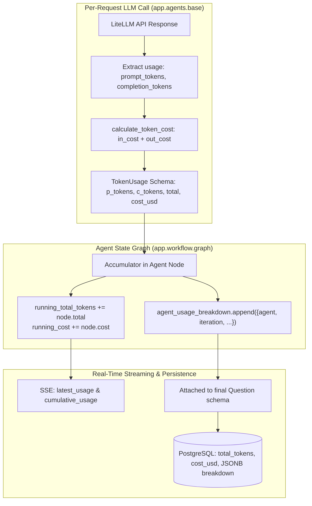

# Per-Request Token Usage & Cost Tracking Specification

This document details the token accounting engine, DeepInfra pricing rate card, accumulation architecture, database persistence, and frontend observability features built into the **UK UCAT Question Bank Generator**.

---

## 1. Inference Engine & Pricing Rate Card

The primary LLM driving the multi-agent system is **Meta Llama 3.3 70B Instruct Turbo**, hosted on **DeepInfra**:

- **Model Identifier**: `deepinfra/meta-llama/Llama-3.3-70B-Instruct-Turbo`
- **Context Window**: 128,000 tokens
- **Inference Speed**: ~110-140 tokens/second

### Official DeepInfra Rate Card

$$\begin{aligned}
\mathbf{Input\ (Prompt)\ Tokens} &: \mathbf{\$0.10}\text{ per 1,000,000 tokens}\ (\text{\$0.00000010 per token}) \\
\mathbf{Output\ (Completion)\ Tokens} &: \mathbf{\$0.32}\text{ per 1,000,000 tokens}\ (\text{\$0.00000032 per token})
\end{aligned}$$

---

## 2. Mathematical Cost Computation Engine

The calculation is implemented in [`backend/app/agents/base.py`](file:///Users/infynnosolutions/Desktop/Code/Question%20Bank%20Generator/backend/app/agents/base.py#L35-L45) via `calculate_token_cost`:

$$\text{Cost}_{\text{USD}} = \left(\frac{\text{Prompt Tokens}}{1,000,000} \times 0.10\right) + \left(\frac{\text{Completion Tokens}}{1,000,000} \times 0.32\right)$$

To preserve numerical accuracy and avoid IEEE 754 floating-point drift, calculations are rounded to **7 decimal places** (sub-micro-cent precision):

```python
def calculate_token_cost(prompt_tokens: int, completion_tokens: int) -> float:
    """Calculates exact USD cost based on official DeepInfra pricing ($0.10 in / $0.32 out / 1M)."""
    in_cost = (prompt_tokens / 1_000_000.0) * config.COST_PER_MILLION_INPUT_TOKENS
    out_cost = (completion_tokens / 1_000_000.0) * config.COST_PER_MILLION_OUTPUT_TOKENS
    return round(in_cost + out_cost, 7)
```

### Calculation Examples

| Scenario | Prompt Tokens ($P$) | Completion Tokens ($C$) | Input Cost | Output Cost | Total Cost (USD) |
| :--- | :---: | :---: | :---: | :---: | :---: |
| **Micro Benchmark (1k / 1k)** | 1,000 | 1,000 | $0.00010 | $0.00032 | **$0.00042** |
| **Generator Pass (Draft v1)** | 450 | 320 | $0.000045 | $0.0001024 | **$0.0001474** |
| **Reviewer Audit Pass** | 380 | 210 | $0.000038 | $0.0000672 | **$0.0001052** |
| **Re-Generator Remediation** | 510 | 390 | $0.000051 | $0.0001248 | **$0.0001758** |
| **2-Cycle Full Question Lifecycle** | 1,720 | 1,130 | $0.000172 | $0.0003616 | **$0.0005336** |
| **1 Million Input Tokens** | 1,000,000 | 0 | $0.10000 | $0.00000 | **$0.10000** |
| **1 Million Output Tokens** | 0 | 1,000,000 | $0.00000 | $0.32000 | **$0.32000** |

---

## 3. FLUX-1-schnell Image Generation Pricing

For visual question stimuli, the system integrates **`black-forest-labs/FLUX-1-schnell`** hosted on **DeepInfra**:

- **Model Identifier**: `black-forest-labs/FLUX-1-schnell`
- **Architecture**: Distilled rectified-flow transformer optimized for 1–4 inference steps.

### Official DeepInfra Image Pricing Formula

$$\mathbf{Price}_{\text{USD}} = \mathbf{\$0.0005} \times \left(\frac{\mathbf{width}}{1024}\right) \times \left(\frac{\mathbf{height}}{1024}\right) \times \mathbf{iters}$$

Where:
* **$\text{width}$**: Pixel width of the generated image (normalized against a $1024$ baseline).
* **$\text{height}$**: Pixel height of the generated image (normalized against a $1024$ baseline).
* **$\text{iters}$**: The number of inference steps (`num_inference_steps`) requested.

### Resolution & Step Variation Cost Table

| Resolution (W × H) | Inference Steps (`iters`) | Scaling Factor | Unit Calculation | Cost per Image (USD) |
| :--- | :---: | :---: | :--- | :---: |
| **1024 × 1024 (Standard)** | **4 steps** | $1.0 \times 1.0$ | $\$0.0005 \times 1 \times 1 \times 4$ | **$0.002000** |
| **1024 × 1024 (Rapid)** | **1 step** | $1.0 \times 1.0$ | $\$0.0005 \times 1 \times 1 \times 1$ | **$0.000500** |
| **768 × 768 (Balanced)** | **4 steps** | $0.75 \times 0.75$ | $\$0.0005 \times 0.5625 \times 4$ | **$0.001125** |
| **512 × 512 (Fast)** | **4 steps** | $0.5 \times 0.5$ | $\$0.0005 \times 0.25 \times 4$ | **$0.000500** |
| **512 × 512 (Draft)** | **1 step** | $0.5 \times 0.5$ | $\$0.0005 \times 0.25 \times 1$ | **$0.000125** |
| **Programmatic SVG Fallback** | — | — | Offline vector diagram | **$0.000000** |

---

## 4. Multi-Agent Accumulation Architecture

Tokens are tracked per-request at the lowest LLM abstraction layer and bubbled up through the LangGraph state graph.



### 3.1 Data Structures

#### `TokenUsage` Schema ([`app/schemas.py`](file:///Users/infynnosolutions/Desktop/Code/Question%20Bank%20Generator/backend/app/schemas.py#L90-L96))
```python
class TokenUsage(BaseModel):
    prompt_tokens: int = Field(0, description="Input tokens processed")
    completion_tokens: int = Field(0, description="Output tokens generated")
    total_tokens: int = Field(0, description="Sum of prompt and completion tokens")
    cost_usd: float = Field(0.0, description="Estimated total cost in USD")
```

#### `agent_usage_breakdown` Item Schema
```json
{
  "agent": "Question Generator",
  "iteration": 1,
  "prompt_tokens": 450,
  "completion_tokens": 320,
  "total_tokens": 770,
  "cost_usd": 0.0001474
}
```

---

## 4. PostgreSQL Persistence & Repository Metrics

Each question persisted in PostgreSQL stores both aggregate summary metrics and the full granular per-cycle audit breakdown:

### Table Columns (`questions`)
| Column Name | SQL Type | Description |
| :--- | :--- | :--- |
| `total_tokens` | `INTEGER DEFAULT 0` | Total tokens consumed across drafting, reviewing, and remediation |
| `prompt_tokens` | `INTEGER DEFAULT 0` | Total input tokens |
| `completion_tokens` | `INTEGER DEFAULT 0` | Total output tokens |
| `cost_usd` | `DOUBLE PRECISION DEFAULT 0.0` | Total USD expense for generating and certifying this question |
| `token_usage_details` | `JSONB` | Granular array of `agent_usage_breakdown` objects |

### Repository-Wide Aggregation
When the client calls `GET /api/questions`, the backend calculates the repository totals in real time:

```python
total_tokens = sum(q.total_tokens or 0 for q in questions)
total_cost_usd = round(sum(q.cost_usd or 0.0 for q in questions), 5)
```

This delivers global repository cost and token totals directly to the Question Bank header.

---

## 5. UI Observability & User Experience

Token and cost data is surfaced across 4 distinct user interfaces in the frontend:

### 1. Multi-Agent State Graph (`AgentVisualizer.jsx`)
- **Cumulative Header Badge**: Displays running totals during live generation:
  $$\text{🪙 2,850 tokens} \quad \bullet \quad \mathbf{\$0.00053}$$
- **Per-Agent Step Badges**: Each agent card shows its specific cycle tokens and cost:
  `450 tok • $0.00015`

### 2. Formatted Question Card (`QuestionCard.jsx`)
- Displays an emerald/cyan metadata chip in the question header:
  `🪙 2,850 tokens • $0.00053`
  giving the user instant visibility into the generation cost of the currently displayed question.

### 3. Psychometric Review & Cost Audit Modal (`ReviewAuditView.jsx`)
- **Summary Metric Cards**: 4-card grid showing Prompt Tokens, Completion Tokens, Total Tokens, and Accumulated Cost.
- **Granular Breakdown Table**: Itemizes every LLM request:
  - Agent Node (`Question Generator`, `Question Reviewer`, `Question Re-Generator`)
  - Execution Cycle / Iteration
  - Prompt Tokens (priced @ $0.10)
  - Completion Tokens (priced @ $0.32)
  - Total Tokens
  - Micro-dollar Cost ($0.000XX)

### 4. Question Bank Repository (`QuestionBank.jsx`)
- **3rd Top Stat Card**: **`REPO TOKENS & COST`** displays total accumulated tokens and total expenditure for the entire database:
  `14,250 ($0.0027)`
- **Table Row Chips**: Each question row includes a compact chip:
  `🪙 2,850 tok • $0.00053`
