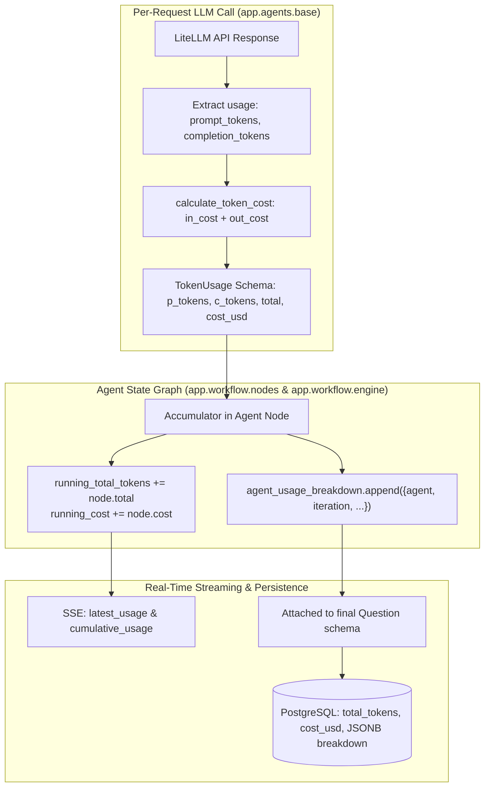

# Per-Request Token Usage & Cost Tracking Specification

Engineered by **[Infynno Solutions LLP](https://infynno.com/)** (*"Infinite Innovations"*).

This document details the token accounting engine, high-throughput pricing rate card, accumulation architecture, database persistence, and frontend observability features built into the **Infynno MCAT Question Bank Generator v2.0**.

---

## 1. Inference Engine & Pricing Rate Card

The primary LLM driving the multi-agent system is **DeepSeek-V4.1-Flash-1017**, hosted on **DeepInfra**:

- **Model Identifier**: `deepinfra/deepseek-ai/DeepSeek-V4.1-Flash-1017`
- **Context Window**: 1,024,000 tokens (1M)
- **Inference Speed**: ~110-140 tokens/second

### Official DeepInfra Rate Card

$$\begin{aligned}
\text{Input (Prompt) Tokens} &: \text{0.098 USD per 1,000,000 tokens} \\
\text{Output (Completion) Tokens} &: \text{0.294 USD per 1,000,000 tokens}
\end{aligned}$$

---

## 2. Mathematical Cost Computation Engine

The calculation is implemented in [`backend/app/agents/base.py`](file:///Users/infynnosolutions/Desktop/Code/Question%20Bank%20Generator/backend/app/agents/base.py#L35-L45) via `calculate_token_cost`:

$$\text{Cost}_{\text{USD}} = \left(\frac{\text{Prompt Tokens}}{1,000,000} \times 0.098\right) + \left(\frac{\text{Completion Tokens}}{1,000,000} \times 0.294\right)$$

To preserve numerical accuracy and avoid IEEE 754 floating-point drift, calculations are rounded to **7 decimal places** (sub-micro-cent precision):

```python
def calculate_token_cost(prompt_tokens: int, completion_tokens: int) -> float:
    """Calculates exact USD cost based on official DeepInfra pricing ($0.098 in / $0.294 out / 1M)."""
    in_cost = (prompt_tokens / 1_000_000.0) * config.COST_PER_MILLION_INPUT_TOKENS
    out_cost = (completion_tokens / 1_000_000.0) * config.COST_PER_MILLION_OUTPUT_TOKENS
    return round(in_cost + out_cost, 7)
```

### Calculation Examples

| Scenario | Prompt Tokens ($P$) | Completion Tokens ($C$) | Input Cost | Output Cost | Total Cost (USD) |
| :--- | :---: | :---: | :---: | :---: | :---: |
| **Micro Benchmark (1k / 1k)** | 1,000 | 1,000 | $0.000098 | $0.000294 | **$0.000392** |
| **Fused Draft & Self-Critique Pass** | 720 | 480 | $0.00007056 | $0.00014112 | **$0.00021168** |
| **Blind-Solver Verification Pass** | 650 | 180 | $0.00006370 | $0.00005292 | **$0.00011662** |
| **Generator Pass (Draft v1)** | 450 | 320 | $0.00004410 | $0.00009408 | **$0.00013818** |
| **Independent Reviewer Audit Pass** | 380 | 210 | $0.00003724 | $0.00006174 | **$0.00009898** |
| **Re-Generator Remediation** | 510 | 390 | $0.00004998 | $0.00011466 | **$0.00016464** |
| **2-Cycle Full Question Lifecycle** | 1,720 | 1,130 | $0.00016856 | $0.00033222 | **$0.00050078** |
| **Full Mock Section (50 Questions)** | ~40,000 | ~28,000 | ~$0.00392 | ~$0.00823 | **~$0.01215** |
| **1 Million Input Tokens** | 1,000,000 | 0 | $0.09800 | $0.00000 | **$0.09800** |
| **1 Million Output Tokens** | 0 | 1,000,000 | $0.00000 | $0.29400 | **$0.29400** |

---

## 3. FLUX-2-klein-4b Image Generation Pricing

For visual question stimuli, the system integrates **`black-forest-labs/FLUX-2-klein-4b`** hosted on **DeepInfra**:

- **Model Identifier**: `black-forest-labs/FLUX-2-klein-4b`
- **Architecture**: Compact rectified-flow transformer delivering prompt adherence, clean white-background test illustrations, and sub-2.0s generation times.

### Official DeepInfra Image Pricing Formula

FLUX-2-klein-4b is billed at a flat rate per image on DeepInfra:

$$\text{Price (USD)} = 0.014 \times \left(\frac{\text{width}}{1024}\right) \times \left(\frac{\text{height}}{1024}\right)$$

Where:
* **$\text{width}$**: Pixel width of the generated image (normalized against a $1024$ baseline).
* **$\text{height}$**: Pixel height of the generated image (normalized against a $1024$ baseline).
* **Dynamic API Telemetry**: The engine automatically extracts and records the exact provider-reported cost from DeepInfra's `inference_status.cost` payload when available.

### Resolution Variation Cost Table

| Resolution (W × H) | Inference Mode | Scaling Factor | Unit Calculation | Cost per Image (USD) |
| :--- | :---: | :---: | :--- | :---: |
| **1024 × 1024 (Standard Quality)** | **Single pass** | $1.0 \times 1.0$ | Flat unit rate | **$0.014000** |
| **768 × 768 (Medium Balanced)** | **Single pass** | $0.75 \times 0.75$ | $0.014 \times 0.5625$ | **$0.007875** |
| **512 × 512 (Fast Lightweight)** | **Single pass** | $0.5 \times 0.5$ | $0.014 \times 0.25$ | **$0.003500** |
| **Programmatic SVG Fallback** | - | - | Offline vector diagram | **$0.000000** |

---

## 4. Multi-Agent Accumulation Architecture

Tokens are tracked per-request at the lowest LLM abstraction layer and bubbled up through the LangGraph state graph.



### 4.1 Data Structures

#### `TokenUsage` Schema ([`app/schemas/token.py`](file:///Users/infynnosolutions/Desktop/Code/Question%20Bank%20Generator/backend/app/schemas/token.py#L9-L15))
```python
class TokenUsage(BaseModel):
    prompt_tokens: int = Field(0, description="Input tokens processed")
    completion_tokens: int = Field(0, description="Output tokens generated")
    total_tokens: int = Field(0, description="Sum of prompt and completion tokens")
    cost_usd: float = Field(0.0, description="Estimated total cost in USD")
```

#### `agent_usage_breakdown` Item Schema
```json
{
  "agent": "Question Writer & Reviewer",
  "iteration": 1,
  "prompt_tokens": 450,
  "completion_tokens": 320,
  "total_tokens": 770,
  "cost_usd": 0.0001474
}
```

---

## 5. PostgreSQL Persistence & Repository Metrics

Each question persisted in PostgreSQL stores both aggregate summary metrics and the full granular per-cycle audit breakdown:

### Table Columns (`questions`)
| Column Name | SQL Type | Description |
| :--- | :--- | :--- |
| `total_tokens` | `INTEGER DEFAULT 0` | Total tokens consumed across drafting, reviewing, and remediation |
| `prompt_tokens` | `INTEGER DEFAULT 0` | Total input tokens |
| `completion_tokens` | `INTEGER DEFAULT 0` | Total output tokens |
| `cost_usd` | `DOUBLE PRECISION DEFAULT 0.0` | Total USD expense for generating and certifying this question |
| `token_usage_details` | `JSONB` | Granular array of `agent_usage_breakdown` objects |

### Repository-Wide Aggregation
When the client calls `GET /api/questions`, the backend queries repository totals via [`question_repository.py`](file:///Users/infynnosolutions/Desktop/Code/Question%20Bank%20Generator/backend/app/repositories/question_repository.py):

```python
total_tokens = sum(q.total_tokens or 0 for q in questions)
total_cost_usd = round(sum(q.cost_usd or 0.0 for q in questions), 5)
```

This delivers global repository cost and token totals directly to the Question Bank header.

---

## 6. UI Observability & User Experience

Token and cost data is surfaced across all 5 top-level views and specialized domain components in the frontend:

### 1. Multi-Agent Pipeline Visualizer ([`MultiAgentPipelineVisualizer.jsx`](file:///Users/infynnosolutions/Desktop/Code/Question%20Bank%20Generator/frontend/src/components/pipeline/MultiAgentPipelineVisualizer.jsx))
- **4-Milestone Pipeline Visualizer**: Tracks live computational usage across the four milestones: `Drafting & Review`, `Answer Check`, `Question Polish`, and `Figures & Diagrams`.
- **Cumulative Header Badge**: Displays running totals during live generation:
  `🪙 2,850 tokens • $0.00053`
- **Per-Agent Step Badges**: Each agent node shows its specific cycle tokens, cost, and status.

### 2. Formatted Question Card ([`QuestionCard.jsx`](file:///Users/infynnosolutions/Desktop/Code/Question%20Bank%20Generator/frontend/src/components/question/QuestionCard.jsx))
- Displays an emerald/cyan metadata chip in the question header:
  `🪙 2,850 tokens • $0.00053`
  giving instant visibility into the generation cost of the displayed question.

### 3. Psychometric Review & Cost Audit Modal ([`ReviewAuditView.jsx`](file:///Users/infynnosolutions/Desktop/Code/Question%20Bank%20Generator/frontend/src/components/question/ReviewAuditView.jsx))
- **Summary Metric Cards**: 4-card grid showing Prompt Tokens, Completion Tokens, Total Tokens, and Accumulated Cost.
- **Granular Breakdown Table**: Itemizes every LLM request with prompt tokens ($0.098 rate), completion tokens ($0.294 rate), total tokens, and micro-dollar cost.

### 4. Question Bank Repository ([`QuestionBankView.jsx`](file:///Users/infynnosolutions/Desktop/Code/Question%20Bank%20Generator/frontend/src/views/QuestionBankView.jsx))
- **Repository Stat Metric**: Displays total accumulated tokens and total expenditure for the entire database:
  `14,250 ($0.0027)`
- **Editorial Card Chips**: Each question card includes a compact chip:
  `🪙 2,850 tok • $0.00053`

### 5. Staged Batch Review Deck ([`StagedBatchReview.jsx`](file:///Users/infynnosolutions/Desktop/Code/Question%20Bank%20Generator/frontend/src/components/staged/StagedBatchReview.jsx))
- Displays cumulative batch token consumption and aggregate batch cost before admin approval via [`BatchProgressHeader.jsx`](file:///Users/infynnosolutions/Desktop/Code/Question%20Bank%20Generator/frontend/src/components/staged/BatchProgressHeader.jsx).
- Allows educators to inspect individual slot cards with their respective token weights and reviewer scores.

### 6. AI Validated Quality Bank ([`AiValidatedQuestionsView.jsx`](file:///Users/infynnosolutions/Desktop/Code/Question%20Bank%20Generator/frontend/src/views/AiValidatedQuestionsView.jsx))
- Header stats bar displays total AI-validated items and total cost of verified inventory.

### 7. Batch Activity Monitor ([`BatchActivityView.jsx`](file:///Users/infynnosolutions/Desktop/Code/Question%20Bank%20Generator/frontend/src/views/BatchActivityView.jsx))
- Aggregates running token totals across parallel jobs for 50-question background mock runs.
