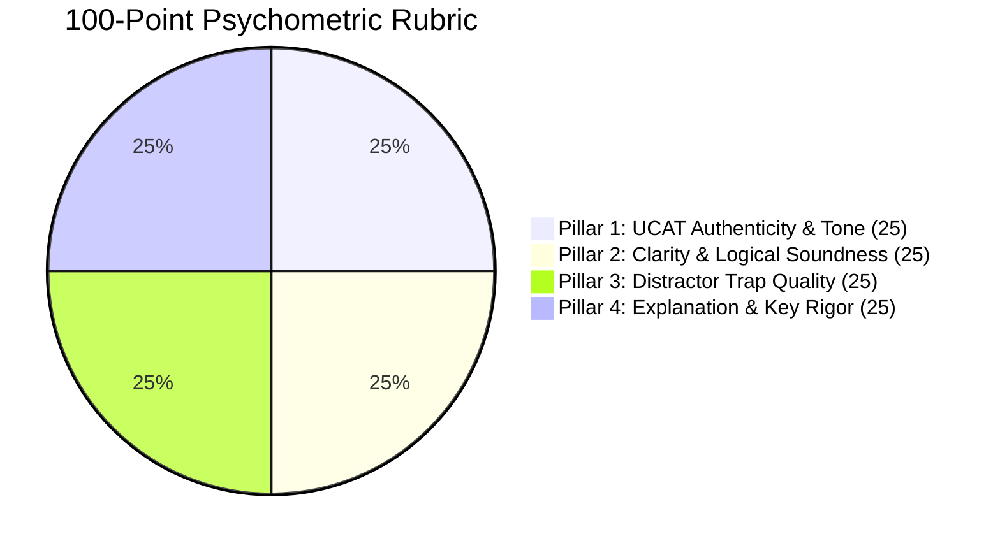

# UK UCAT 100-Point Psychometric Rubric & Question Authoring Standards

Engineered by **[Infynno Solutions LLP](https://infynno.com/)** (*"Infinite Innovations"*).

This document specifies the psychometric standards, 100-point quality rubric, cognitive distractor trap engineering principles, and pacing guidelines governing the **UK UCAT Question Studio v2.0**.

---

## 1. The UK UCAT Examination Overview

The **University Clinical Aptitude Test (UCAT)** is the standardized admissions test utilised by the vast majority of UK medical and dental schools (including Oxford, Cambridge, Imperial, UCL, King's College London, Edinburgh, and Manchester). 

It does not assess curriculum science knowledge; rather, it measures **innate cognitive abilities**, **critical reasoning under extreme time pressure**, **logical deduction**, and **ethical integrity**.

### 1.1 The 5 Official Subtests & Time Allocations

| Subtest | Questions | Time Limit | Target Pacing | Core Focus |
| :--- | :---: | :---: | :---: | :--- |
| **Verbal Reasoning (VR)** | 44 | 21 mins | **~28s / question** | Critical reading of dense academic/medical passages; filtering facts from unwarranted assumptions. |
| **Decision Making (DM)** | 29 | 31 mins | **~64s / question** | Syllogistic logic, Venn diagram sets, probabilistic trees, evaluating strong vs weak arguments. |
| **Quantitative Reasoning (QR)** | 36 | 25 mins | **~41s / question** | Rapid clinical/mathematical problem solving (dosages, percentage yields, geometry, rate conversions). |
| **Abstract Reasoning (AR)** | 50 | 12 mins | **~14s / question** | Rapid pattern recognition, spatial orientation, transformation symmetries across Set A vs Set B vs Neither. |
| **Situational Judgement (SJT)** | 66 | 26 mins | **~23s / question** | Clinical workplace dilemmas, patient safety, professional boundaries, GMC *Good Medical Practice* compliance. |

---

## 2. The 100-Point Psychometric Rubric

Every candidate question drafted by the Question Generator Agent is audited independently by the Question Reviewer Agent against a standardized **100-point rubric** divided into 4 equal 25-point pillars:

---

### Pillar 1: UCAT Authenticity & Tone (0 - 25 Points)
Evaluates whether the stimulus passage and prompt match the exact linguistic style, vocabulary density, and intellectual register of official Pearson VUE UCAT exam papers.

| Score Range | Descriptor | Criteria |
| :---: | :--- | :--- |
| **23 - 25** | *Flawless Authenticity* | Indistinguishable from official UCAT consortium questions. British English spelling, sophisticated vocabulary, authentic academic or clinical vignette style. |
| **19 - 22** | *Strong Authenticity* | Minor stylistic variance, but conceptually indistinguishable from authentic items. Appropriate clinical or logical tone. |
| **14 - 18** | *Borderline* | Slightly simplistic language, non-British idioms, or scenario mildly uncharacteristic of UCAT testing conventions. |
| **0 - 13** | *Unacceptable* | Trivia-like question, cartoonish scenario, or tone entirely foreign to professional medical admissions testing. |

---

### Pillar 2: Clarity & Logical Soundness (0 - 25 Points)
Ensures the question stem is unambiguous, free from syntactic confusion, and logically watertight.

| Score Range | Descriptor | Criteria |
| :---: | :--- | :--- |
| **23 - 25** | *Axiomatic Precision* | Absolute clarity. The question stem is concise and directs the candidate unequivocally. The premise contains all necessary information without extraneous ambiguity. |
| **19 - 22** | *Sound & Clear* | Premise is logically valid with minimal extraneous fluff; stem is straightforward. |
| **14 - 18** | *Ambiguous* | Borderline double-negative phrasing or subtle loophole in the stimulus that creates legitimate contention. |
| **0 - 13** | *Logically Flawed* | Premise contradicts itself, missing crucial data required to solve, or multiple contradictory interpretations exist. |

---

### Pillar 3: Distractor Trap Quality (0 - 25 Points)
The defining hallmark of authentic UCAT questions is the quality of the 3 incorrect options. UCAT distractors are **never random or obviously wrong**; they are deliberate psychological traps.

| Score Range | Descriptor | Criteria |
| :---: | :--- | :--- |
| **23 - 25** | *Masterful Cognitive Traps* | All 3 distractors represent sophisticated, predictable cognitive errors: common calculation slips, inverted logical quantifiers, or alluring unwarranted assumptions. |
| **19 - 22** | *Plausible Distractors* | At least 2 distractors require rigorous elimination; 1 distractor is slightly easier to discard. |
| **14 - 18** | *Weak Distractors* | 2 or more distractors are trivial or easily eliminated by process of elimination without engaging with the stimulus. |
| **0 - 13** | *Nonsensical Options* | Distractors are comical, out of scope, or wildly distinct in grammatical structure from the key. |

---

### Pillar 4: Explanation & Key Rigor (0 - 25 Points)
Evaluates the educational depth and logical definitiveness of the correct key and step-by-step rationale.

| Score Range | Descriptor | Criteria |
| :---: | :--- | :--- |
| **23 - 25** | *Gold-Standard Rationale* | Complete step-by-step proof explaining why the key is undeniably correct AND explicitly disproving every single distractor by name with cognitive error analysis. |
| **19 - 22** | *Comprehensive* | Proves the correct key clearly; addresses primary distractors with satisfactory detail. |
| **14 - 18** | *Partial Explanation* | States why the correct answer is right but fails to explain why the distractors are incorrect. |
| **0 - 13** | *Inadequate* | Restates the answer key with zero pedagogical reasoning or deductive proof. |

---

## 3. Strict Quality Gate Threshold ($> 90$ Benchmark)

The system enforces an uncompromising quality threshold:

$$\mathbf{Passing\ Benchmark:\ Score} > \mathbf{90\ points}\ (91 - 100)$$
$$\mathbf{Remediation\ Loop:\ Score} \le \mathbf{90\ points}\ (0 - 90)$$

### The Dual-Stage Evaluation Protocol
The 100-point rubric operates across two coordinated mechanisms:
1. **Stage 1 (Fused Draft & Self-Critique)**: The Question Generator performs an immediate, rigorous 4-pillar self-audit in the same inference round-trip as item drafting. If the self-score is $> 90$, the candidate item passes immediately without requiring a redundant second LLM call, reducing latency by $\sim 35 - 45\%$.
2. **Stage 2 (Remediation & Independent Audit)**: If the draft scores $\le 90$ points, the Autonomous Remediation Engine repairs the item based on the critique, and the Independent Senior Psychometric Auditor re-scores the revised candidate.
3. **Cycle 3 (Final Polish)**: If still $\le 90$, re-attempted once more.
4. **Strict Quality Gate Reject**: If a draft fails to score $> 90$ by Cycle 3, the circuit breaker halts and discards the question entirely. Zero substandard questions enter the repository.

---

## 4. Distractor Engineering Principles

When generating distractors for UCAT multiple-choice items, the system applies the following taxonomy of psychological traps:

### 4.1 The "Partial Premise" Trap (Verbal & Decision Making)
- *Mechanism*: Uses verbatim terminology from the stimulus passage, but links two concepts that the passage discussed separately without establishing causality.
- *Candidate Bias*: Recognition heuristic (candidates mistake familiar keywords for truth).

### 4.2 The "Extreme Quantifier" Trap (Verbal & Decision Making)
- *Mechanism*: Converts a nuanced probabilistic premise ("many patients benefit") into an absolute claim ("all patients benefit" or "only patients under 40 benefit").
- *Candidate Bias*: Overgeneralisation.

### 4.3 The "Intermediate Calculation" Trap (Quantitative Reasoning)
- *Mechanism*: Matches the numerical output of Step 1 or Step 2 in a 3-step calculation (e.g., daily dose before dividing by 3 infusions; or total cost before applying 20% VAT rebate).
- *Candidate Bias*: Premature closure under strict 41-second pacing.

### 4.4 The "Inverted Ratio / Directional" Trap (Quantitative Reasoning)
- *Mechanism*: Inverts the numerator and denominator or calculates $\frac{A - B}{B}$ instead of $\frac{B - A}{A}$.

### 4.5 The "Sub-Pattern Distractor" (Abstract Reasoning)
- *Mechanism*: Satisfies the primary pattern rule of Set A (e.g., even number of circles) but violates the secondary conditional rule (e.g., shapes must alternate in shading).

---

## 5. Option Symmetry & Anti-Guessability Standards

A critical flaw in standard AI question authoring is the inadvertent introduction of test-wiseness cues. The studio enforces strict mathematical and grammatical symmetry across all options (the correct answer and all distractors):

### 5.1 Length & Word Count Parity
- **The $\pm 15\%$ Word Count Rule**: All four options (A, B, C, D) must have approximately equal length and word count (within $\pm 15\%$ or within 2-4 words of each other).
- **Zero "Longest Option" Tell-Tales**: Off-the-shelf LLMs frequently write the correct answer with extra qualifiers, making it noticeably longer than distractors. If the correct key is $\ge 20\%$ longer than the distractors, the psychometric reviewer automatically docks 5 to 8 points from Pillar 3 (*Distractor Trap Quality*).

### 5.2 Grammatical & Syntactical Parallelism
- **Parallel Part of Speech**: Every option in a question must begin with the identical grammatical construct:
  - All imperative verbs (e.g., *"Prescribe...", "Request...", "Refer..."*)
  - All gerunds (e.g., *"Administering...", "Conducting...", "Evaluating..."*)
  - All noun phrases (e.g., *"The immediate elevation...", "The secondary reduction..."*)
  - All complete declarative sentences.
- **Syntactic Cadence**: Options must maintain identical rhythmic and structural complexity so no single option appears more qualified or scholarly than the others.

### 5.3 Uniform Epistemic Hedging & Qualifiers
- **Balanced Hedging**: Do NOT use hedging language (*"may", "tends to", "in certain conditions", "often"*) exclusively in the correct answer while using absolute terms (*"always", "never", "only", "completely"*) in distractors. All choices must maintain an equivalent level of epistemic qualification.

---

## 6. Anti-AI Punctuation & Dash Standard

To ensure human authorial authenticity and eliminate synthetic AI artifacts:
- **Strict Prohibition**: Em dashes (`—`), en dashes (`–`), and double hyphens (`--`) are strictly forbidden across question stems, reading passage stimuli, option text, and pedagogical explanations.
- **Single Hyphen Rule**: Use only standard single hyphens (`-`) where compound adjectives or numerical ranges are grammatically necessary (e.g., `pre-clinical`, `15-20 minutes`, `Option A - incorrect`).
- **Reviewer Enforcement**: The presence of an em dash triggers an immediate penalty in Pillar 1 (*UCAT Authenticity & Tone*).

---

## 7. Conversational Mentor Explanation Architecture

Rather than cold, clinical answer keys, all explanations adhere to a warm, conversational tutor persona:

### 7.1 Emulating a 1-on-1 Clinical Mentor
- **Intuitive Entry Point**: Explanations begin with the core intuition so students grasp the big picture before diving into mathematical or formal syllogistic proofs.
- **Dual-Section Structure**:
  1. **Mentor Walkthrough & Winning Strategy**: A step-by-step breakdown proving why the correct key is incontrovertible, accompanied by encouraging, constructive commentary.
  2. **Trap Breakdown (Why Other Options Fail)**: A dedicated analysis of each incorrect choice (Options A, B, C, D), explicitly stating why an applicant might be tempted by it and the exact cognitive trap that disqualifies it.

---

## 8. Reading Stimulus Calibration & Question Style Mix

### 8.1 Passage-Linked vs Independent Direct Questions
- **Passage-Linked Items (`passage_required == "Yes"`)**: Accompanied by a 250-400 word academic or clinical reading passage with high information density, paragraph structure, and medical terminology.
- **Independent Direct Questions (`passage_required == "No"`)**: `stimulus_text` is kept strictly empty (`""`). The question stem must pose the entire calculation, scenario, or logical premise directly, avoiding unnecessary narrative filler.

### 8.2 Single Choice vs Multi-Choice Format
- **Single Choice (Standard)**: Exactly 4 options (A-D) with exactly one correct key (`correct_answer_id: "B"`).
- **Multi-Choice (Specialized)**: 4 to 5 options (A-E) where the stem explicitly specifies the requirement (e.g., *"Which TWO of the following...", "Select all that apply"*), paired with an array of correct keys (`correct_answer_ids: ["A", "C"]`).

