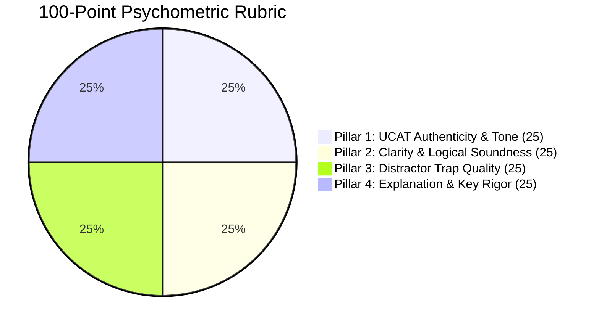

# UK UCAT 100-Point Psychometric Rubric & Question Authoring Standards

This document specifies the psychometric standards, 100-point quality rubric, cognitive distractor trap engineering principles, and pacing guidelines governing the **UK UCAT Question Bank Generator**.

---

## 1. The UK UCAT Examination Overview

The **University Clinical Aptitude Test (UCAT)** is the standardized admissions test utilised by the vast majority of UK medical and dental schools (including Oxford, Cambridge, Imperial, UCL, King's College London, Edinburgh, and Manchester). 

It does not assess curriculum science knowledge; rather, it measures **innate cognitive abilities**, **critical reasoning under extreme time pressure**, **logical deduction**, and **ethical integrity**.

### 1.1 The 5 Official Subtests & Time Allocations

| Subtest | Questions | Time Limit | Target Pacing | Core Focus |
| :--- | :---: | :---: | :---: | :--- |
| **Verbal Reasoning (VR)** | 44 | 21 mins | **~28s / question** | Critical reading of dense academic/medical passages; filtering facts from unwarranted assumptions. |
| **Decision Making (DM)** | 29 | 31 mins | **~64s / question** | Syllogistic logic, Venn diagram sets, probabilistic trees, evaluating strong vs weak arguments. |
| **Quantitative Reasoning (QR)** | 36 | 25 mins | **~41s / question** | Rapid clinical/mathematical problem solving (dosages, percentage yields, geometry, rate conversions). |
| **Abstract Reasoning (AR)** | 50 | 12 mins | **~14s / question** | Rapid pattern recognition, spatial orientation, transformation symmetries across Set A vs Set B vs Neither. |
| **Situational Judgement (SJT)** | 66 | 26 mins | **~23s / question** | Clinical workplace dilemmas, patient safety, professional boundaries, GMC *Good Medical Practice* compliance. |

---

## 2. The 100-Point Psychometric Rubric

Every candidate question drafted by the Question Generator Agent is audited independently by the Question Reviewer Agent against a standardized **100-point rubric** divided into 4 equal 25-point pillars:

---

### Pillar 1: UCAT Authenticity & Tone (0 – 25 Points)
Evaluates whether the stimulus passage and prompt match the exact linguistic style, vocabulary density, and intellectual register of official Pearson VUE UCAT exam papers.

| Score Range | Descriptor | Criteria |
| :---: | :--- | :--- |
| **23 – 25** | *Flawless Authenticity* | Indistinguishable from official UCAT consortium questions. British English spelling, sophisticated vocabulary, authentic academic or clinical vignette style. |
| **19 – 22** | *Strong Authenticity* | Minor stylistic variance, but conceptually indistinguishable from authentic items. Appropriate clinical or logical tone. |
| **14 – 18** | *Borderline* | Slightly simplistic language, non-British idioms, or scenario mildly uncharacteristic of UCAT testing conventions. |
| **0 – 13** | *Unacceptable* | Trivia-like question, cartoonish scenario, or tone entirely foreign to professional medical admissions testing. |

---

### Pillar 2: Clarity & Logical Soundness (0 – 25 Points)
Ensures the question stem is unambiguous, free from syntactic confusion, and logically watertight.

| Score Range | Descriptor | Criteria |
| :---: | :--- | :--- |
| **23 – 25** | *Axiomatic Precision* | Absolute clarity. The question stem is concise and directs the candidate unequivocally. The premise contains all necessary information without extraneous ambiguity. |
| **19 – 22** | *Sound & Clear* | Premise is logically valid with minimal extraneous fluff; stem is straightforward. |
| **14 – 18** | *Ambiguous* | Borderline double-negative phrasing or subtle loophole in the stimulus that creates legitimate contention. |
| **0 – 13** | *Logically Flawed* | Premise contradicts itself, missing crucial data required to solve, or multiple contradictory interpretations exist. |

---

### Pillar 3: Distractor Trap Quality (0 – 25 Points)
The defining hallmark of authentic UCAT questions is the quality of the 3 incorrect options. UCAT distractors are **never random or obviously wrong**; they are deliberate psychological traps.

| Score Range | Descriptor | Criteria |
| :---: | :--- | :--- |
| **23 – 25** | *Masterful Cognitive Traps* | All 3 distractors represent sophisticated, predictable cognitive errors: common calculation slips, inverted logical quantifiers, or alluring unwarranted assumptions. |
| **19 – 22** | *Plausible Distractors* | At least 2 distractors require rigorous elimination; 1 distractor is slightly easier to discard. |
| **14 – 18** | *Weak Distractors* | 2 or more distractors are trivial or easily eliminated by process of elimination without engaging with the stimulus. |
| **0 – 13** | *Nonsensical Options* | Distractors are comical, out of scope, or wildly distinct in grammatical structure from the key. |

---

### Pillar 4: Explanation & Key Rigor (0 – 25 Points)
Evaluates the educational depth and logical definitiveness of the correct key and step-by-step rationale.

| Score Range | Descriptor | Criteria |
| :---: | :--- | :--- |
| **23 – 25** | *Gold-Standard Rationale* | Complete step-by-step proof explaining why the key is undeniably correct AND explicitly disproving every single distractor by name with cognitive error analysis. |
| **19 – 22** | *Comprehensive* | Proves the correct key clearly; addresses primary distractors with satisfactory detail. |
| **14 – 18** | *Partial Explanation* | States why the correct answer is right but fails to explain why the distractors are incorrect. |
| **0 – 13** | *Inadequate* | Restates the answer key with zero pedagogical reasoning or deductive proof. |

---

## 3. Strict Quality Gate Threshold ($> 90$ Benchmark)

The system enforces an uncompromising quality threshold:

$$\mathbf{Passing\ Benchmark:\ Score} > \mathbf{90\ points}\ (91 - 100)$$
$$\mathbf{Remediation\ Loop:\ Score} \le \mathbf{90\ points}\ (0 - 90)$$

### Why $\le 90$ Triggers Remediation
A score of 88 or 90 indicates a good question with a minor flaw (e.g., one slightly weak distractor or an explanation lacking explicit distractor counterproofs). In medical admissions preparation, a borderline distractor can miscalibrate student test strategy.

1. **Cycle 1 (Initial Draft)**: Scored by Reviewer.
2. **Cycle 2 (Remediation)**: If score $\le 90$, Re-Generator Agent addresses specific reviewer critiques.
3. **Cycle 3 (Final Polish)**: If still $\le 90$, re-attempted once more.
4. **Strict Rejection**: If a draft fails to score $> 90$ by Cycle 3, the **Strict Quality Gate** discards the question entirely.

---

## 4. Distractor Engineering Principles

When generating distractors for UCAT multiple-choice items, the system applies the following taxonomy of psychological traps:

### 4.1 The "Partial Premise" Trap (Verbal & Decision Making)
- *Mechanism*: Uses verbatim terminology from the stimulus passage, but links two concepts that the passage discussed separately without establishing causality.
- *Candidate Bias*: Recognition heuristic (candidates mistake familiar keywords for truth).

### 4.2 The "Extreme Quantifier" Trap (Verbal & Decision Making)
- *Mechanism*: Converts a nuanced probabilistic premise ("many patients benefit") into an absolute claim ("all patients benefit" or "only patients under 40 benefit").
- *Candidate Bias*: Overgeneralisation.

### 4.3 The "Intermediate Calculation" Trap (Quantitative Reasoning)
- *Mechanism*: Matches the numerical output of Step 1 or Step 2 in a 3-step calculation (e.g., daily dose before dividing by 3 infusions; or total cost before applying 20% VAT rebate).
- *Candidate Bias*: Premature closure under strict 41-second pacing.

### 4.4 The "Inverted Ratio / Directional" Trap (Quantitative Reasoning)
- *Mechanism*: Inverts the numerator and denominator or calculates $\frac{A - B}{B}$ instead of $\frac{B - A}{A}$.

### 4.5 The "Sub-Pattern Distractor" (Abstract Reasoning)
- *Mechanism*: Satisfies the primary pattern rule of Set A (e.g., even number of circles) but violates the secondary conditional rule (e.g., shapes must alternate in shading).
