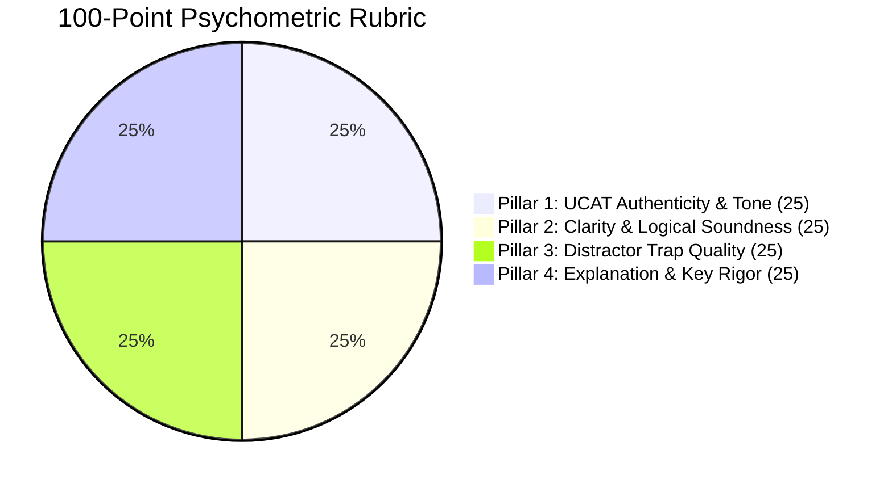

# UK UCAT 100-Point Psychometric Rubric & Question Authoring Standards

Engineered by **[Infynno Solutions LLP](https://infynno.com/)** (*"Infinite Innovations"*).

This document specifies the psychometric standards, 100-point quality rubric, cognitive distractor trap engineering principles, and pacing guidelines governing the **UK UCAT Question Studio v2.0**.

---

## 1. The UK UCAT Examination Overview

The **University Clinical Aptitude Test (UCAT)** is the standardized admissions test utilised by the vast majority of UK medical and dental schools (including Oxford, Cambridge, Imperial, UCL, King's College London, Edinburgh, and Manchester). 

It does not assess curriculum science knowledge; rather, it measures **innate cognitive abilities**, **critical reasoning under extreme time pressure**, **logical deduction**, and **ethical integrity**.

### 1.1 The 5 Official Subtests & Time Allocations

| Subtest | Questions | Time Limit | Target Pacing | Core Focus |
| :--- | :---: | :---: | :---: | :--- |
| **Verbal Reasoning (VR)** | 44 | 21 mins | **~28s / question** | Critical reading of dense academic/medical passages; filtering facts from unwarranted assumptions. |
| **Decision Making (DM)** | 29 | 31 mins | **~64s / question** | Syllogistic logic, Venn diagram sets, probabilistic trees, evaluating strong vs weak arguments. |
| **Quantitative Reasoning (QR)** | 36 | 25 mins | **~41s / question** | Rapid clinical/mathematical problem solving (dosages, percentage yields, geometry, rate conversions). |
| **Abstract Reasoning (AR)** | 50 | 12 mins | **~14s / question** | Rapid pattern recognition, spatial orientation, transformation symmetries across Set A vs Set B vs Neither. |
| **Situational Judgement (SJT)** | 66 | 26 mins | **~23s / question** | Clinical workplace dilemmas, patient safety, professional boundaries, GMC *Good Medical Practice* compliance. |

---

## 2. The 100-Point Psychometric Rubric

Every candidate question drafted by the **Question Writer & Reviewer** agent is audited against a standardized **100-point rubric** divided into 4 equal 25-point pillars (with instant self-critique scoring in Stage 1 and independent auditor re-scoring during remediation in Stage 2):

---

### Pillar 1: UCAT Authenticity & Tone (0 - 25 Points)
Evaluates whether the stimulus passage and prompt match the exact linguistic style, vocabulary density, and intellectual register of official Pearson VUE UCAT exam papers.

| Score Range | Descriptor | Criteria |
| :---: | :--- | :--- |
| **23 - 25** | *Flawless Authenticity* | Indistinguishable from official UCAT consortium questions. British English spelling, sophisticated vocabulary, authentic academic or clinical vignette style. |
| **19 - 22** | *Strong Authenticity* | Minor stylistic variance, but conceptually indistinguishable from authentic items. Appropriate clinical or logical tone. |
| **14 - 18** | *Borderline* | Slightly simplistic language, non-British idioms, or scenario mildly uncharacteristic of UCAT testing conventions. |
| **0 - 13** | *Unacceptable* | Trivia-like question, cartoonish scenario, or tone entirely foreign to professional medical admissions testing. |

---

### Pillar 2: Clarity & Logical Soundness (0 - 25 Points)
Ensures the question stem is unambiguous, free from syntactic confusion, and logically watertight.

| Score Range | Descriptor | Criteria |
| :---: | :--- | :--- |
| **23 - 25** | *Axiomatic Precision* | Absolute clarity. The question stem is concise and directs the candidate unequivocally. The premise contains all necessary information without extraneous ambiguity. |
| **19 - 22** | *Sound & Clear* | Premise is logically valid with minimal extraneous fluff; stem is straightforward. |
| **14 - 18** | *Ambiguous* | Borderline double-negative phrasing or subtle loophole in the stimulus that creates legitimate contention. |
| **0 - 13** | *Logically Flawed* | Premise contradicts itself, missing crucial data required to solve, or multiple contradictory interpretations exist. |

---

### Pillar 3: Distractor Trap Quality (0 - 25 Points)
The defining hallmark of authentic UCAT questions is the quality of the 3 incorrect options. UCAT distractors are **never random or obviously wrong**; they are deliberate psychological traps.

| Score Range | Descriptor | Criteria |
| :---: | :--- | :--- |
| **23 - 25** | *Masterful Cognitive Traps* | All 3 distractors represent sophisticated, predictable cognitive errors: common calculation slips, inverted logical quantifiers, or alluring unwarranted assumptions. |
| **19 - 22** | *Plausible Distractors* | At least 2 distractors require rigorous elimination; 1 distractor is slightly easier to discard. |
| **14 - 18** | *Weak Distractors* | 2 or more distractors are trivial or easily eliminated by process of elimination without engaging with the stimulus. |
| **0 - 13** | *Nonsensical Options* | Distractors are comical, out of scope, or wildly distinct in grammatical structure from the key. |

---

### Pillar 4: Explanation & Key Rigor (0 - 25 Points)
Evaluates the educational depth and logical definitiveness of the correct key and step-by-step rationale.

| Score Range | Descriptor | Criteria |
| :---: | :--- | :--- |
| **23 - 25** | *Gold-Standard Rationale* | Complete step-by-step proof explaining why the key is undeniably correct AND explicitly disproving every single distractor by name with cognitive error analysis. |
| **19 - 22** | *Comprehensive* | Proves the correct key clearly; addresses primary distractors with satisfactory detail. |
| **14 - 18** | *Partial Explanation* | States why the correct answer is right but fails to explain why the distractors are incorrect. |
| **0 - 13** | *Inadequate* | Restates the answer key with zero pedagogical reasoning or deductive proof. |

---

## 3. Strict Quality Gate Threshold ($> 90$ Benchmark)

The system enforces an uncompromising quality threshold:

$$\mathbf{Passing\ Benchmark:\ Score} > \mathbf{90\ points}\ (91 - 100)$$
$$\mathbf{Remediation\ Loop:\ Score} \le \mathbf{90\ points}\ (0 - 90)$$

### The Dual-Stage Evaluation Protocol
The 100-point rubric operates across two coordinated mechanisms:
1. **Stage 1 (Fused Draft & Self-Critique)**: The **Question Writer & Reviewer** performs an immediate, rigorous 4-pillar self-audit in the same inference round-trip as item drafting. If the self-score is $> 90$, the candidate item passes immediately without requiring a redundant second LLM call, reducing latency by $\sim 35 - 45\%$.
2. **Stage 2 (Remediation & Independent Audit)**: If the draft scores $\le 90$ points, the Autonomous Remediation Engine repairs the item based on the critique, and the Independent Senior Psychometric Auditor re-scores the revised candidate.
3. **Cycle 3 (Final Polish)**: If still $\le 90$, re-attempted once more.
4. **Strict Quality Gate Reject**: If a draft fails to score $> 90$ by Cycle 3, the circuit breaker halts and discards the question entirely. Zero substandard questions enter the repository.

---

## 4. Distractor Engineering Principles & Cognitive Trap Taxonomy

When generating distractors for UCAT multiple-choice items, the system applies an authoritative taxonomy of 11 psychological traps. Each question explicitly engineers one primary cognitive trap, accompanied by detailed error mechanisms and student defense strategies:

### 4.1 Authoritative 11-Trap Cognitive Taxonomy Reference Table

| Trap Key | Display Label | Error Mechanism | Student Defense Strategy |
| :--- | :--- | :--- | :--- |
| `Scope_Shift` | Scope Shift | Broadens or narrows the stimulus timeframe, population, or geographic context beyond the author's stated boundary. | Check whether findings from a specific cohort or timeframe are being misapplied to a wider or different demographic. |
| `Keyword_Trap` | Keyword Trap | Uses identical verbatim phrasing from the text but alters the grammatical subject, object, or directional causality. | Never pick an option solely because words match the text; verify that the relational logic between keywords is conserved. |
| `Extreme_Language` | Extreme Language | Employs absolute qualifiers (*always*, *never*, *all*, *completely*, *only*) when the text warrants only probabilistic or qualified claims. | Treat words like *always*, *never*, and *solely* as immediate red flags requiring airtight justification in the passage. |
| `Correlation_vs_Causation` | Correlation vs Causation | Treats statistical association, co-occurrence, or temporal sequence as direct biological or mechanical causation. | Distinguish between observational co-occurrence and proven causative mechanisms. |
| `Partial_Match` | Partial Match | Presents a statement that is 80% accurate based on the premise but introduces a subtle, fatal factual distortion in its concluding clause. | Verify every clause of an option rather than stopping after confirming the first half. |
| `Half_Truth` | Half Truth | Combines a genuinely true factual premise with an invalid inference or unsubstantiated conclusion. | Confirm that the concluding inference is logically forced by the premise, not just plausibly related. |
| `Unwarranted_Assumption` | Unwarranted Assumption | Relies on plausible external real-world clinical knowledge not provided or supported by the stimulus text. | Base answers strictly on the four corners of the provided text; do not import outside medical general knowledge. |
| `Calculation_Trap` | Calculation Trap | Mirrors an intermediate mathematical result (Step 1 of 3) or incorporates an inverted ratio / unit conversion oversight. | Execute multi-step calculations to final completion; check units and denominator definitions before matching answers. |
| `Out_of_Scope` | Out of Scope | Introduces topics, variables, or outcomes that appear clinically relevant but are entirely unaddressed by the author. | Discard choices that wander outside the boundaries of the specific research questions investigated in the stimulus. |
| `False_Dichotomy` | False Dichotomy | Artificially constrains a scenario to two mutually exclusive extremes when intermediate or alternative outcomes exist. | Identify whether unstated middle-ground alternatives exist that invalidate the either/or premise. |
| `Over_generalisation` | Over-generalisation | Extrapolates a narrow finding (e.g. in vitro cell cultures or single hospital pilot) into universal clinical dogma. | Verify whether conclusions exceed the demographic scale or statistical power of the initial study sample. |

---

## 5. Option Symmetry & Anti-Guessability Standards

A critical flaw in standard AI question authoring is the inadvertent introduction of test-wiseness cues. The studio enforces strict mathematical and grammatical symmetry across all options (the correct answer and all distractors):

### 5.1 Length & Word Count Parity
- **The $\pm 15\%$ Word Count Rule**: All four options (A, B, C, D) must have approximately equal length and word count (within $\pm 15\%$ or within 2-4 words of each other).
- **Zero "Longest Option" Tell-Tales**: Off-the-shelf LLMs frequently write the correct answer with extra qualifiers, making it noticeably longer than distractors. If the correct key is $\ge 20\%$ longer than the distractors, the psychometric reviewer automatically docks 5 to 8 points from Pillar 3 (*Distractor Trap Quality*).

### 5.2 Grammatical & Syntactical Parallelism
- **Parallel Part of Speech**: Every option in a question must begin with the identical grammatical construct:
  - All imperative verbs (e.g., *"Prescribe...", "Request...", "Refer..."*)
  - All gerunds (e.g., *"Administering...", "Conducting...", "Evaluating..."*)
  - All noun phrases (e.g., *"The immediate elevation...", "The secondary reduction..."*)
  - All complete declarative sentences.
- **Syntactic Cadence**: Options must maintain identical rhythmic and structural complexity so no single option appears more qualified or scholarly than the others.

### 5.3 Uniform Epistemic Hedging & Qualifiers
- **Balanced Hedging**: Do NOT use hedging language (*"may", "tends to", "in certain conditions", "often"*) exclusively in the correct answer while using absolute terms (*"always", "never", "only", "completely"*) in distractors. All choices must maintain an equivalent level of epistemic qualification.

---

## 6. Anti-AI Punctuation & Dash Standard

To ensure human authorial authenticity and eliminate synthetic AI artifacts:
- **Strict Prohibition**: Em dashes (`—`), en dashes (`–`), and double hyphens (`--`) are strictly forbidden across question stems, reading passage stimuli, option text, and pedagogical explanations.
- **Single Hyphen Rule**: Use only standard single hyphens (`-`) where compound adjectives or numerical ranges are grammatically necessary (e.g., `pre-clinical`, `15-20 minutes`, `Option A - incorrect`).
- **Reviewer Enforcement**: The presence of an em dash triggers an immediate penalty in Pillar 1 (*UCAT Authenticity & Tone*).

---

## 7. Conversational Mentor Explanation Architecture

Rather than cold, clinical answer keys, all explanations adhere to a 3-part structured mentor persona:

### 7.1 The 3-Part Structured Pedagogical Layout
1. **Card 1: Why Option [Key] is Correct** (Emerald / Success styling):
   - Establishes core intuition and step-by-step mathematical or deductive proof.
   - Proves why the key is incontrovertible, citing direct textual or arithmetic evidence.
2. **Card 2: Why Other Options are Incorrect** (Amber / Warning styling):
   - Features dedicated itemized sub-cards for each incorrect choice (e.g. Option A, Option B, Option D).
   - Explains the specific trap, tempting misconception, and disqualifying counter-evidence for each distractor.
3. **Card 3: Primary Cognitive Trap Spotlight** (Purple / Tactical Defense styling):
   - Spotlights the dominant cognitive failure mode engineered into the item.
   - Specifies the precise psychological **Error Mechanism** explaining how students get trapped.
   - Provides an actionable **Student Defense Strategy** for recognizing and neutralizing the trap under timed exam pressure.

---

## 8. Reading Stimulus Calibration & Question Style Mix

### 8.1 Passage-Linked vs Independent Direct Questions
- **Passage-Linked Items (`passage_required == "Yes"`)**: Accompanied by a 250-400 word academic or clinical reading passage with high information density, paragraph structure, and medical terminology.
- **Independent Direct Questions (`passage_required == "No"`)**: `stimulus_text` is kept strictly empty (`""`). The question stem must pose the entire calculation, scenario, or logical premise directly, avoiding unnecessary narrative filler.

### 8.2 Single Choice vs Multi-Choice Format
- **Single Choice (Standard)**: Exactly 4 options (A-D) with exactly one correct key (`correct_answer_id: "B"`).
- **Multi-Choice (Specialized)**: 4 to 5 options (A-E) where the stem explicitly specifies the requirement (e.g., *"Which TWO of the following...", "Select all that apply"*), paired with an array of correct keys (`correct_answer_ids: ["A", "C"]`).

